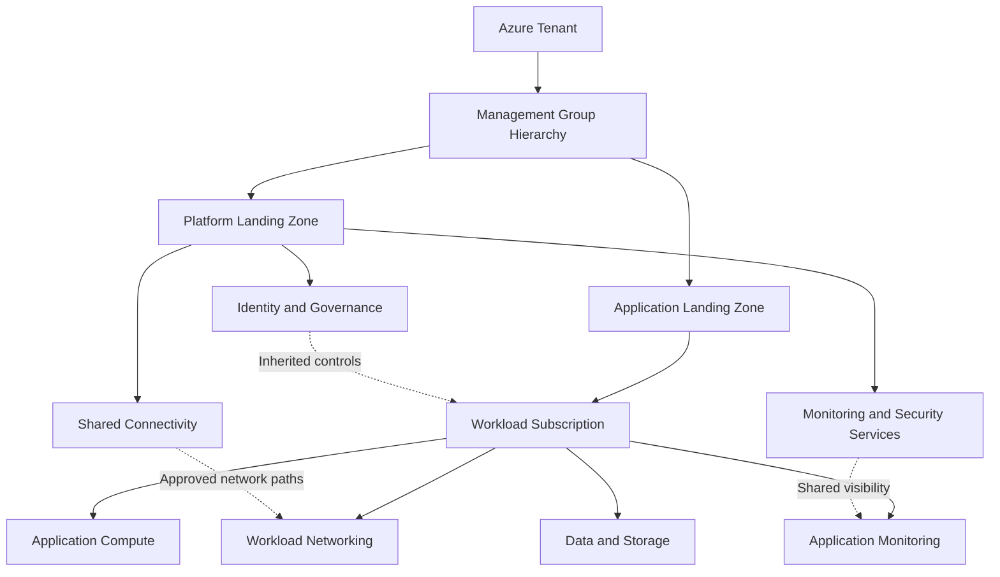
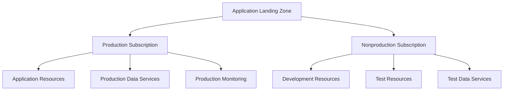
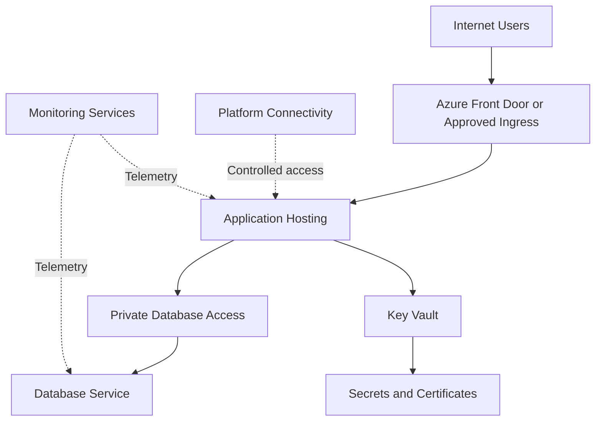

# Application Landing Zone

## 1. Application Landing Zone Architecture Context

An **Application Landing Zone** is the Azure environment in which an application or workload is deployed, governed, secured, and operated within the organization's broader Azure Landing Zone architecture.

It provides workload teams with the resources and permissions required to run their applications while inheriting appropriate enterprise controls from the platform.

An application landing zone is not simply a resource group or virtual network. It represents a workload environment with defined ownership, governance boundaries, connectivity, security requirements, operational responsibilities, and lifecycle management.

The architecture must balance two objectives:

- **Enterprise consistency:** Workloads follow organizational security, governance, connectivity, and operational requirements.
- **Workload autonomy:** Application teams can select and operate appropriate Azure services within the boundaries established by the organization.

Application landing zones are typically implemented using one or more Azure subscriptions organized under the appropriate management group. The correct structure depends on workload isolation, regulatory obligations, application lifecycle, resource quotas, cost ownership, and operational responsibilities.

## 2. Application Landing Zone Architecture

An application landing zone consumes shared capabilities from the platform landing zone while retaining responsibility for application-specific resources and configuration.



This is a conceptual architecture. The exact resources and integration points depend on the workload and the organization's landing zone implementation.

The application landing zone does not need to duplicate every platform capability. It consumes shared services where appropriate and implements workload-specific services where required.

## 3. Define the Workload Boundary

Before selecting subscriptions or designing resources, the architect should establish what belongs to the application landing zone.

The boundary should reflect:

- Business application ownership.
- Application lifecycle and release model.
- Data classification and sensitivity.
- Regulatory and compliance requirements.
- Required isolation from other workloads.
- Operational and support responsibilities.
- Cost allocation and financial accountability.
- Availability, recovery, and performance objectives.

A workload boundary should be based on meaningful architectural and operational requirements rather than the number of resources in the application.

For example, a customer-facing application and an internal reporting application may share enterprise identity and monitoring capabilities but require different network exposure, data-access controls, and operational objectives.

### Workload boundary decisions

| Decision | Architectural impact |
|---|---|
| Business ownership | Defines who is accountable for the workload |
| Subscription boundary | Establishes a resource, access, quota, and billing boundary |
| Resource group structure | Organizes related resources for deployment and management |
| Network boundary | Determines communication paths and network isolation |
| Data boundary | Defines data access, protection, residency, and lifecycle requirements |
| Operational boundary | Defines monitoring, incident response, and service ownership |

These boundaries should be consistent with the wider management group and subscription strategy rather than designed independently.

## 4. Subscription and Resource Organization

An application landing zone may use one subscription or several subscriptions. A single application does not automatically require a dedicated subscription, and multiple applications do not always need to share one.

### 4.1 Single-subscription design

A single subscription may be suitable when the workload has a common owner, lifecycle, security boundary, and operational model.

Resources can be separated into resource groups based on lifecycle, deployment responsibilities, or management requirements.

### 4.2 Multi-subscription design

Multiple subscriptions may be justified when the architecture requires distinct:

- Production and nonproduction boundaries.
- Regulatory or data isolation boundaries.
- Administrative ownership.
- Quota or service-limit boundaries.
- Billing and cost accountability.
- Workload lifecycle or operational responsibilities.

A multi-subscription design introduces additional governance and operational overhead. The architect should confirm that the separation provides a meaningful benefit.

### 4.3 Example resource organization



This example illustrates one possible design, not a universal requirement. Some workloads use separate subscriptions for development, testing, and production, while others use different boundaries based on organizational and regulatory needs.

Production and nonproduction environments should not share sensitive production data or privileged access merely for convenience. Any required data replication or testing arrangement should follow the organization's security and privacy controls.

For detailed subscription design, see Section 3.12, **Subscription Strategy**.

```markdown id="az310app"
## 5. Identity and Access for Application Workloads

Application landing zones must provide appropriate access for application teams, operators, automation identities, and workloads.

The design should distinguish between access to manage Azure infrastructure and access to use the application or its data.

Relevant controls include:

- Microsoft Entra ID for organizational identity.
- Azure RBAC for Azure resource management.
- Managed identities for supported application-to-Azure authentication.
- Least-privilege access for developers, operators, and deployment processes.
- Privileged access controls for administrative operations.
- Workload-specific data access permissions.
- Access reviews and removal of unnecessary permissions.

### Separate control-plane and data-plane access

Azure resource management permissions and access to data within a service are not always the same.

For example, permission to manage a storage account does not necessarily grant permission to read its blobs. Data access may require additional data-plane roles or service-specific authorization.

The architecture should define these permission boundaries explicitly, especially for production databases, storage accounts, Key Vault, and other sensitive services.

### Workload identity design

Where supported, managed identities can eliminate the need to store long-lived credentials in application configuration.

For example, an application running on Azure App Service may use a managed identity to access Azure Key Vault or another supported Azure service. The target service must still authorize that identity with the appropriate permissions.

Official references:

- [Azure identity and access management](https://learn.microsoft.com/en-us/azure/cloud-adoption-framework/ready/landing-zone/design-area/identity-access)
- [Managed identities for Azure resources](https://learn.microsoft.com/en-us/entra/identity/managed-identities-azure-resources/overview)

## 6. Application Network Architecture

The application landing zone must define how its resources communicate with platform services, other workloads, on-premises systems, and external users.

The architecture depends on whether the workload is internet-facing, internal, hybrid, or private.

Common design elements include:

- Workload virtual networks and subnets.
- Network security groups and supported network controls.
- Private endpoints for supported Azure services.
- Private DNS integration.
- Approved routes to shared platform services.
- Load balancing and application ingress.
- Controlled outbound connectivity.
- Hybrid connectivity where required.

Not every application requires a dedicated virtual network. The architect should determine whether the workload needs its own network boundary or can securely use an existing network design.

### 6.1 Example internet-facing application



The diagram is illustrative. Azure Front Door, private endpoints, and specific hosting or database services should be selected only when their capabilities match the application's requirements.

For example, an application hosted on Azure App Service may use VNet integration for supported outbound access into a virtual network, while private endpoints may provide private inbound access to supported services. These mechanisms have different purposes and should not be treated as interchangeable.

### 6.2 Network design decisions

| Requirement | Design consideration |
|---|---|
| Internet-facing application | Select an appropriate ingress and protection architecture |
| Internal application | Determine whether access should be limited to private network paths |
| Private data services | Configure private connectivity, DNS, and service authorization where required |
| Hybrid dependency | Establish approved routes and name resolution to on-premises systems |
| Outbound internet access | Define permitted destinations and the appropriate egress design |
| Multi-region application | Evaluate regional connectivity, traffic distribution, and failure behavior |

Network design should be consistent with the platform's connectivity model and should avoid unintended bypasses of required security controls.

Official reference: [Network topology and connectivity design area](https://learn.microsoft.com/en-us/azure/cloud-adoption-framework/ready/landing-zone/design-area/network-topology-and-connectivity)

## 7. Application Security and Data Protection

Application landing zones inherit enterprise security requirements and must implement additional controls appropriate to the workload.

The design should address:

- Data classification and sensitivity.
- Authentication and authorization.
- Encryption in transit and at rest.
- Secrets and certificate management.
- Private connectivity where required.
- Vulnerability management.
- Application security monitoring.
- Data retention and deletion.
- Regulatory and residency requirements.

Azure Key Vault can store supported secrets, keys, and certificates. Azure Policy can enforce selected resource configuration requirements. Microsoft Defender for Cloud can provide security posture management and workload protection capabilities according to the services and plans enabled.

These services support security architecture but do not replace application-level threat modeling, secure coding, authorization design, or data governance.

### Security boundary decisions

| Decision | Design objective |
|---|---|
| Data access | Restrict access to approved identities and applications |
| Secret handling | Avoid embedding credentials in source code or application configuration |
| Network exposure | Expose only the endpoints required by the workload |
| Encryption | Meet applicable organizational and regulatory requirements |
| Security monitoring | Ensure relevant security events and findings reach responsible teams |
| Compliance | Apply appropriate policies and maintain evidence of required controls |

The workload owner should understand which controls are inherited from the platform and which must be configured and operated within the application landing zone.

Official references:

- [Azure Well-Architected Framework — Security](https://learn.microsoft.com/en-us/azure/well-architected/security/)
- [Azure Key Vault overview](https://learn.microsoft.com/en-us/azure/key-vault/general/overview)
- [Microsoft Defender for Cloud](https://learn.microsoft.com/en-us/azure/defender-for-cloud/defender-for-cloud-introduction)

## 8. Application Observability and Operations

An application landing zone must provide enough operational visibility to detect failures, diagnose performance issues, and support the application's service objectives.

Depending on the workload, observability may include:

- Azure Monitor metrics and alerts.
- Application Insights for supported application telemetry.
- Log Analytics for centralized log queries.
- Resource-specific diagnostic settings.
- Application health checks.
- Distributed tracing.
- Service Health and Resource Health integration.
- Operational dashboards and workbooks.

The monitoring architecture should capture both infrastructure behavior and application behavior. A virtual machine may be running while the application hosted on it is unavailable; infrastructure health alone is therefore insufficient.

### Monitoring ownership

| Responsibility | Platform team | Application team |
|---|---|---|
| Shared monitoring infrastructure | Operates centrally managed components where assigned | Consumes approved capabilities |
| Workload telemetry | Establishes platform-level standards where applicable | Configures and validates application-specific telemetry |
| Alert routing | Provides shared alerting integrations where assigned | Defines workload-specific thresholds and responders |
| Incident investigation | Supports platform-related incidents | Investigates application behavior and application dependencies |
| Operational improvement | Improves shared services | Improves application reliability and performance |

The operating model should clearly identify who responds to alerts and who has the authority to remediate issues.

Official references:

- [Azure Monitor overview](https://learn.microsoft.com/en-us/azure/azure-monitor/overview)
- [Application Insights overview](https://learn.microsoft.com/en-us/azure/azure-monitor/app/app-insights-overview)

## 9. Workload Availability and Resilience

Application landing zone design should reflect the business impact of application downtime and data loss.

The architect should establish the required service objectives before selecting redundancy and recovery mechanisms.

Important requirements include:

- Required availability and acceptable downtime.
- Recovery time objective (RTO).
- Recovery point objective (RPO).
- Regional and zonal failure tolerance.
- Data durability and consistency requirements.
- Dependency availability.
- Backup and restore procedures.
- Application failover behavior.
- Recovery testing and operational ownership.

A highly available compute tier does not automatically make the complete application highly available. The database, identity dependencies, DNS, network paths, external services, and deployment processes can all affect the end-to-end service.

Similarly, backups do not automatically provide regional disaster recovery. Recovery mechanisms must match the relevant failure scenarios and the application's RTO and RPO.

Detailed backup, disaster recovery, and business continuity architecture will be covered in the dedicated AZ-305 continuity section.

Official reference: [Azure Well-Architected Framework — Reliability](https://learn.microsoft.com/en-us/azure/well-architected/reliability/)

## 10. Workload Lifecycle and Environment Separation

Application landing zones must support the workload throughout its lifecycle, from initial deployment to production operation and eventual retirement.

The design should establish how environments are provisioned, changed, promoted, recovered, and decommissioned.

Typical lifecycle considerations include:

- Development and testing environments.
- Preproduction validation where required.
- Production deployment boundaries.
- Resource naming and tagging standards.
- Configuration and secret management.
- Infrastructure change control.
- Backup and retention requirements.
- Resource inventory and cost ownership.
- Retirement of unused resources and access.

Environment separation can be implemented through subscriptions, resource groups, separate service instances, or other boundaries. The correct choice depends on security, lifecycle, operational, and service-specific requirements.

For example, separate production and nonproduction subscriptions can strengthen access and policy boundaries. However, they also require consistent configuration management and additional governance.

The architect should ensure that production credentials, sensitive production data, and privileged administrative access are not exposed to lower-trust environments without a justified and controlled design.

## 11. Application Landing Zone Onboarding

A repeatable onboarding process helps ensure that new workloads meet platform requirements before production deployment.

A typical process includes:

1. **Workload assessment:** Identify business ownership, data sensitivity, dependencies, and service objectives.
2. **Boundary selection:** Determine the appropriate management group, subscription, resource groups, and network boundaries.
3. **Governance alignment:** Confirm inherited policies, access controls, and required workload-specific controls.
4. **Connectivity design:** Validate routing, DNS, private access, and approved ingress and egress paths.
5. **Security configuration:** Configure workload identity, permissions, encryption, secrets, and relevant monitoring.
6. **Operational readiness:** Establish telemetry, alert routing, support ownership, and incident procedures.
7. **Resilience validation:** Test the recovery mechanisms required by the workload's business objectives.
8. **Production approval:** Confirm that required architecture and operational controls have been validated.

The onboarding process should be proportionate to workload risk. A low-risk development workload may need a lighter approval process than a business-critical application processing regulated data.

## 12. Enterprise Scenario: Customer-Facing Business Application

### Business requirement

An organization plans to deploy a customer-facing application to Azure. The application must support secure internet access, private database connectivity, controlled administrative access, monitoring, and production-grade operations.

The organization already has a platform landing zone with shared governance and approved connectivity services.

### Proposed architecture

The architect designs an application landing zone with:

- A workload subscription aligned with the organization's ownership and isolation requirements.
- Application hosting selected according to runtime, scaling, and availability requirements.
- An approved ingress architecture for public traffic.
- Private connectivity to supported data services where required.
- Managed identity for supported service-to-service authentication.
- Key Vault for applicable secrets, keys, and certificates.
- Azure Monitor and application telemetry for operational visibility.
- Inherited enterprise policies plus workload-specific controls.
- Backup and recovery mechanisms aligned with the application's business objectives.

### Architecture decisions

**Should the application have a dedicated subscription?**

Use a dedicated subscription when it provides meaningful isolation, governance, quota, lifecycle, or cost-accountability benefits. It is not mandatory for every application.

**Should the database be publicly accessible?**

If the requirement is private-only access, select a supported private connectivity design, configure DNS and routing correctly, and disable public access where supported and appropriate. Network isolation must be combined with service authorization.

**Should monitoring be fully centralized?**

Centralized monitoring can improve operational consistency, but the design must account for sensitive data, workspace access, retention, and ingestion cost.

**Who owns application incidents?**

The application team should own application-specific diagnosis and remediation, while the platform team supports incidents involving shared platform services according to the agreed operating model.

The final architecture should make these responsibilities explicit instead of assuming that deploying resources automatically establishes operational ownership.

## 13. Application Landing Zone Validation

Before production deployment, verify that the application landing zone satisfies its architectural and operational requirements.

| Validation area | Expected evidence |
|---|---|
| Resource boundaries | Subscription and resource organization align with ownership and isolation requirements |
| Identity | Human and workload identities have appropriate permissions |
| Networking | Required traffic flows, DNS, and private access behave as designed |
| Security | Applicable security and data-protection controls are implemented |
| Governance | Inherited and workload-specific policies are validated |
| Observability | Application and infrastructure telemetry support diagnosis and alerting |
| Availability | Required redundancy and dependency behavior are tested |
| Recovery | Backup and recovery procedures meet defined objectives |
| Cost management | Resource ownership and cost visibility are established |
| Operations | Incident response, support ownership, and escalation are documented |

Validation should test both expected operation and failure conditions. Examples include verifying that unauthorized identities cannot access sensitive data, prohibited configurations are blocked when required, and recovery procedures work under representative failure scenarios.

## Microsoft References

- [Azure landing zones](https://learn.microsoft.com/en-us/azure/cloud-adoption-framework/ready/landing-zone/)
- [Azure landing zone architecture design areas](https://learn.microsoft.com/en-us/azure/cloud-adoption-framework/ready/landing-zone/architecture-design-areas)
- [Identity and access design area](https://learn.microsoft.com/en-us/azure/cloud-adoption-framework/ready/landing-zone/design-area/identity-access)
- [Network topology and connectivity design area](https://learn.microsoft.com/en-us/azure/cloud-adoption-framework/ready/landing-zone/design-area/network-topology-and-connectivity)
- [Azure management groups](https://learn.microsoft.com/en-us/azure/governance/management-groups/overview)
- [Azure Policy overview](https://learn.microsoft.com/en-us/azure/governance/policy/overview)
- [Azure Monitor overview](https://learn.microsoft.com/en-us/azure/azure-monitor/overview)
- [Azure Well-Architected Framework](https://learn.microsoft.com/en-us/azure/well-architected/)
- [Azure Architecture Center](https://learn.microsoft.com/en-us/azure/architecture/)
