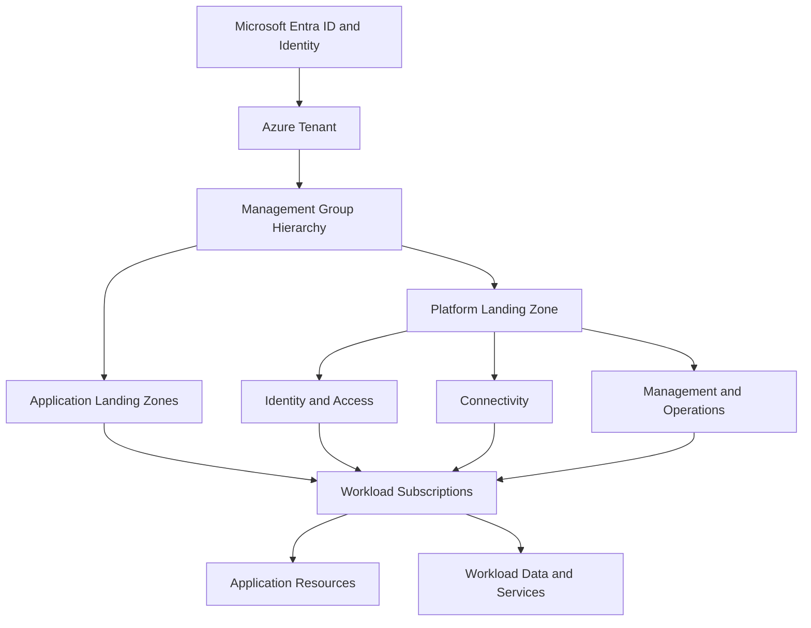
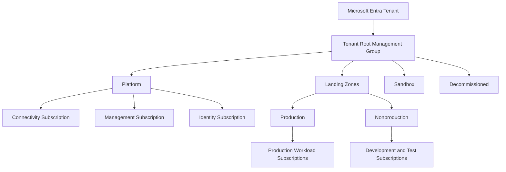

# Azure Landing Zones

## 1. Azure Landing Zone Architecture Context

An **Azure Landing Zone (ALZ)** is an architectural foundation for deploying and operating workloads in Azure within a governed, secure, scalable, and operationally manageable environment.

It provides the shared platform capabilities, organizational boundaries, and governance controls required to support application workloads across an enterprise.

A landing zone is not a single Azure resource, a predefined subscription, or simply a virtual network. It is a combination of architecture decisions, platform services, governance policies, identity controls, network connectivity, management capabilities, and operational processes.

For a solution architect, the objective is to establish an Azure environment where workloads can be deployed consistently without each application team independently designing identity, connectivity, governance, monitoring, and security foundations.

Azure Landing Zones align with the Microsoft Cloud Adoption Framework (CAF), particularly the Ready methodology, while supporting the ongoing Govern, Secure, and Manage capabilities.

## 2. Azure Landing Zone Architecture

The Azure Landing Zone conceptual architecture separates shared platform capabilities from application workloads.

This is a conceptual view rather than a mandatory resource hierarchy. Actual implementations vary according to organizational structure, regulatory requirements, network topology, operational responsibilities, and workload needs.

The key architectural principle is to centralize shared capabilities where doing so improves consistency and control, while allowing workload teams appropriate autonomy within defined boundaries.

## 3. Core Azure Landing Zone Design Areas

Azure Landing Zone architecture is commonly organized around several interconnected design areas.

| Design area | Architectural responsibility |
|---|---|
| Tenant and identity | Establish identity boundaries, authentication, privileged access, and authorization |
| Resource organization | Structure management groups, subscriptions, and resource groups |
| Network topology and connectivity | Design network segmentation, routing, hybrid connectivity, and shared network services |
| Security | Establish security controls, protection requirements, and security monitoring |
| Management | Provide monitoring, inventory, operational visibility, and service management |
| Governance | Enforce organizational requirements through Azure Policy and appropriate role assignments |
| Platform automation | Enable repeatable provisioning and controlled platform evolution |
| Business continuity | Align recovery capabilities with workload criticality and business requirements |

These areas must be designed together. For example, subscription separation without appropriate identity and policy controls does not provide complete governance. Similarly, centralized network connectivity without a defined routing and security model can introduce unnecessary dependencies or expand the impact of failures.

## 4. Platform Landing Zones and Application Landing Zones

Azure Landing Zone architecture distinguishes shared platform capabilities from workload-specific environments.

### 4.1 Platform landing zones

A platform landing zone hosts services shared across multiple workloads or application teams.

Typical capabilities include:

- Centralized identity and privileged access integration.
- Shared network connectivity and hybrid connectivity services.
- Centralized monitoring and operational services.
- Security management and shared governance capabilities.
- Supporting services that are intentionally operated centrally.

Platform capabilities are commonly organized into dedicated subscriptions under a platform management group. The exact number and boundaries depend on scale, service ownership, isolation requirements, and the organization's operating model.

### 4.2 Application landing zones

An application landing zone provides the environment in which an application or workload is deployed and operated.

It typically contains workload-specific resources, such as:

- Application compute and hosting services.
- Workload databases and storage.
- Application-specific networking components.
- Workload monitoring and diagnostics.
- Data processing and integration services.
- Workload-specific security and access configuration.

An application landing zone may use one or more subscriptions. A subscription boundary should be selected according to isolation, lifecycle, ownership, quota, compliance, and operational requirements—not simply because an application contains multiple components.

### 4.3 Architectural separation

| Consideration | Platform landing zone | Application landing zone |
|---|---|---|
| Primary purpose | Deliver shared platform capabilities | Host and operate business workloads |
| Typical ownership | Central platform or infrastructure team | Application or product team |
| Lifecycle | Shared across multiple workloads | Aligned with workload lifecycle |
| Changes | Evaluated for impact on dependent workloads | Evaluated for application-specific impact |
| Governance | Platform-wide controls and responsibilities | Inherited controls plus workload requirements |
| Network dependencies | May provide shared connectivity services | Consumes approved connectivity capabilities |
| Monitoring | Focuses on shared-service health and capacity | Focuses on workload health and business behavior |

This separation is logical and operational as well as organizational. It does not require every capability to be deployed in a separate subscription.

## 5. Management Group and Subscription Architecture

Azure management groups provide a hierarchy for organizing subscriptions and applying inherited governance controls.

A common enterprise pattern separates platform subscriptions from workload subscriptions.

The hierarchy is illustrative. The number of management groups and subscriptions should reflect actual governance boundaries and operational needs.

For example, an organization may use separate production and nonproduction management groups when different policies, access boundaries, or compliance requirements justify the distinction. Other organizations may organize workloads by business unit, regulatory boundary, or operating model.

Management groups should not be created for every application by default. Excessive hierarchy increases policy inheritance complexity and makes governance harder to understand.

Subscription design is covered in greater detail in Section 3.12, while management group architecture is covered in Section 3.11.

## 6. Identity and Access Design

Identity is a foundational dependency for the landing zone. The architecture must define how administrators, platform teams, workload teams, applications, and automation authenticate and receive authorization.

Relevant design considerations include:

- Microsoft Entra ID tenant boundaries.
- Role-based access control (Azure RBAC).
- Privileged access and administrative role separation.
- Managed identities for supported Azure-to-Azure authentication scenarios.
- Conditional Access and multifactor authentication where applicable.
- Separation of human administration from workload identities.
- Access reviews and periodic privilege evaluation.
- Emergency access procedures.

Azure RBAC assignments should be made at the narrowest practical scope that supports the required responsibility. Broad assignments at tenant or management group scope can create unnecessary privilege exposure.

A landing zone should also establish how access is requested, approved, audited, and removed. The exact design depends on organizational security requirements and identity governance capabilities.

Official reference: [Azure identity and access management](https://learn.microsoft.com/en-us/azure/cloud-adoption-framework/ready/landing-zone/design-area/identity-access)

## 7. Network Topology and Connectivity

The landing zone network architecture determines how workloads communicate with each other, shared platform services, on-premises networks, and external destinations.

Common architectural approaches include:

| Network approach | Appropriate when |
|---|---|
| Hub-and-spoke | Centralized connectivity and shared network controls are required |
| Azure Virtual WAN | The organization needs managed large-scale connectivity across multiple regions, branches, or remote networks |
| Workload-specific virtual networks | Workloads require independent network boundaries or specialized topology |
| Private connectivity to Azure services | Access should use private endpoints and controlled private routing where supported |
| Internet-facing connectivity | Public access is required and can be appropriately protected |

Network topology should be selected according to connectivity requirements, routing complexity, security boundaries, regional distribution, and operational ownership.

A shared connectivity model may reduce duplicated infrastructure, but it also creates dependencies on central services. The architect must evaluate the impact of shared firewall, routing, DNS, and hybrid connectivity failures.

The design should explicitly consider:

- Address-space allocation and overlap avoidance.
- DNS resolution across cloud and hybrid environments.
- Routing and network segmentation.
- Inbound and outbound traffic inspection.
- Private endpoint DNS and connectivity.
- Hybrid connectivity and regional resilience.
- Network ownership and troubleshooting responsibility.

Detailed network design belongs in the dedicated networking sections of the repository.

Official reference: [Azure landing zone network topology and connectivity](https://learn.microsoft.com/en-us/azure/cloud-adoption-framework/ready/landing-zone/design-area/network-topology-and-connectivity)

## 8. Governance and Policy Architecture

Azure Landing Zones establish governance boundaries before workloads are deployed.

Governance controls may be applied at the tenant, management group, subscription, resource group, or resource scope, depending on the control and its supported assignment scope.

Typical controls include:

- Allowed Azure regions.
- Required security configurations.
- Restrictions on public network exposure.
- Required diagnostic settings where supported.
- Approved resource types and service configurations.
- Resource tagging and organizational metadata.
- Required security or compliance configurations.
- Controls governing privileged access and administrative operations.

Azure Policy provides mechanisms to audit, deny, modify, or deploy configurations according to supported policy effects and resource-provider behavior.

However, not every requirement should be enforced with a deny policy. Preventive controls are appropriate when noncompliant deployments must be blocked, while audit controls can be more suitable during assessment, migration, or gradual adoption.

A well-designed landing zone establishes how policy assignments, exemptions, ownership, and compliance reporting are managed over time.

Detailed policy and compliance architecture is covered in Section 3.13.

Official reference: [Azure landing zone design principles](https://learn.microsoft.com/en-us/azure/cloud-adoption-framework/ready/landing-zone/design-principles)

## 9. Management, Monitoring, and Operational Integration

A landing zone must provide the operational foundation needed to detect service degradation, investigate incidents, and maintain the environment.

Depending on organizational requirements, this may include:

- Azure Monitor and Log Analytics.
- Centralized diagnostic collection.
- Azure Monitor Alerts and action groups.
- Azure Service Health and Resource Health.
- Azure Resource Graph for inventory and queries.
- Azure Update Manager where appropriate.
- Operational dashboards and workload-specific observability.
- Defined incident escalation and ownership procedures.

Centralized monitoring can improve consistency and cross-workload visibility. However, centralization introduces decisions about data ownership, access boundaries, log retention, ingestion costs, and regional requirements.

Not every workload must send every log to a single workspace. The design should balance operational visibility with regulatory obligations, data residency, access separation, and cost.

Platform monitoring should cover shared services, while application teams should retain visibility into workload-specific behavior and business-level performance.

## 10. Security and Compliance Integration

Security is a cross-cutting responsibility within Azure Landing Zones. It must be integrated with identity, networking, governance, workload configuration, and operational management.

Depending on organizational requirements, the design may incorporate:

- Microsoft Defender for Cloud.
- Microsoft Sentinel.
- Azure Key Vault.
- Private endpoints and network controls.
- Azure Policy and compliance initiatives.
- Centralized security logging.
- Vulnerability and configuration assessment.
- Data protection and encryption requirements.
- Security incident response procedures.

These services are not mandatory components of every landing zone. Their selection depends on the threat model, regulatory obligations, existing security platforms, and the organization's security operating model.

The architecture should identify which controls are centralized, which are inherited by application landing zones, and which remain the responsibility of workload owners.

Centralized security services do not eliminate the need for application-specific threat modeling and security validation.

## 11. Landing Zone Deployment and Evolution

A landing zone should be implemented consistently and maintained as the organization evolves.

Common implementation approaches include:

| Implementation approach | Architectural consideration |
|---|---|
| Azure Landing Zone accelerator | Provides an implementation path based on Microsoft's enterprise-scale architecture guidance |
| Infrastructure as Code | Supports repeatable provisioning, reviewable changes, and consistent configuration |
| Portal-based deployment | Can be useful for exploration or limited initial setup but requires additional controls to ensure repeatability |
| Existing-environment adaptation | Requires assessment of current identity, networking, policies, subscriptions, and operational dependencies |

The appropriate approach depends on platform maturity, implementation constraints, team skills, and the amount of existing Azure infrastructure.

For enterprise environments, repeatable deployment is generally preferable to manually recreating foundational resources. Infrastructure as Code should be version controlled, reviewed, tested, and operated through an appropriate change process.

A landing zone is not complete merely because its resources have been deployed. The organization must also validate policy behavior, connectivity, access boundaries, monitoring, operational procedures, and workload onboarding.

Official reference: [Azure landing zone implementation options](https://learn.microsoft.com/en-us/azure/cloud-adoption-framework/ready/landing-zone/implementation-options)

## 12. Enterprise Scenario: Multi-Department Azure Adoption

### Business requirement

A large organization plans to migrate customer-facing applications, internal business systems, and data analytics workloads to Azure.

Different departments have different compliance requirements, but they need shared identity integration, centralized connectivity, consistent governance, and operational visibility.

### Architectural design

The architect establishes the following design:

1. A management group hierarchy defines organizational governance boundaries.
2. Platform subscriptions host approved shared connectivity and management capabilities.
3. Application landing zones provide isolated environments for workload teams.
4. Azure RBAC assignments separate platform administration from workload operations.
5. Azure Policy enforces baseline requirements, with documented exemptions where justified.
6. Network architecture defines approved connectivity between workloads, shared services, and external environments.
7. Monitoring and security services provide visibility appropriate to the organization's requirements.
8. Workload onboarding procedures validate readiness before production deployment.

### Architecture decision considerations

The architect must evaluate whether departments require separate subscriptions or management groups, whether workloads can share network infrastructure, and which controls should be inherited centrally.

For example, a regulated workload may require stronger isolation, restricted administrative access, or different data-location controls. Those requirements should be translated into explicit architecture and governance decisions rather than assuming every workload needs an entirely independent platform.

The resulting architecture should provide consistent enterprise controls while preserving the workload teams' ability to select appropriate Azure services within approved boundaries.

## 13. Architecture Validation

Landing zone validation should produce evidence that the platform is ready to host production workloads.

| Validation area | Evidence to evaluate |
|---|---|
| Identity | Administrative roles, access boundaries, and workload authentication are tested |
| Governance | Required policies are assigned and their behavior is verified |
| Networking | Routing, DNS, connectivity, segmentation, and required private access are validated |
| Monitoring | Required telemetry is collected and actionable alerts are tested |
| Security | Applicable security controls and monitoring integrations are verified |
| Operations | Ownership, escalation, incident response, and support procedures are documented |
| Automation | Foundational resources can be provisioned and changed repeatably |
| Cost management | Budgets, cost visibility, and ownership of shared services are established |
| Workload onboarding | Application teams understand inherited controls and remaining responsibilities |

Validation should include failure and exception scenarios, not only successful deployment tests. For example, the team should verify that a prohibited configuration is actually blocked where a deny policy is intended to prevent it.

The depth of validation should reflect workload criticality, regulatory exposure, and the potential impact of platform failure.

## Microsoft References

- [Cloud Adoption Framework: Azure landing zones](https://learn.microsoft.com/en-us/azure/cloud-adoption-framework/ready/landing-zone/)
- [Azure landing zone design principles](https://learn.microsoft.com/en-us/azure/cloud-adoption-framework/ready/landing-zone/design-principles)
- [Azure landing zone architecture design areas](https://learn.microsoft.com/en-us/azure/cloud-adoption-framework/ready/landing-zone/architecture-design-areas)
- [Azure landing zone implementation options](https://learn.microsoft.com/en-us/azure/cloud-adoption-framework/ready/landing-zone/implementation-options)
- [Azure landing zone identity and access](https://learn.microsoft.com/en-us/azure/cloud-adoption-framework/ready/landing-zone/design-area/identity-access)
- [Azure landing zone network topology and connectivity](https://learn.microsoft.com/en-us/azure/cloud-adoption-framework/ready/landing-zone/design-area/network-topology-and-connectivity)
- [Azure management groups](https://learn.microsoft.com/en-us/azure/governance/management-groups/overview)
- [Azure Policy overview](https://learn.microsoft.com/en-us/azure/governance/policy/overview)
- [Azure Monitor overview](https://learn.microsoft.com/en-us/azure/azure-monitor/overview)
- [Azure Architecture Center](https://learn.microsoft.com/en-us/azure/architecture/)
