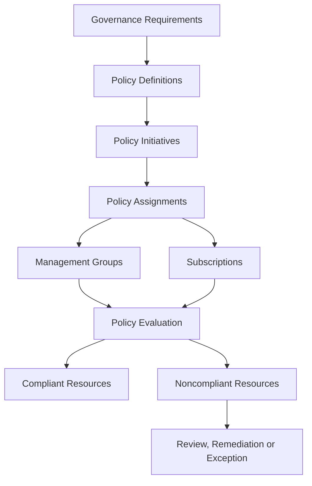
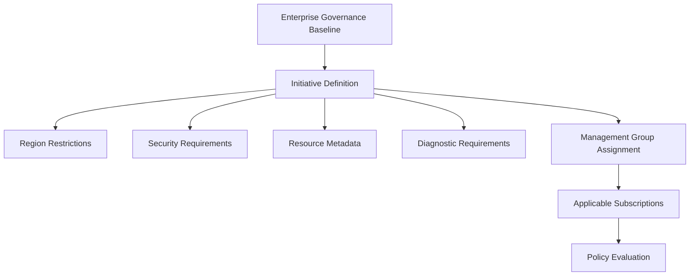
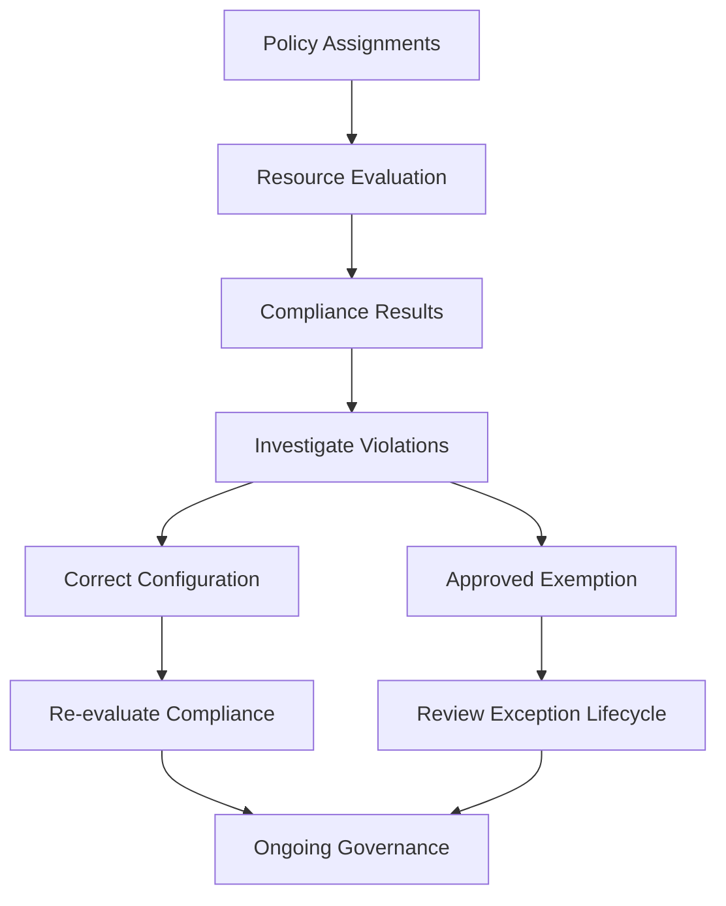

# Azure Policy and Compliance

## 1. Azure Policy Architecture Context

Azure Policy is an Azure governance service that enables organizations to assess, enforce, and maintain resource configuration requirements across their Azure environments.

For a solution architect, Azure Policy is a core mechanism for translating organizational standards, security requirements, regulatory obligations, and operational rules into enforceable controls.

Policy can evaluate existing resources and influence resource creation or updates, depending on the policy definition, effect, assignment scope, and resource provider behavior.

Azure Policy is commonly used to enforce requirements such as:

- Restricting deployments to approved Azure regions.
- Preventing prohibited resource configurations.
- Auditing resources against organizational standards.
- Requiring selected resource properties or configurations.
- Deploying supported diagnostic settings or other configurations through policy remediation.
- Identifying noncompliant resources across multiple subscriptions.

Azure Policy does not replace Azure RBAC, Microsoft Defender for Cloud, or an organization's broader compliance program. Each serves a different purpose and should be integrated into the governance architecture.

Official reference: [Azure Policy overview](https://learn.microsoft.com/en-us/azure/governance/policy/overview)

## 2. Azure Policy Architecture

Azure Policy operates through definitions, assignments, scopes, and compliance evaluation.

This is a conceptual architecture. A policy can also be assigned directly without being included in an initiative, and assignments can be created at supported scopes such as resource groups.

The architecture separates the definition of a requirement from the scope at which the requirement is applied.

For example, an organization can define a policy that restricts resource deployment to approved regions and assign it at a landing zone management group. Subscriptions beneath that management group can then inherit the assignment.

## 3. Azure Policy Components

Azure Policy uses several related components to implement governance controls.

| Component | Purpose | Architectural example |
|---|---|---|
| Policy definition | Describes a rule that evaluates resource properties or configuration | Restrict resources to approved locations |
| Initiative definition | Groups related policy definitions into a logical collection | Enterprise security baseline |
| Assignment | Applies a policy or initiative at a particular scope | Assign the baseline to a management group |
| Parameters | Allow supported values to be supplied when a definition or initiative is assigned | Specify permitted Azure regions |
| Exemption | Documents an approved exception to an applicable policy assignment | Exempt an approved workload from a specific requirement |
| Compliance state | Reports evaluation results for assigned policies | Identify resources that violate a requirement |
| Remediation task | Performs supported remediation for applicable policies | Deploy or modify supported resource configurations |

Not every policy supports remediation, and remediation is not always automatic. The policy definition, effect, managed identity permissions, and resource provider behavior determine what can be remediated.

Official reference: [Azure Policy definition structure](https://learn.microsoft.com/en-us/azure/governance/policy/concepts/definition-structure-basics)

## 4. Policy Definitions and Effects

A policy definition contains the conditions used to evaluate resources and the effect that determines how applicable requests or resources are handled.

The architect must choose the effect according to the intended governance outcome.

### 4.1 Common policy effects

| Effect | Purpose | Typical use |
|---|---|---|
| `Deny` | Blocks applicable resource requests that violate the policy | Prevent deployment of prohibited configurations |
| `Audit` | Records noncompliance without blocking the request | Assess existing environments before enforcement |
| `Modify` | Changes supported resource properties during applicable operations | Apply supported configuration changes |
| `DeployIfNotExists` | Deploys specified related resources or configurations when required conditions are not satisfied | Deploy required diagnostic settings where supported |
| `AuditIfNotExists` | Audits whether specified related resources or configurations exist | Detect missing related configurations |
| `Disabled` | Prevents the policy definition from enforcing its effect through that definition | Disable a policy rule where explicitly appropriate |

The exact behavior depends on the policy definition, assignment parameters, resource provider, and supported policy mode.

`Modify` and `DeployIfNotExists` may require remediation tasks and appropriate managed identity permissions. They should not be assumed to repair every existing resource automatically.

### 4.2 Choosing an enforcement strategy

A mature governance implementation often introduces controls progressively:

1. **Assess:** Use audit-oriented policies to understand the current environment.
2. **Evaluate:** Identify violations, operational impacts, and justified exceptions.
3. **Remediate:** Correct existing resources where supported and appropriate.
4. **Enforce:** Apply preventive controls to block prohibited future changes.
5. **Monitor:** Review compliance and policy behavior as workloads evolve.

This approach is particularly useful when onboarding existing workloads, where immediate enforcement could disrupt deployments or applications that have not yet been assessed.

Official reference: [Understand Azure Policy effects](https://learn.microsoft.com/en-us/azure/governance/policy/concepts/effect-basics)

## 5. Policy Initiatives and Enterprise Baselines

An initiative definition groups multiple policy definitions into a single governance unit.

Initiatives are useful when an organization needs to apply a related collection of controls consistently across management groups, subscriptions, or other supported scopes.

For example, an enterprise baseline initiative might include policies for:

- Approved deployment regions.
- Required resource metadata.
- Selected security configuration requirements.
- Diagnostic settings.
- Restrictions on prohibited resource types.
- Other applicable organizational standards.

An initiative can contain parameters that help administrators configure related policies consistently.

### Initiative architecture

The diagram is illustrative. An initiative should contain controls that belong together logically; unrelated requirements should not be combined simply to reduce the number of assignments.

### Architecture considerations

- Reuse suitable built-in policy definitions when they satisfy the requirement.
- Use custom definitions when the organization has requirements that built-in policies do not adequately address.
- Keep initiative parameters understandable and appropriately constrained.
- Validate policy behavior before broad assignment.
- Document which team owns each policy and its ongoing maintenance.

Official references:

- [Azure Policy initiatives](https://learn.microsoft.com/en-us/azure/governance/policy/concepts/initiative-definition-structure)
- [Azure Policy built-in definitions](https://learn.microsoft.com/en-us/azure/governance/policy/samples/built-in-policies)

## 6. Policy Assignment Scope and Inheritance

Policy assignments should be placed at the scope that best matches the requirement.

Supported assignment scopes include management groups, subscriptions, resource groups, and individual resources, subject to Azure Policy's scope and service rules.

### 6.1 Scope selection

| Scope | Appropriate use |
|---|---|
| Management group | Requirements shared by multiple descendant subscriptions |
| Subscription | Controls specific to a subscription or its workloads |
| Resource group | Requirements for a particular group of resources |
| Individual resource | A narrowly targeted requirement where supported |

Parent-scope assignments can apply to descendant resources. This enables enterprise-wide governance but also means that a policy applied too broadly can unintentionally affect workloads that have different needs.

For example, an organization may apply approved-region restrictions at a landing zone management group while applying stricter controls to production subscriptions.

### 6.2 Exemptions and exclusions

Azure Policy supports mechanisms to manage exceptions and assignment scope.

A **policy exemption** documents an approved exception to an applicable policy assignment.

An **assignment's noncompliance message**, where configured, can help explain the requirement that a resource violates. It is not itself an exemption.

The `notScopes` property can exclude selected scopes from a policy assignment, but those exclusions should be used carefully because they can create governance gaps.

An exemption is generally preferable when the organization needs a documented exception with a defined justification, approval, and lifecycle.

Exemptions and exclusions should not be treated as informal methods for bypassing enterprise controls.

Official references:

- [Azure Policy scope](https://learn.microsoft.com/en-us/azure/governance/policy/concepts/scope)
- [Azure Policy exemption structure](https://learn.microsoft.com/en-us/azure/governance/policy/concepts/exemption-structure)

## 7. Azure Policy and Regulatory Compliance

Regulatory compliance requires more than assigning policies.

An organization must translate applicable legal, regulatory, contractual, and internal requirements into specific technical and operational controls.

Azure Policy can help evaluate selected Azure resource configurations against those controls. Microsoft Defender for Cloud also provides regulatory compliance capabilities for supported standards and environments.

The architect should determine which requirements can be assessed through Azure resource configuration and which require additional processes, evidence, or controls outside Azure Policy.

### Compliance design considerations

| Requirement | Architectural approach |
|---|---|
| Resource configuration standards | Use applicable Azure Policy definitions |
| Security posture visibility | Integrate appropriate security assessment capabilities |
| Evidence collection | Establish reporting and evidence-retention procedures |
| Regulatory exceptions | Document approved exceptions and their justification |
| Data residency | Apply appropriate service, deployment, and data-location controls |
| Access governance | Use identity governance and Azure RBAC alongside resource policies |
| Ongoing compliance | Monitor compliance states and review changes over time |

A resource marked compliant by Azure Policy is not proof that an entire application or organization satisfies a regulation. Policy compliance is limited to the controls actually defined and evaluated.

Similarly, regulatory compliance dashboards should be interpreted in the context of the applicable standard, assessment scope, enabled services, and evidence requirements.

Official references:

- [Regulatory compliance in Microsoft Defender for Cloud](https://learn.microsoft.com/en-us/azure/defender-for-cloud/regulatory-compliance-dashboard)
- [Azure Policy overview](https://learn.microsoft.com/en-us/azure/governance/policy/overview)

## 8. Azure Policy and Azure RBAC

Azure Policy and Azure RBAC address different governance problems.

Azure Policy evaluates resource configuration and can enforce supported configuration requirements. Azure RBAC determines which identities can perform actions on Azure resources.

| Requirement | Azure Policy | Azure RBAC |
|---|---|---|
| Restrict resource deployment to approved regions | Appropriate | Not the primary mechanism |
| Prevent prohibited resource configurations | Appropriate when supported by the policy | May restrict who can make changes, but does not inherently evaluate all configuration requirements |
| Grant an administrator permission to manage a subscription | Not the primary mechanism | Appropriate |
| Delegate access to a resource group | Not the primary mechanism | Appropriate |
| Audit selected configuration requirements | Appropriate | Not the primary mechanism |
| Restrict access to a data service | Depends on the specific configuration requirement | Resource authorization or service-specific data permissions may be required |

These mechanisms complement one another.

For example, Azure RBAC can allow an application team to deploy resources within a subscription, while Azure Policy restricts the regions and configurations available to that team.

The team can therefore have deployment permissions without having unrestricted authority to create any configuration it chooses.

Official references:

- [Azure Policy overview](https://learn.microsoft.com/en-us/azure/governance/policy/overview)
- [Azure RBAC overview](https://learn.microsoft.com/en-us/azure/role-based-access-control/overview)

## 9. Remediation and Compliance Operations

Policy compliance requires an operating process for investigating and addressing noncompliant resources.

The remediation approach depends on the policy effect and the reason for the violation.

Possible actions include:

- Correcting a resource configuration manually or through an approved deployment process.
- Executing a remediation task for supported `Modify` or `DeployIfNotExists` policies.
- Updating an application architecture when the existing design violates a requirement.
- Requesting an approved exemption when a justified exception is necessary.
- Revising an incorrectly scoped or configured policy assignment.
- Investigating evaluation delays or resource-provider limitations.

### Remediation considerations

A remediation task may require a managed identity associated with the policy assignment and appropriate permissions to perform the required operation.

For `DeployIfNotExists` and `Modify` policies, the architect must verify that the required remediation roles are assigned and that the relevant resource provider supports the intended operation.

A remediation task should not be used as a substitute for understanding the reason a resource became noncompliant.

For example, if a workload requires a region that the enterprise policy prohibits, the correct response may be to redesign the deployment, change the approved regional strategy, or request an authorized exception—not repeatedly attempt remediation.

## 10. Policy Compliance Monitoring and Reporting

Organizations should monitor policy compliance continuously rather than evaluating it only during initial deployment.

Azure Policy provides compliance information for assigned definitions and initiatives. Azure Resource Graph and other supported reporting mechanisms can also help investigate resources and governance states.

The operating model should define:

- Who reviews compliance results.
- How violations are prioritized.
- Which violations block production deployment.
- Which violations require remediation.
- How exceptions are approved and reviewed.
- How policy changes are tested and released.
- How compliance evidence is retained when required.

### Compliance monitoring workflow

Evaluation and reporting may not be instantaneous. Newly assigned policies, resource changes, and remediation operations can require time before the expected compliance state is visible.

The architect should account for evaluation behavior and use supported evaluation or remediation mechanisms when timely validation is required.

Official references:

- [Get compliance data](https://learn.microsoft.com/en-us/azure/governance/policy/how-to/get-compliance-data)
- [Remediate non-compliant resources](https://learn.microsoft.com/en-us/azure/governance/policy/how-to/remediate-resources)

## 11. Enterprise Scenario: Enforcing an Azure Governance Baseline

### Business requirement

An enterprise operates multiple Azure subscriptions across production, nonproduction, and platform environments.

The organization must restrict deployments to approved regions, improve visibility into security configurations, maintain required diagnostics, and provide a controlled process for exceptions.

### Proposed architecture

The architect implements the following approach:

1. Define an enterprise governance baseline using suitable built-in and custom policy definitions.
2. Group related controls into initiatives where appropriate.
3. Assign baseline policies at a management group scope that covers the intended subscriptions.
4. Introduce additional assignments for production or specialized workloads where required.
5. Use audit-oriented controls to assess existing environments before introducing disruptive enforcement.
6. Remediate supported configurations through controlled remediation tasks.
7. Enforce critical requirements through appropriate policy effects.
8. Establish a documented exemption approval and review process.
9. Monitor compliance and investigate violations.
10. Review policy definitions and assignments as organizational requirements change.

### Architecture decisions

**Should every policy be assigned at the tenant root management group?**

No. Parent-level assignments should be used only when the requirement applies to the intended descendant scopes. More specialized controls should be assigned at suitable lower scopes.

**Should all noncompliant resources be blocked immediately?**

Not necessarily. Existing workloads may require assessment and remediation before preventive enforcement is introduced. Critical security requirements may justify immediate controls, but their impact should still be evaluated.

**Can an exemption make a workload compliant with every other requirement?**

No. An exemption applies to the specified policy assignment and scope. Other applicable policies continue to be evaluated according to their own assignments and rules.

**Does policy compliance guarantee regulatory compliance?**

No. It provides evidence about the configuration requirements actually evaluated. Broader regulatory obligations may require additional technical controls, procedures, and independent evidence.

## 12. Azure Policy Architecture Validation

| Validation area | Evidence to evaluate |
|---|---|
| Policy definitions | Rules and effects match the intended governance requirement |
| Initiative design | Related policies are grouped appropriately and parameters are understood |
| Assignment scope | Policies apply to the intended management groups, subscriptions, and resources |
| Enforcement | Preventive policies block the intended prohibited configurations |
| Audit | Audit policies identify the intended noncompliant resources |
| Remediation | Required permissions and remediation tasks work for supported policies |
| Exemptions | Exceptions have documented justification, authorization, and lifecycle management |
| RBAC integration | Resource permissions and configuration controls complement each other |
| Reporting | Compliance results can be reviewed and investigated |
| Change management | Policy changes are tested before broad deployment |

Validation should include both positive and negative tests. For example, verify that an approved deployment succeeds and a prohibited configuration is denied when a deny policy is intended to enforce the restriction.

## Microsoft References

- [Azure Policy overview](https://learn.microsoft.com/en-us/azure/governance/policy/overview)
- [Azure Policy definition structure](https://learn.microsoft.com/en-us/azure/governance/policy/concepts/definition-structure-basics)
- [Azure Policy initiative definitions](https://learn.microsoft.com/en-us/azure/governance/policy/concepts/initiative-definition-structure)
- [Understand Azure Policy effects](https://learn.microsoft.com/en-us/azure/governance/policy/concepts/effect-basics)
- [Azure Policy scope](https://learn.microsoft.com/en-us/azure/governance/policy/concepts/scope)
- [Azure Policy exemption structure](https://learn.microsoft.com/en-us/azure/governance/policy/concepts/exemption-structure)
- [Get Azure Policy compliance data](https://learn.microsoft.com/en-us/azure/governance/policy/how-to/get-compliance-data)
- [Remediate noncompliant resources](https://learn.microsoft.com/en-us/azure/governance/policy/how-to/remediate-resources)
- [Regulatory compliance in Microsoft Defender for Cloud](https://learn.microsoft.com/en-us/azure/defender-for-cloud/regulatory-compliance-dashboard)
- [Azure Architecture Center](https://learn.microsoft.com/en-us/azure/architecture/)
