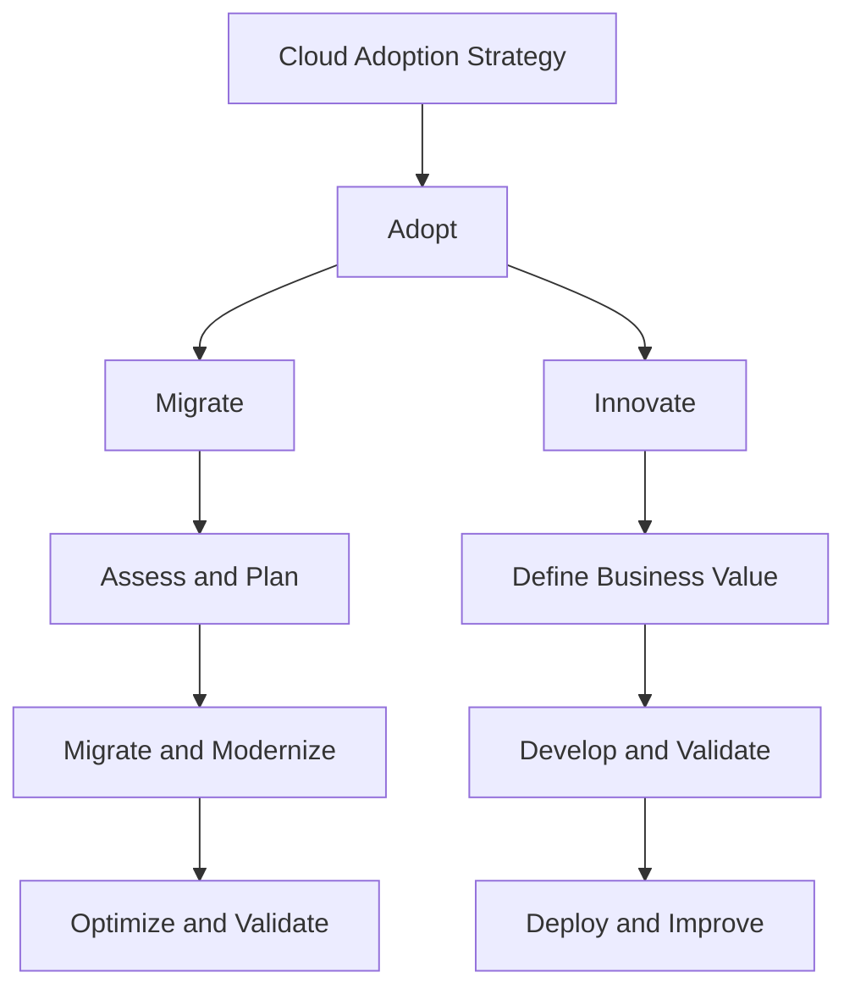
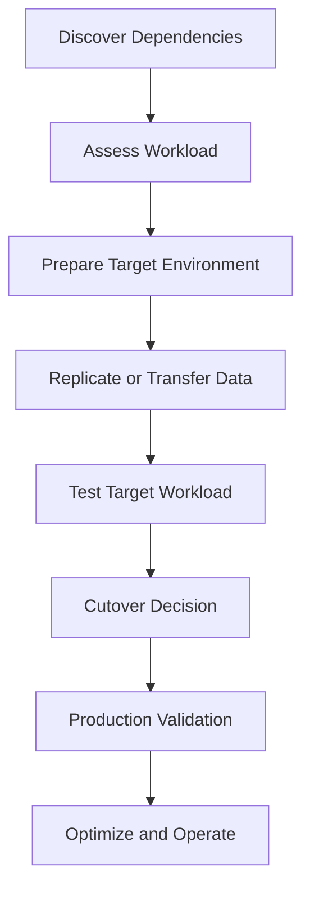
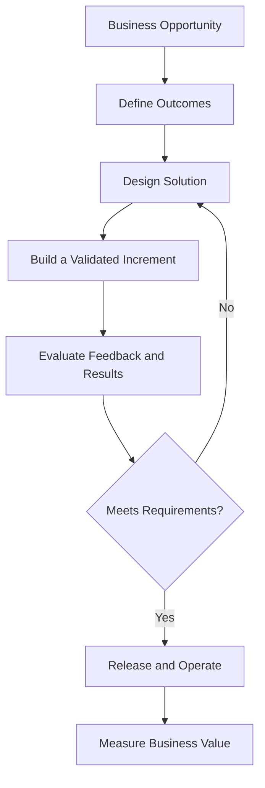

# CAF Adopt

## 1. Architectural Context

The **Adopt methodology** of the Microsoft Cloud Adoption Framework (CAF) focuses on realizing business value from cloud adoption through two primary paths: **Migrate** and **Innovate**.

For a solution architect, adoption is the point where business objectives, workload assessments, and target architecture decisions are translated into implemented solutions.

The appropriate path depends on the workload's current state, business requirements, technical constraints, and expected outcomes. Moving an existing application to Azure and building a new cloud-native solution require different architectural approaches, delivery plans, and validation criteria.

## 2. Adoption Paths

CAF distinguishes between migrating existing workloads and developing innovative cloud solutions.

| Adoption path | Primary objective | Architectural focus |
|---|---|---|
| Migrate | Transition existing workloads to Azure while meeting business and technical requirements | Compatibility, dependencies, data movement, cutover, continuity, and modernization opportunities |
| Innovate | Create or extend solutions to deliver new business capabilities | Product requirements, cloud-native design, data capabilities, experimentation, and feedback |

These paths are not mutually exclusive. An organization may migrate a legacy application first and modernize selected components later, or develop new capabilities alongside an existing migration program.

## 3. Migration Architecture

Migration architecture determines how an existing workload can move to Azure while managing downtime, data consistency, compatibility, and operational risk.

### 3.1 Assess the source workload

Before selecting a migration approach, establish:

- Application and infrastructure dependencies.
- Supported operating systems, runtimes, and database technologies.
- Network, DNS, identity, and integration requirements.
- Data volume, transfer constraints, and consistency requirements.
- Availability targets, RPO, and RTO.
- Security, compliance, and licensing constraints.
- Performance requirements and expected Azure consumption.

Assessment findings determine whether the workload can be migrated with minimal change or requires remediation, replatforming, or deeper modernization.

### 3.2 Select the migration approach

| Approach | Architectural implications |
|---|---|
| Rehost | Move the workload with minimal application changes; existing design limitations may remain |
| Replatform | Introduce selected platform changes without fully redesigning the application |
| Refactor or rearchitect | Modify the application or its components to meet new requirements |
| Rebuild | Develop a replacement solution when existing constraints justify a new implementation |
| Replace | Adopt a suitable existing product or service instead of maintaining the current application |

The selection should be justified by business outcomes, application compatibility, risk, cost, delivery timelines, and the desired target state.

A rehost approach may be suitable when migration speed is the primary constraint. A rearchitecture may be more appropriate when the current design cannot meet required scalability, resilience, or maintainability goals.

## 4. Plan Migration Execution

Migration execution requires coordination between infrastructure, application, data, security, and operations teams.

A typical migration workflow is:

The exact sequence varies by workload. For example, a database may require continuous replication before cutover, while a stateless application may be deployed and tested independently before traffic is redirected.

Before production cutover, define:

- Entry and exit criteria.
- Data synchronization and consistency checks.
- Downtime or service interruption limits.
- DNS, routing, or traffic-switching changes.
- Rollback conditions and recovery procedures.
- Business acceptance tests.
- Post-cutover monitoring and operational ownership.

A migration is not complete merely because the workload starts successfully in Azure. It must satisfy its functional, performance, security, resilience, and operational requirements.

## 5. Modernization During Adoption

Migration and modernization should be treated as related but distinct decisions.

A workload can be migrated first and modernized later when the organization needs to reduce immediate transition risk. Alternatively, modernization may be necessary before migration if the existing architecture is incompatible with the target platform.

Examples of modernization include:

- Moving application hosting to a managed platform.
- Replacing self-managed components with suitable Azure managed services.
- Separating tightly coupled application components where justified.
- Improving deployment repeatability and configuration management.
- Introducing event-driven integration when it fits the workload.
- Improving telemetry, failure handling, and scaling behavior.

Modernization should address a defined limitation or business objective. Introducing microservices, containers, or other technologies without a clear requirement can increase complexity rather than improve the solution.

## 6. Innovation Architecture

The **Innovate** path focuses on creating or extending digital capabilities using cloud services and iterative development.

Innovation begins with a business problem, not with a predetermined Azure service.

The architect translates the desired outcome into functional requirements, quality attributes, data requirements, security constraints, and a design that can be validated with users and stakeholders.

### 6.1 Architectural considerations

| Design area | Key considerations |
|---|---|
| Application platform | Evaluate compute options against runtime, scaling, integration, and operational requirements |
| Data architecture | Choose storage and processing technologies based on data structure, consistency, access patterns, and analytical needs |
| Integration | Determine how applications communicate, including synchronous APIs, asynchronous messaging, and event-driven interactions |
| Security | Establish identity, authorization, data protection, secrets management, and threat controls |
| Reliability | Define failure handling, redundancy, recovery, and service-level expectations |
| Performance | Validate latency, throughput, scaling behavior, and capacity |
| Cost | Estimate consumption and evaluate cost against the delivered business value |
| Operability | Establish telemetry, deployment controls, incident response, and service ownership |

Specific service choices belong to the workload architecture and must be validated against requirements, supported capabilities, service limits, and operational constraints.

## 7. Data-Driven Innovation

Data may be central to a new cloud solution, particularly when the objective involves analytics, personalization, automation, or AI-enabled capabilities.

The data architecture should establish:

- Data sources and ownership.
- Data quality and transformation requirements.
- Data classification and permitted use.
- Data ingestion and integration patterns.
- Storage, retention, and lifecycle requirements.
- Access control and auditability.
- Data processing and consumption patterns.

For AI-enabled solutions, additional considerations may include data suitability, privacy, model evaluation, responsible AI requirements, and the operational costs of inference.

The choice of Azure data or AI services should follow from the use case, workload requirements, and constraints rather than precede them.

## 8. Validate the Adopted Solution

Both migration and innovation require validation against the intended business and technical outcomes.

| Validation area | Evidence required |
|---|---|
| Functional correctness | Workload behavior satisfies agreed acceptance criteria |
| Performance | Measured latency, throughput, and capacity meet requirements |
| Reliability | Failure handling and recovery mechanisms behave as expected |
| Security | Identity, access, data protection, and security controls are verified |
| Compliance | Required controls and evidence are available |
| Cost | Actual consumption is compared with estimates and financial expectations |
| Operations | Monitoring, alerting, support ownership, and incident procedures are tested |
| Business value | Results are measured against the objectives defined during strategy and planning |

Validation criteria should be defined before implementation or cutover. This prevents teams from declaring success based solely on technical deployment completion.

## 9. Enterprise Scenario: Migrate First, Modernize Selectively

### Current state

A retail organization operates a legacy e-commerce application on virtual machines. The application experiences seasonal traffic peaks and depends on a relational database. The organization wants to move to Azure while reducing operational overhead and improving scalability.

### Architectural assessment

The architect identifies three separate concerns:

1. The existing application must be moved without exceeding the business's downtime tolerance.
2. The database requires a validated migration and recovery strategy.
3. Seasonal demand creates an opportunity to improve application scaling.

### Adoption decision

The organization evaluates a phased approach:

- Establish the target landing zone and required connectivity.
- Assess application and database compatibility.
- Select an appropriate initial migration approach based on technical constraints.
- Validate data movement, cutover, and rollback procedures.
- Measure workload performance and operational behavior after migration.
- Modernize selected components where the expected benefits justify the additional investment.

The target may use Azure Virtual Machines for components that require existing operating-system compatibility and a managed application platform for components that can use it effectively. The database platform must be selected based on compatibility, data requirements, availability, and recovery objectives.

The architecture should not assume that every component must be modernized simultaneously. Each decision should balance business continuity, transformation effort, and expected value.

## 10. Relationship to Governance, Security, and Management

Adoption does not eliminate the need for continuous governance, security, and operations.

| Related CAF methodology | Relationship to adoption |
|---|---|
| Govern | Ensures adopted workloads remain aligned with organizational controls and risk requirements |
| Secure | Integrates security practices throughout migration, development, deployment, and operation |
| Manage | Establishes monitoring, support, incident handling, and continuous operational improvement |

These methodologies operate alongside adoption rather than only after deployment. Architecture and delivery plans should account for their requirements from the beginning.

## Microsoft References

- [Cloud Adoption Framework: Adopt](https://learn.microsoft.com/en-us/azure/cloud-adoption-framework/innovate/)
- [Cloud Adoption Framework: Migrate](https://learn.microsoft.com/en-us/azure/cloud-adoption-framework/migrate/)
- [Select a cloud migration strategy](https://learn.microsoft.com/en-us/azure/cloud-adoption-framework/plan/select-cloud-migration-strategy)
- [Azure Migrate](https://learn.microsoft.com/en-us/azure/migrate/)
- [Azure Architecture Center](https://learn.microsoft.com/en-us/azure/architecture/)
- [Azure Well-Architected Framework](https://learn.microsoft.com/en-us/azure/well-architected/)
