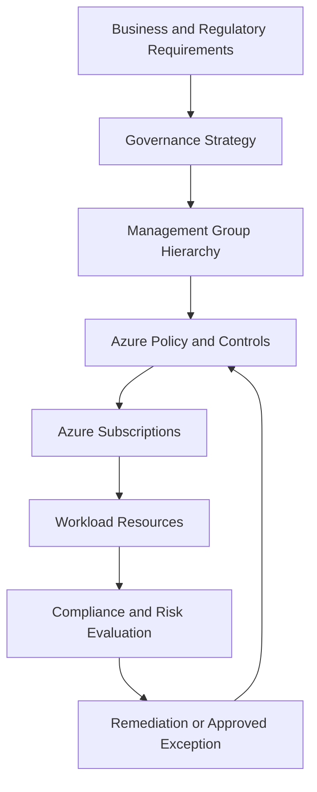
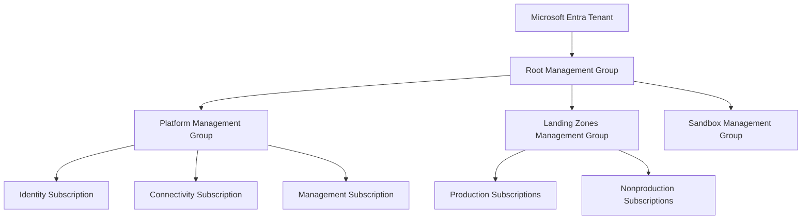

# CAF Govern

## 1. Governance Architecture Context

The **Govern methodology** of the Microsoft Cloud Adoption Framework (CAF) establishes how an organization manages cloud-related risks, enforces organizational requirements, and maintains accountability across its Azure environment.

For a solution architect, governance is the mechanism that translates business policies, regulatory obligations, financial controls, and risk tolerances into enforceable architectural requirements.

At enterprise scale, governance must operate consistently across management groups, subscriptions, resource groups, and individual resources without unnecessarily restricting legitimate workload requirements.

The objective is not to prevent teams from using Azure freely. It is to establish clear boundaries within which teams can build, deploy, and operate solutions while remaining compliant with organizational requirements.

## 2. Governance Control Model

Azure governance combines organizational decision-making with technical enforcement and continuous evaluation.

This is a conceptual governance model. Actual control placement depends on the organization's management hierarchy, security architecture, and operational responsibilities.

A governance design should establish:

- Which requirements are mandatory.
- Where each control is applied.
- Who owns and operates the control.
- How compliance is measured.
- How violations are remediated.
- How exceptions are approved, monitored, and retired.

## 3. Establish Governance Requirements

Governance requirements should be derived from the organization's business objectives, risk profile, regulatory obligations, and operational model.

| Governance domain | Architectural requirement | Example control |
|---|---|---|
| Resource organization | Resources must follow approved organizational boundaries | Management group and subscription design |
| Resource configuration | Resources must meet required configuration standards | Azure Policy definitions and initiatives |
| Location restrictions | Workloads must use permitted Azure regions | Allowed-locations policy |
| Resource types | Only approved resource types may be deployed where restrictions apply | Allowed resource types policy |
| Identity and access | Permissions must follow least privilege and separation of duties | Azure RBAC and privileged access controls |
| Security | Workloads must satisfy the organization's security baseline | Policy enforcement and security monitoring |
| Data protection | Sensitive information must follow defined protection requirements | Encryption, access controls, and data governance |
| Cost management | Spending must be visible and accountable | Budgets, cost allocation, and reporting |
| Compliance | Required standards must be demonstrable | Compliance assessments and retained evidence |
| Operations | Workloads must meet minimum operational requirements | Diagnostic settings and monitoring controls |

These controls are illustrative. The exact implementation must reflect applicable laws, contractual obligations, workload requirements, and current Azure capabilities.

## 4. Design the Governance Hierarchy

Azure management groups allow organizations to organize subscriptions into a hierarchy and apply governance controls across multiple subscriptions.

A management group hierarchy should reflect meaningful governance boundaries rather than duplicate the organizational chart without considering technical consequences.

This is an illustrative structure, not a mandatory hierarchy. Some organizations require additional management groups for regulatory boundaries, business units, or specialized workloads.

### 4.1 Inheritance and control placement

Governance assignments at a parent management group can apply to descendant scopes, subject to the relevant policy or role assignment behavior and supported exemptions.

This allows an organization to establish baseline requirements centrally while applying additional controls to specific workload groups.

For example:

- An organization-wide policy can restrict deployment to approved regions.
- A production management group can apply stricter security requirements.
- A sandbox scope can allow controlled experimentation.
- A workload-specific policy assignment can enforce additional requirements for a regulated application.

The hierarchy should minimize unnecessary complexity. Excessive management group depth and overlapping policy assignments can make governance difficult to understand and maintain.

## 5. Azure Policy as a Governance Mechanism

Azure Policy evaluates resources against organizational rules and can enforce or report compliance according to the selected policy effect.

Policy is not the same as Azure RBAC. RBAC primarily controls who can perform operations, while Azure Policy evaluates whether resource configurations comply with defined requirements.

| Policy effect or capability | Governance purpose | Architectural consideration |
|---|---|---|
| `Deny` | Prevents noncompliant requests from being completed | Use for mandatory requirements after validating workload compatibility |
| `Audit` | Records noncompliant resources without blocking their creation or update | Useful for discovery and assessing existing environments |
| `AuditIfNotExists` | Audits when a related required resource or configuration is absent | Useful for identifying missing dependencies or controls |
| `DeployIfNotExists` | Can deploy or configure supporting resources when conditions are met | Requires appropriate managed identity permissions and remediation configuration |
| `Modify` | Can modify supported resource properties during applicable operations | Validate supported aliases and behavior before relying on enforcement |
| `Disabled` | Prevents the policy definition from being evaluated through that assignment configuration | Use carefully to avoid creating governance gaps |

Policy behavior depends on the definition, assignment parameters, scope, effect, resource provider support, and evaluation context. Not every policy effect is suitable for every requirement.

### 5.1 Policy definitions, initiatives, and assignments

Azure Policy uses three important concepts:

- **Policy definition:** Describes an individual compliance rule.
- **Initiative definition:** Groups related policy definitions into a coordinated set of controls.
- **Assignment:** Applies a policy or initiative to a selected scope with the required parameters.

For example, an organization may create a security initiative that groups rules for approved locations, diagnostic settings, and required resource configurations, then assign it at an appropriate management group.

An initiative should represent a coherent governance objective rather than an arbitrary collection of unrelated rules.

## 6. Preventive, Detective, and Corrective Governance

A mature governance design uses multiple control approaches because preventing every issue at deployment time is neither practical nor sufficient.

| Control approach | Purpose | Azure implementation examples |
|---|---|---|
| Preventive | Block prohibited configurations before they are accepted | Azure Policy `Deny`, Azure RBAC restrictions |
| Detective | Identify deviations from requirements | Azure Policy compliance results, Azure Resource Graph queries, monitoring |
| Corrective | Bring noncompliant resources back into an approved state | Policy remediation tasks, automation, controlled configuration updates |

These approaches complement each other.

A preventive control can block a prohibited deployment, but it cannot by itself guarantee that every existing resource is correctly configured. Detective controls identify gaps, while corrective processes establish how those gaps are resolved.

Remediation must consider resource dependencies, application impact, and change-management requirements. Automatically changing a production resource without evaluating those consequences can introduce availability or security risks.

## 7. Governance Exceptions and Delegated Control

Enterprise governance must support legitimate exceptions without allowing teams to bypass mandatory requirements informally.

An exception process should define:

- The specific requirement that cannot currently be satisfied.
- The business and technical justification.
- The affected resources and scope.
- The associated risk and compensating controls.
- The approving authority.
- The exception owner and review date.
- The conditions under which the exception must be removed.

Azure Policy exemptions can document approved exceptions for supported policy assignments. An exemption does not automatically make a workload safe or eliminate the organization's regulatory obligations.

For example, a legacy workload may temporarily require a region or configuration that conflicts with a standard. The organization should document the justification, evaluate the risk, apply compensating controls where appropriate, and establish a path toward compliance.

Delegation should also be deliberate. Application teams may manage their workload resources while platform teams retain responsibility for centrally controlled identity, networking, and governance capabilities.

## 8. Governance Across the Resource Lifecycle

Governance should apply throughout resource creation, operation, modification, and retirement.

| Lifecycle stage | Governance considerations |
|---|---|
| Design | Identify applicable policies, security requirements, and architecture constraints |
| Provisioning | Enforce deployment standards and approved configurations |
| Operation | Monitor compliance and investigate configuration drift |
| Change | Reassess compliance and validate the effect of architecture changes |
| Exception | Record, approve, and review deviations |
| Retirement | Remove obsolete resources, access assignments, and supporting configurations according to retention requirements |

Resource configuration can change after initial deployment. Governance must therefore include ongoing evaluation rather than treating a successful initial deployment as permanent compliance.

## 9. Governance and Financial Accountability

Financial governance establishes visibility and accountability for Azure consumption.

The architecture should make it possible to identify which teams, applications, or business units are responsible for resource usage and expenditure.

Relevant mechanisms include:

- Consistent resource tagging.
- Appropriate subscription and resource group boundaries.
- Azure Cost Management reporting.
- Budgets and configured notifications.
- Resource usage analysis.
- Cost allocation and showback or chargeback practices.
- Review of unused resources and unexpected consumption.

Tags can support financial reporting, but they should not be assumed to be a complete security boundary or a guaranteed cost-control mechanism.

Budgets and notifications provide visibility and alerts; they do not necessarily stop resource consumption automatically. Any automated cost-control action should be explicitly designed and assessed for operational consequences.

Detailed cost optimization belongs in the Well-Architected Framework and relevant cost-management topics.

## 10. Enterprise Scenario: Governing Multiple Azure Subscriptions

### Current state

A multinational organization has separate subscriptions for production, development, shared connectivity, and data workloads.

Different teams have created resources in different regions, applied inconsistent monitoring settings, and used varying resource naming conventions. Some workloads also require additional controls because of regulatory obligations.

### Governance requirements

The organization needs to:

1. Restrict deployment to approved regions where required.
2. Establish consistent baseline security and monitoring requirements.
3. Separate platform responsibilities from workload-team responsibilities.
4. Identify and report noncompliant resources.
5. Allow documented exceptions when justified.
6. Maintain financial accountability across subscriptions.

### Architectural approach

The architect evaluates the management group hierarchy and places controls at the narrowest appropriate scope that supports consistent enforcement.

- Apply common baseline policies at an appropriate parent scope.
- Introduce additional controls for production or regulated workload scopes.
- Delegate resource management through appropriately scoped Azure RBAC assignments.
- Use policy compliance reporting to identify configuration gaps.
- Establish remediation procedures and a documented exception process.
- Use cost allocation and reporting mechanisms to identify spending responsibility.

The design should be tested against representative workloads before broad enforcement. Policies that block required deployments or incorrectly evaluate existing configurations can disrupt delivery if introduced without validation.

## 11. Governance Validation

Before declaring the governance architecture operational, validate both the control configuration and the organizational process around it.

| Validation area | Required evidence |
|---|---|
| Scope | Policy and RBAC assignments apply at the intended scopes |
| Enforcement | Preventive controls block prohibited configurations as expected |
| Compliance visibility | Noncompliant resources can be identified and investigated |
| Remediation | Corrective actions are tested and have accountable owners |
| Exceptions | Exemptions and risk acceptance decisions are documented and reviewed |
| Delegation | Teams have the permissions required for their responsibilities without excessive privilege |
| Lifecycle | Controls remain effective as resources are created, changed, and retired |
| Financial accountability | Resource consumption can be associated with the appropriate business or technical owner |

Governance should be evaluated continuously as organizational requirements and the Azure environment evolve.

## Microsoft References

- [Cloud Adoption Framework: Govern](https://learn.microsoft.com/en-us/azure/cloud-adoption-framework/govern/)
- [Azure governance documentation](https://learn.microsoft.com/en-us/azure/governance/)
- [Azure management groups](https://learn.microsoft.com/en-us/azure/governance/management-groups/overview)
- [Azure Policy overview](https://learn.microsoft.com/en-us/azure/governance/policy/overview)
- [Understand Azure Policy effects](https://learn.microsoft.com/en-us/azure/governance/policy/concepts/effect-basics)
- [Azure Policy exemptions](https://learn.microsoft.com/en-us/azure/governance/policy/concepts/exemption-structure)
- [Azure Cost Management](https://learn.microsoft.com/en-us/azure/cost-management-billing/costs/overview)
- [Azure Architecture Center](https://learn.microsoft.com/en-us/azure/architecture/)
