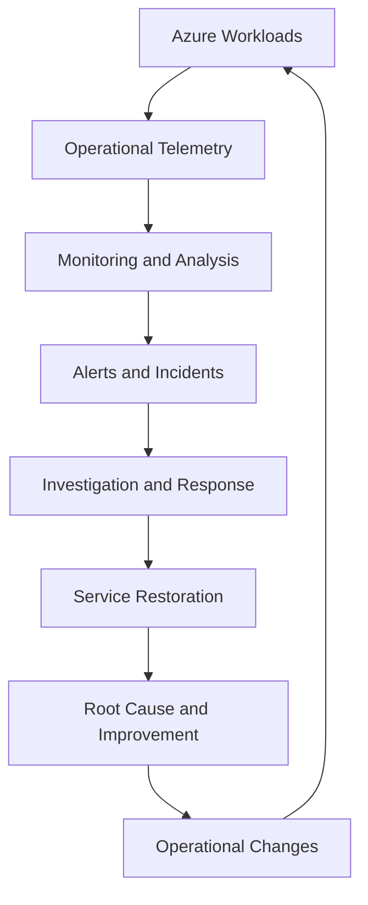
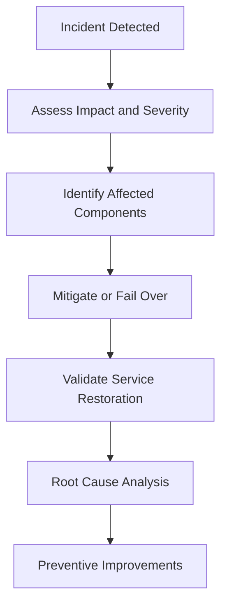

# CAF Manage

## 1. Operational Management Architecture Context

The **Manage methodology** of the Microsoft Cloud Adoption Framework (CAF) establishes how an organization operates, monitors, maintains, and continuously improves its cloud environment after workloads are deployed.

For an Azure solution architect, operational management must be designed into the solution rather than treated as a separate activity after deployment. The architecture should define service health visibility, monitoring, incident response, recovery, configuration management, operational ownership, and service-level objectives.

The objective is to maintain workloads that meet business requirements for availability, performance, security, recoverability, and operational cost throughout their lifecycle.

CAF Manage aligns cloud operations with the organization's business criticality, operational capabilities, and risk tolerance. The appropriate operating model depends on workload complexity, service dependencies, compliance requirements, and the level of operational responsibility retained by the organization.

## 2. Cloud Operations Architecture

Operational management connects workload telemetry, service health, operational processes, and continuous improvement.

This is a conceptual operating model. Actual implementation may use centralized platform operations, workload-specific operations, managed services, or a combination of these approaches.

The architecture must establish which signals are collected, which conditions trigger action, who responds, how service restoration is validated, and how operational findings influence subsequent design decisions.

## 3. Define the Operational Management Model

The operating model determines how cloud services are supported, who owns operational decisions, and how responsibilities are divided between platform and workload teams.

| Operating concern | Architectural consideration |
|---|---|
| Service ownership | Define accountable owners for each workload and shared platform service |
| Operational responsibility | Establish which activities are managed centrally and which are delegated to application teams |
| Service criticality | Classify workloads according to business impact and recovery requirements |
| Service-level objectives | Define measurable expectations for availability, latency, and reliability |
| Monitoring | Determine required telemetry, collection locations, retention, and alerting |
| Incident management | Define detection, triage, escalation, communication, and restoration procedures |
| Configuration management | Maintain visibility into resource configuration and changes |
| Recovery | Establish backup, restoration, and disaster recovery responsibilities |
| Capacity management | Monitor demand, service limits, quotas, and scaling requirements |
| Continuous improvement | Use incidents, metrics, and operational reviews to improve the architecture |

A shared responsibility model should be explicit. Azure manages the underlying infrastructure for many platform services, but customers remain responsible for their applications, configurations, access controls, data, and other workload-specific responsibilities according to the selected service model.

## 4. Monitoring and Observability Architecture

Monitoring provides visibility into the condition of Azure resources and applications. Observability combines telemetry and analysis to help teams understand system behavior and investigate problems.

A production architecture should distinguish between collecting data, detecting abnormal conditions, and taking operational action.

### 4.1 Azure monitoring capabilities

| Azure capability | Operational purpose |
|---|---|
| Azure Monitor | Provides the monitoring foundation for metrics, logs, alerts, and supported telemetry |
| Azure Monitor Metrics | Supports numerical measurements and near-real-time analysis of supported resource metrics |
| Azure Monitor Logs | Enables querying and analysis of collected log data using Kusto Query Language (KQL) |
| Log Analytics workspaces | Store and provide query access to supported log data |
| Application Insights | Supports application performance monitoring, distributed tracing, and application diagnostics |
| Azure Monitor Alerts | Detects configured conditions and can trigger notification or action workflows |
| Azure Service Health | Provides information about Azure service issues, planned maintenance, and relevant service health events |
| Azure Resource Health | Provides health information for supported individual Azure resources |
| Azure Workbooks | Combines metrics, logs, and other supported data into operational reports and visualizations |

These capabilities serve different purposes. Service Health helps identify Azure platform issues, while Resource Health provides information about specific resources. Application Insights focuses on application telemetry, whereas Azure Monitor provides broader monitoring capabilities.

The architecture should select monitoring services based on the diagnostic questions that operators need to answer, not simply enable every available feature.

### 4.2 Define meaningful telemetry

Operational telemetry should help teams detect and diagnose conditions that affect users or business processes.

Relevant signals include:

- Request rate and transaction volume.
- Response latency and failure rate.
- CPU, memory, storage, and network utilization.
- Database performance and connection pressure.
- Dependency failures and timeout behavior.
- Queue depth and message-processing delays.
- Application exceptions and distributed traces.
- Resource health and service availability.

Not every metric requires an alert. Alerting should focus on actionable conditions that indicate a service impact, an approaching operational limit, or a meaningful risk to the workload.

## 5. Design Alerting and Incident Detection

Alerting translates telemetry into operational signals that require investigation or action.

An effective design defines thresholds or detection logic, severity, evaluation frequency, notification routes, ownership, and escalation behavior.

| Alert category | Example detection condition | Operational response |
|---|---|---|
| Availability | Application availability falls below its objective | Investigate service reachability and dependencies |
| Performance | Response latency exceeds the workload's defined threshold | Analyze application, database, and network behavior |
| Capacity | Resource utilization approaches a known limit | Evaluate scaling, optimization, or capacity expansion |
| Dependency | Repeated database or external API failures occur | Investigate dependency health, connectivity, and timeout behavior |
| Platform health | An Azure service issue affects a deployed workload | Assess impact and follow the relevant mitigation or recovery plan |
| Data processing | Queue backlog or processing delay exceeds an acceptable level | Investigate consumers, throughput, and downstream dependencies |

Thresholds should be based on workload baselines, service-level objectives, and failure characteristics. Generic thresholds can create excessive noise or miss genuine service degradation.

### 5.1 Alert routing and action groups

Azure Monitor action groups can define supported notification and action mechanisms for alert rules.

The design should establish:

- Which team receives each alert category.
- How severity determines escalation.
- Which alerts require immediate response.
- How duplicate or correlated alerts are handled.
- Which automated actions are safe to execute.
- How notification and response behavior is tested.

Automation should be used carefully. An automated restart or scaling action may help resolve a known failure pattern, but it can also hide a recurring defect or worsen an incident if applied without appropriate safeguards.

## 6. Service-Level Objectives and Reliability Management

Operational management must connect technical measurements to business expectations.

A service-level indicator (SLI) is a measurement of service behavior. A service-level objective (SLO) defines the target for that measurement. A service-level agreement (SLA) is a formal commitment with defined terms and conditions.

These concepts are related but not interchangeable.

| Concept | Example |
|---|---|
| SLI | Percentage of valid application requests completed successfully |
| SLO | Target of 99.9% successful requests over a defined measurement window |
| SLA | A published service commitment subject to its documented scope, exclusions, and terms |
| Error budget | The amount of unreliability permitted by a defined SLO over its measurement window |

The example SLO is illustrative and is not an Azure service SLA.

### 6.1 Architecture implications

Service-level objectives influence:

- Redundancy and failure-domain design.
- Health probes and traffic routing.
- Dependency selection and timeout policies.
- Retry behavior and circuit-breaking strategies.
- Capacity headroom and scaling behavior.
- Backup and disaster recovery requirements.
- Monitoring coverage and alert thresholds.

A solution architect should evaluate the end-to-end service rather than assume that the SLA of an individual Azure service represents the availability of the complete application.

For example, multiple dependent components can reduce overall availability when the application requires every component to function for a request to succeed. The impact depends on the actual dependency model, redundancy, failure handling, and architecture.

## 7. Incident Management and Service Restoration

Incident management establishes how teams respond when a workload experiences service degradation, failure, or an operational security event.

A production-ready architecture should define incident detection, triage, escalation, mitigation, recovery, communication, and post-incident review.

The appropriate response depends on the incident type. A regional service disruption, application deployment failure, exhausted database connections, and incorrect configuration change may require different investigation and recovery procedures.

Operational runbooks should document known failure scenarios, diagnostic steps, escalation contacts, recovery actions, and validation criteria.

A successful restart does not necessarily resolve the underlying cause. Recurring incidents should lead to investigation and corrective work rather than repeated manual recovery alone.

## 8. Configuration, Change, and Operational Consistency

Operational management requires visibility into how Azure resources change over time.

Configuration drift occurs when deployed resources no longer match their intended configuration or approved baseline.

Relevant mechanisms include:

- Azure Activity Log for Azure Resource Manager control-plane operations.
- Azure Policy compliance evaluation for applicable governance requirements.
- Infrastructure as Code for repeatable resource configuration.
- Version-controlled change definitions and deployment history.
- Azure Resource Graph for querying supported resource inventory and configuration.
- Monitoring and alerting for relevant configuration or service changes.

These mechanisms are complementary. The Activity Log records supported control-plane operations, but it does not replace application logs or provide complete visibility into every data-plane operation.

Infrastructure as Code can help maintain consistency, but it does not automatically eliminate drift. The organization needs a process to detect differences, assess their impact, and reconcile them through controlled changes.

Detailed deployment pipelines and IaC implementation belong in the relevant DevOps repository; the focus here is the operational architecture and its controls.

## 9. Backup, Recovery, and Operational Readiness

Backup and recovery are core operational responsibilities, but they must be designed according to workload requirements.

The architecture should define:

- Required recovery point objective (RPO).
- Required recovery time objective (RTO).
- Backup frequency and retention.
- Restore procedures and validation.
- Cross-zone or cross-region recovery requirements where applicable.
- Dependencies required to restore the service.
- Ownership of recovery decisions and execution.
- Testing frequency and evidence of successful recovery.

Backup success does not prove that a workload can be restored within its required recovery time. Restoration procedures must be tested, and the recovered application must be validated against its functional and data-consistency requirements.

Detailed high-availability, backup, and disaster recovery architecture is covered in the dedicated business continuity section of the repository.

## 10. Capacity and Performance Management

Operational management should anticipate resource constraints before they become service-impacting incidents.

Capacity planning considers workload demand, scaling characteristics, service quotas, regional capacity, dependency limits, and cost implications.

| Area | Operational consideration |
|---|---|
| Compute | Utilization, scaling behavior, instance limits, and workload concurrency |
| Storage | Capacity growth, throughput, latency, and IOPS limits where applicable |
| Databases | Connections, query performance, storage limits, and transaction demand |
| Networking | Throughput, connection limits, routing, and network service capacity |
| Platform quotas | Subscription and regional limits that may constrain deployment or scaling |
| Application dependencies | API rate limits, queue capacity, and downstream processing capability |

Scaling one component does not guarantee that the complete application scales successfully. For example, increasing application instances may overload a database or exceed an external API's rate limit.

Capacity management must therefore consider end-to-end workload behavior and validate scaling decisions under realistic demand.

## 11. Enterprise Scenario: Operating a Business-Critical Azure Application

### Current state

An organization operates a customer-facing application in Azure. The application uses a web tier, a managed database, and an external payment API.

The organization experiences intermittent latency during peak traffic and lacks a clear process for identifying whether the issue originates in the application, database, or external dependency.

### Operational requirements

The solution must provide:

1. End-to-end visibility into application and dependency performance.
2. Actionable alerts aligned with business impact.
3. Clear operational ownership and escalation paths.
4. Defined service-level objectives.
5. Tested recovery procedures.
6. Evidence to support root cause analysis and continuous improvement.

### Architectural approach

The architect evaluates an operational design that combines:

- Azure Monitor for infrastructure and platform telemetry.
- Application Insights for application performance and distributed tracing.
- Log Analytics for supported centralized log analysis.
- Azure Monitor Alerts and action groups for actionable notifications.
- Azure Service Health and Resource Health for relevant platform and resource conditions.
- Documented incident procedures and workload-specific runbooks.

The organization defines service-level indicators for request success and latency, then establishes appropriate objectives and alert conditions based on observed workload behavior.

During an incident, operators correlate application traces, database metrics, and dependency failures to identify the likely failure domain. After service restoration, the team documents the cause, evaluates whether existing controls detected the issue effectively, and prioritizes corrective actions.

The final monitoring topology, log retention, alert thresholds, and recovery design depend on business criticality, telemetry volume, regulatory requirements, and operational support capabilities.

## 12. Continuous Operational Improvement

CAF Manage treats operational management as an ongoing capability rather than a one-time deployment activity.

Operational reviews should evaluate whether the architecture continues to satisfy business requirements as workload demand, dependencies, and Azure services evolve.

Relevant improvement inputs include:

- Incident and problem management records.
- SLO attainment and error-budget consumption.
- Capacity and performance trends.
- Repeated configuration drift.
- Recovery exercise results.
- Monitoring gaps and ineffective alerts.
- Operational cost and resource utilization.
- Changes in business criticality and service dependencies.

Improvement activities may involve changing alert thresholds, removing noisy alerts, improving failure handling, automating repetitive operations, adjusting capacity, or revising architecture decisions.

Changes should be prioritized according to risk and business impact, then validated through controlled deployment and operational testing.

## Microsoft References

- [Cloud Adoption Framework: Manage](https://learn.microsoft.com/en-us/azure/cloud-adoption-framework/manage/)
- [Cloud Adoption Framework: Management disciplines](https://learn.microsoft.com/en-us/azure/cloud-adoption-framework/manage/considerations/)
- [Azure Monitor overview](https://learn.microsoft.com/en-us/azure/azure-monitor/overview)
- [Azure Monitor alerts](https://learn.microsoft.com/en-us/azure/azure-monitor/alerts/alerts-overview)
- [Azure Service Health](https://learn.microsoft.com/en-us/azure/service-health/overview)
- [Azure Resource Health](https://learn.microsoft.com/en-us/azure/service-health/resource-health-overview)
- [Application Insights overview](https://learn.microsoft.com/en-us/azure/azure-monitor/app/app-insights-overview)
- [Azure Monitor Logs and Log Analytics](https://learn.microsoft.com/en-us/azure/azure-monitor/logs/log-analytics-overview)
- [Azure Well-Architected Framework: Operational Excellence](https://learn.microsoft.com/en-us/azure/well-architected/operational-excellence/)
- [Azure Architecture Center](https://learn.microsoft.com/en-us/azure/architecture/)
