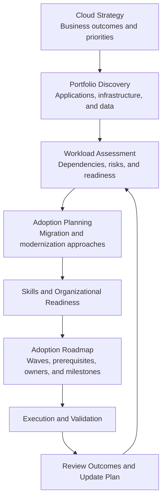
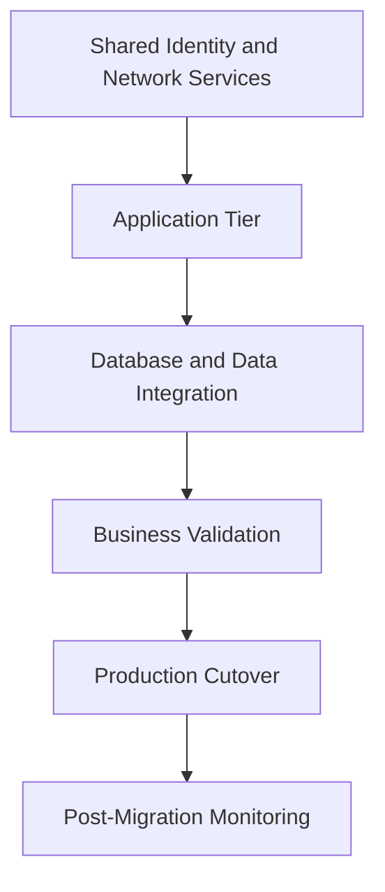

# CAF Plan

## 1. Planning Context

The **Plan methodology** of the Microsoft Cloud Adoption Framework (CAF) translates an organization's cloud strategy into an actionable adoption plan.

For a solution architect, planning establishes the workload scope, dependencies, technical readiness, skills, sequencing, and constraints that influence the target architecture.

The objective is not simply to create a migration schedule. It is to determine **which workloads should move, in what order, using which adoption approach, and with what prerequisites and measurable outcomes**.

Planning must connect business priorities to technical feasibility. A workload with high business value may still require dependency remediation, data-platform changes, security approvals, or platform readiness work before migration.

## 2. Planning Inputs and Outputs

CAF planning uses the outcomes of the strategy process and the organization's current-state assessment to define the adoption roadmap.

The planning process is iterative. Assessment findings may change workload priorities, migration approaches, timelines, or the target architecture.

| Input | Planning purpose | Expected output |
|---|---|---|
| Business objectives | Determine which outcomes matter most | Prioritized adoption criteria |
| Workload inventory | Establish the scope of the portfolio | Workload catalogue |
| Dependency information | Identify technical and operational relationships | Dependency map |
| Current-state assessment | Identify limitations and readiness gaps | Remediation requirements |
| Security and compliance requirements | Establish mandatory constraints | Security and compliance prerequisites |
| Cost and licensing information | Evaluate financial feasibility | Cost assumptions and estimates |
| Skills and operating capabilities | Determine implementation and support readiness | Skills development and operating model actions |
| Target architecture direction | Align workload plans with platform standards | Workload adoption plans and architecture requirements |

## 3. Build a Reliable Workload Inventory

An adoption plan is only as reliable as the information used to build it.

For each workload, collect the information needed to evaluate its business importance, technical dependencies, and adoption complexity.

| Attribute | Architectural relevance |
|---|---|
| Business owner and purpose | Establishes accountability and business criticality |
| Application components | Identifies compute, application, database, and integration layers |
| Hosting environment | Establishes the current infrastructure and platform constraints |
| Data stores and data flows | Identifies data migration, consistency, and residency requirements |
| Upstream and downstream dependencies | Determines migration sequencing and temporary connectivity requirements |
| Identity and access dependencies | Identifies authentication, authorization, and service identity requirements |
| Availability and recovery requirements | Influences redundancy, backup, and disaster recovery design |
| Compliance classification | Constrains service selection, data location, and access controls |
| Usage and performance profile | Informs sizing, scaling, and performance validation |
| Licensing and contractual constraints | Identifies restrictions and cost implications |
| Operational ownership | Establishes who will operate and support the workload after adoption |

Do not treat an incomplete inventory as evidence that a workload is ready to migrate. Missing dependency, ownership, or recovery information should be recorded as an explicit assessment gap.

## 4. Assess Workload Readiness

Workload readiness determines whether a workload can proceed with its proposed adoption approach and what must be resolved first.

Assess the workload across multiple dimensions rather than assigning readiness based solely on its infrastructure configuration.

### 4.1 Technical readiness

Evaluate:

- Operating system, runtime, and application compatibility.
- Dependency on legacy infrastructure or unsupported components.
- Network connectivity and name resolution requirements.
- Data migration volume, transfer duration, and consistency requirements.
- Integration with external systems and third-party services.
- Performance and capacity requirements.
- Backup, recovery, and rollback capabilities.

### 4.2 Organizational readiness

Evaluate whether the organization has:

- An accountable workload owner.
- Approved funding and a delivery plan.
- Required implementation and operational skills.
- Security, compliance, and architecture approvals.
- Monitoring, incident response, and support arrangements.
- A defined approach for validating business outcomes.

### 4.3 Platform readiness

Confirm that the target Azure environment can support the workload.

Depending on the architecture, prerequisites may include:

- An approved landing zone and subscription.
- Required identity and access controls.
- Network connectivity and DNS configuration.
- Governance policies and security baselines.
- Logging, monitoring, and operational integration.
- Required Azure service quotas, regional availability, and licensing arrangements.

Landing zone architecture and implementation are covered in the dedicated landing zone topics. This section establishes how platform readiness affects workload planning.

## 5. Prioritize Workloads

Workload prioritization should balance business value, technical feasibility, risk, dependencies, and organizational capacity.

A useful assessment model considers the following factors:

| Factor | Planning question |
|---|---|
| Business value | How much value will adoption deliver? |
| Business criticality | What is the impact of disruption or migration failure? |
| Technical complexity | How many dependencies and legacy constraints must be resolved? |
| Migration risk | What is the likelihood and impact of an unsuccessful transition? |
| Dependency readiness | Are related systems ready to migrate or integrate? |
| Compliance requirements | Are there mandatory approvals or restrictions? |
| Cost and effort | Is the expected outcome justified by the investment? |
| Strategic alignment | Does the workload support the organization's prioritized outcomes? |

A workload that is technically easy to migrate is not automatically the best first candidate. Likewise, a business-critical application should not be selected as an early migration solely because it offers high strategic value.

Use an agreed prioritization model to identify candidate workloads, then validate the result against business constraints and dependencies.

## 6. Select an Adoption Approach

The adoption approach determines the scope of change required to move a workload toward its target state.

| Approach | Planning considerations |
|---|---|
| Retain | Confirm why the workload remains in its current environment and what future conditions would trigger reassessment |
| Retire | Validate business approval, data retention, dependent systems, and decommissioning requirements |
| Rehost | Confirm compatibility, sizing, networking, operational requirements, and acceptable limitations of the existing design |
| Replatform | Validate managed-service compatibility, configuration changes, performance, and operational benefits |
| Refactor or rearchitect | Assess application redesign, data changes, integration impact, testing, and transition risk |
| Rebuild or replace | Evaluate functional requirements, product suitability, data migration, user transition, and contractual implications |

The selected approach must reflect both the desired business outcome and the workload's constraints. The least disruptive option may be appropriate for an urgent datacenter exit, while a longer modernization effort may be justified when the current design prevents essential business capabilities.

## 7. Map Dependencies and Sequence Adoption

Workloads should be grouped into adoption waves according to dependency relationships, readiness, business impact, and implementation capacity.

A migration wave may include multiple components that must transition together, while independent components can sometimes move separately.

This is an illustrative dependency chain, not a universal migration order. In some architectures, data replication begins before application migration, shared services move independently, or application and database components must be transitioned together.

Before approving a wave, determine:

- Which dependencies must already be available.
- Which components must move together.
- Whether temporary hybrid connectivity is required.
- How data consistency will be maintained.
- How cutover and rollback will work.
- How business acceptance will be validated.
- Which team owns each prerequisite and decision.

A dependency-aware plan reduces the risk of migrating a workload into an environment where essential services are unavailable.

## 8. Define Adoption Waves and Milestones

An adoption roadmap converts workload decisions into a delivery sequence.

A typical roadmap may distinguish:

1. **Foundation:** Establish required platform capabilities, governance, identity, connectivity, and operational integration.
2. **Pilot workloads:** Validate the proposed migration approach with appropriately selected workloads.
3. **Migration waves:** Transition prioritized workloads according to dependencies and readiness.
4. **Modernization initiatives:** Deliver deeper application or data-platform changes where justified.
5. **Optimization:** Validate business outcomes and improve architecture, operations, and cost efficiency.

These are planning categories, not mandatory CAF stages. Organizations may run migration and modernization work in parallel when dependencies and controls permit.

For each wave, document its scope, prerequisites, owners, milestones, acceptance criteria, risks, and dependencies on other teams.

## 9. Estimate Cost, Capacity, and Delivery Effort

Planning should test whether the proposed adoption roadmap is financially and technically feasible.

Consider:

- Current infrastructure and licensing costs.
- Expected Azure consumption and managed-service charges.
- Data transfer, network connectivity, and storage requirements.
- Resilience, backup, security, and observability costs.
- Migration tooling, implementation effort, and parallel-running periods.
- Required skills, support arrangements, and operational changes.
- Capacity, quotas, regional service availability, and scaling limits.

Cost estimates are assumptions to be validated, not guarantees. Consumption can change with traffic, retention, data transfer, architecture decisions, and operational behavior.

Use workload-specific estimates and sensitivity analysis for material uncertainties rather than relying on a single organization-wide average.

## 10. Plan for Risk and Validation

Every adoption wave should identify its major risks and the evidence required to proceed.

| Risk | Planning response |
|---|---|
| Unknown dependencies | Complete discovery and validate communication paths |
| Incompatible application components | Perform compatibility testing and define remediation |
| Data migration delays | Estimate transfer time, validate throughput, and test synchronization |
| Insufficient platform readiness | Assign prerequisite work and establish completion criteria |
| Cost overruns | Validate consumption assumptions and define cost-monitoring responsibilities |
| Failed cutover | Test rollback, recovery, and business validation procedures |
| Operational gaps | Confirm monitoring, support ownership, incident procedures, and escalation paths |

Risk responses should have clear owners and measurable completion criteria. High-impact uncertainties should be resolved before the workload is committed to a production migration window.

## 11. Enterprise Scenario: Planning a Hybrid Application Portfolio

### Current state

An enterprise plans to adopt Azure for three workloads:

- A customer-facing web application.
- A business-critical transaction database.
- An internal reporting application.

The web application depends on the transaction database. The reporting application consumes data from the same database but has different availability requirements.

### Planning assessment

| Workload | Key constraint | Planning decision |
|---|---|---|
| Customer-facing application | Database dependency and peak traffic | Validate the target hosting platform, connectivity, performance, and cutover approach |
| Transaction database | High business criticality and strict data consistency requirements | Complete data compatibility, recovery, migration, and rollback assessments before approving the transition |
| Reporting application | Data dependency but less demanding availability requirements | Assess whether it can move independently while preserving required data access and reporting behavior |

### Adoption plan

The architect should not automatically migrate all three workloads in a single wave.

Instead:

1. Validate the target platform and establish the required connectivity and governance controls.
2. Test the database migration and recovery approach.
3. Determine whether the reporting workload can move independently.
4. Plan application and database cutover around their dependency and consistency requirements.
5. Define business acceptance tests, monitoring, and rollback criteria.
6. Review the outcome before applying the approach to similar workloads.

The final sequencing depends on the database technology, replication options, application compatibility, downtime tolerance, and dependency analysis.

This example demonstrates how CAF planning converts strategic objectives into a dependency-aware adoption roadmap without prematurely prescribing a specific Azure implementation.

## 12. Expected Planning Deliverables

The Plan methodology should produce a coordinated set of planning outputs, including:

- Workload inventory and dependency information.
- Workload readiness assessments and identified gaps.
- Prioritized workload adoption decisions.
- Adoption approaches and target-state requirements.
- Skills and organizational readiness actions.
- Adoption waves, milestones, owners, and dependencies.
- Cost and effort assumptions.
- Risk assessments and validation criteria.
- A roadmap that can be updated as discovery and implementation provide new evidence.

These deliverables provide the basis for preparing the Azure environment and executing adoption activities. They should be maintained as living planning artifacts rather than treated as a one-time document.

## Microsoft References

- [Cloud Adoption Framework: Plan](https://learn.microsoft.com/en-us/azure/cloud-adoption-framework/plan/)
- [Digital estate planning](https://learn.microsoft.com/en-us/azure/cloud-adoption-framework/plan/digital-estate)
- [Select a cloud migration strategy](https://learn.microsoft.com/en-us/azure/cloud-adoption-framework/plan/select-cloud-migration-strategy)
- [Create a cloud adoption plan](https://learn.microsoft.com/en-us/azure/cloud-adoption-framework/plan/plan-implementation)
- [Azure Migrate](https://learn.microsoft.com/en-us/azure/migrate/)
- [Azure Architecture Center](https://learn.microsoft.com/en-us/azure/architecture/)
