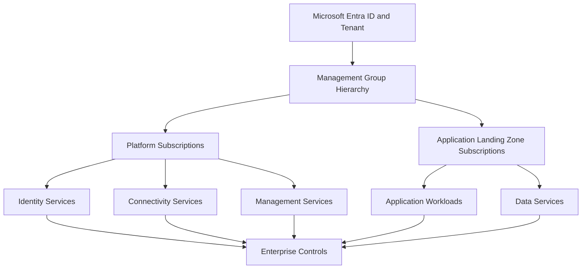

# CAF Ready

## 1. Architectural Context

The **Ready methodology** of the Microsoft Cloud Adoption Framework (CAF) focuses on preparing the cloud environment and organizational capabilities required to host workloads in Azure.

For a solution architect, readiness means establishing a secure, governed, scalable, and operationally supportable foundation before workloads are deployed or migrated.

The central architectural decision is how to prepare the Azure environment so that application teams can deploy workloads consistently without independently rebuilding foundational capabilities for every application.

Azure landing zones are a core architectural approach for establishing this foundation. Their detailed design is covered in the dedicated Azure Landing Zones topics.

## 2. Readiness Architecture

A production-ready Azure environment requires more than an Azure subscription. It must provide the platform capabilities, organizational controls, and operational integration required by the workloads it will host.

```mermaid
flowchart TD
    A["Enterprise Requirements"] --> B["Readiness Assessment"]
    B --> C["Platform Architecture"]
    C --> D["Identity and Access"]
    C --> E["Network and Connectivity"]
    C --> F["Governance and Security"]
    C --> G["Management and Operations"]
    D --> H["Validated Azure Environment"]
    E --> H
    F --> H
    G --> H
    H --> I["Workload Deployment or Migration"]
    I --> J["Operational Validation"]
```

The required capabilities depend on the organization's scale, workload criticality, regulatory obligations, and operating model. Not every workload requires the same topology, but every production workload needs an explicitly designed foundation.

## 3. Determine Platform Requirements

Before preparing the Azure environment, identify the platform requirements that follow from the organization's strategy and workload portfolio.

| Requirement | Architectural consideration |
|---|---|
| Organizational scale | Number of workloads, teams, subscriptions, environments, and regions |
| Identity | Authentication, authorization, privileged access, and workload identities |
| Network connectivity | Internet access, private connectivity, hybrid networking, DNS, and segmentation |
| Governance | Policy enforcement, resource organization, naming standards, and tagging |
| Security | Security baselines, threat protection, data protection, and compliance requirements |
| Management | Monitoring, logging, alerting, automation, and operational ownership |
| Resilience | Availability, backup, recovery, and regional dependency requirements |
| Financial management | Budgets, cost allocation, resource optimization, and consumption visibility |
| Automation | Repeatable deployment of platform and workload resources |
| Service availability | Regional support, quotas, capacity, and service limitations |

These requirements should be derived from business needs rather than implemented as a generic checklist without context.

## 4. Prepare the Azure Platform

### 4.1 Identity and access foundation

Establish how administrators, platform teams, application teams, and workloads authenticate and receive permissions.

Architecture considerations include:

- Microsoft Entra ID as the identity foundation.
- Role-based access control (Azure RBAC) and least-privilege assignments.
- Separation of privileged administration from routine operations.
- Managed identities for supported workload-to-service authentication.
- Privileged Identity Management where appropriate.
- Emergency access arrangements and administrative recovery procedures.

The identity design must account for both human administrators and service-to-service access. Avoid using long-lived credentials or broadly privileged identities when a more restricted supported approach is available.

### 4.2 Network and connectivity foundation

Determine how workloads communicate with one another, shared platform services, on-premises environments, and external endpoints.

Depending on the requirements, the foundation may include:

- Virtual network and subnet design.
- Address-space allocation and overlap avoidance.
- Hub-and-spoke networking or Azure Virtual WAN.
- VPN Gateway or ExpressRoute for hybrid connectivity.
- Azure DNS and private DNS integration.
- Network security controls and traffic inspection.
- Centralized or distributed egress and ingress architectures.

Network design should account for address planning, routing, DNS, security boundaries, expected traffic, and operational ownership before dependent workloads are deployed.

### 4.3 Governance foundation

Define the controls that apply across subscriptions and workloads.

These may include:

- Management group and subscription organization.
- Azure Policy initiatives and assignments.
- Resource naming and tagging standards.
- Allowed regions and permitted resource types.
- Security configuration requirements.
- Resource deployment restrictions and exemptions.
- Cost allocation and reporting conventions.

Governance controls should be designed to enforce mandatory requirements while allowing justified workload-specific exceptions through an accountable process.

### 4.4 Management and operations foundation

Establish how the organization will observe, support, and maintain the Azure environment.

Depending on operational requirements, this can include:

- Azure Monitor and Log Analytics.
- Diagnostic settings and centralized log collection.
- Alert rules and incident routing.
- Azure Activity Log collection and retention.
- Service health monitoring.
- Backup and recovery integration.
- Configuration management and automation.
- Operational runbooks and escalation responsibilities.

Monitoring configuration alone does not establish operational readiness. The organization must also define who responds to alerts, how incidents are handled, and how service health is validated.

## 5. Establish the Landing Zone Architecture

An Azure landing zone provides a repeatable environment in which workloads can be deployed under established platform standards.

At enterprise scale, the architecture commonly distinguishes between platform capabilities shared across the organization and application-specific environments.

This is a conceptual view, not a mandatory subscription hierarchy. The actual structure should reflect the organization's governance, security, networking, and operational requirements.

The architect must decide which capabilities are centralized, which are delegated, and which remain under workload-team control.

## 6. Choose the Appropriate Landing Zone Approach

The platform preparation approach depends on the organization's scale, existing Azure footprint, and readiness.

| Situation | Architectural direction |
|---|---|
| New enterprise Azure environment | Establish the required platform foundation and landing zone architecture before onboarding production workloads |
| Existing Azure environment with inconsistent controls | Assess gaps and incrementally align the environment with the target architecture |
| Small organization with limited platform complexity | Use a proportionate landing zone design that avoids unnecessary organizational overhead |
| Regulated enterprise | Establish explicit governance, identity, security, logging, and compliance requirements |
| Hybrid enterprise | Validate connectivity, DNS, identity dependencies, routing, and operational integration |
| Rapid workload migration | Prioritize the foundational capabilities required by the first workloads while maintaining an agreed target architecture |

The objective is not to maximize the number of Azure services deployed before migration. It is to establish the capabilities required to support the intended workloads safely and consistently.

## 7. Infrastructure as Code and Repeatability

For enterprise environments, platform configuration should be repeatable and controlled rather than dependent on undocumented portal operations.

Infrastructure as Code (IaC) can be used to define and deploy supported Azure resources and configuration through tools such as Bicep or Terraform.

Architecture considerations include:

- Version-controlled platform definitions.
- Reusable modules and standardized configurations.
- Controlled deployment permissions.
- Environment-specific parameters.
- Validation and change review.
- Drift detection and configuration reconciliation.
- Deployment logging and recovery procedures.

For example, an organization may maintain version-controlled definitions for management group policies, networking resources, monitoring configuration, and workload subscription foundations.

The exact toolchain depends on organizational standards. Detailed CI/CD implementation belongs in the relevant DevOps repository; this topic focuses on why repeatability and controlled change are architectural requirements.

## 8. Validate Platform Readiness

A platform should be considered ready only when the required capabilities have been validated against the workloads it is expected to support.

| Validation area | Evidence to obtain |
|---|---|
| Identity | Expected administrators and workloads can access approved resources without excessive privileges |
| Networking | Required routes, DNS resolution, connectivity, and segmentation behave as designed |
| Governance | Applicable policies are enforced and approved exceptions are documented |
| Security | Required security controls and monitoring integrations are operational |
| Management | Logs, alerts, operational ownership, and incident routing have been tested |
| Resilience | Required backup, restore, and recovery capabilities have been validated |
| Deployment | Approved platform definitions can be deployed and changed repeatably |
| Capacity | Required regions, quotas, and service capabilities are available |
| Cost management | Consumption visibility and relevant financial controls are established |

Validation should use evidence such as test results, deployment outputs, configuration reviews, and operational exercises. A design document alone does not demonstrate that the environment behaves as intended.

## 9. Enterprise Scenario: Preparing Azure for Multiple Application Teams

### Current state

An organization plans to migrate several business applications from an on-premises datacenter to Azure.

Different teams have independent deployment practices, networking requirements, and monitoring arrangements. The organization wants to establish shared standards without preventing application teams from delivering workload-specific solutions.

### Architectural decisions

| Decision | Consideration |
|---|---|
| Subscription organization | Separate platform capabilities from workload environments according to governance and operational boundaries |
| Identity model | Establish centralized identity controls and delegated workload permissions |
| Network architecture | Define shared connectivity, DNS, routing, and segmentation requirements |
| Governance | Apply organization-wide controls through management groups and Azure Policy |
| Operational model | Define centralized platform responsibilities and application-team ownership |
| Deployment model | Use repeatable platform definitions and controlled changes |
| Workload onboarding | Validate each workload against the requirements of its target landing zone |

### Recommended direction

Establish the minimum platform capabilities needed for the first production workloads while maintaining a documented enterprise target architecture.

Before onboarding each workload, verify that its requirements fit the selected landing zone and that any additional controls, connectivity, or operational capabilities are available.

If a workload requires an exception, document the reason, risk, owner, and approval process rather than bypassing platform standards informally.

## 10. Relationship to Subsequent Architecture Topics

This topic establishes the readiness requirements. The detailed architecture decisions are addressed in the following dedicated topics.

| Topic | Detailed scope |
|---|---|
| Azure Landing Zones | Landing zone architecture, design principles, and deployment approaches |
| Platform Landing Zone | Shared platform services and centralized capabilities |
| Application Landing Zone | Workload-specific environments and delegated ownership |
| Management Group Architecture | Hierarchy, inheritance, and governance boundaries |
| Subscription Strategy | Subscription boundaries, isolation, and lifecycle |
| Azure Policy and Compliance | Policy design, initiatives, assignments, and exceptions |
| Resource Organization and Tagging | Naming, tagging, resource groups, and resource organization |

This separation keeps the readiness discussion focused on prerequisites and validation rather than repeating the detailed design of each platform component.

## Microsoft References

- [Cloud Adoption Framework: Ready](https://learn.microsoft.com/en-us/azure/cloud-adoption-framework/ready/)
- [Azure landing zones](https://learn.microsoft.com/en-us/azure/cloud-adoption-framework/ready/landing-zone/)
- [Azure landing zone design principles](https://learn.microsoft.com/en-us/azure/cloud-adoption-framework/ready/landing-zone/design-principles)
- [Azure landing zone architecture](https://learn.microsoft.com/en-us/azure/cloud-adoption-framework/ready/landing-zone/architecture-design-areas)
- [Azure landing zone implementation options](https://learn.microsoft.com/en-us/azure/cloud-adoption-framework/ready/landing-zone/implementation-options)
- [Azure Architecture Center](https://learn.microsoft.com/en-us/azure/architecture/)
