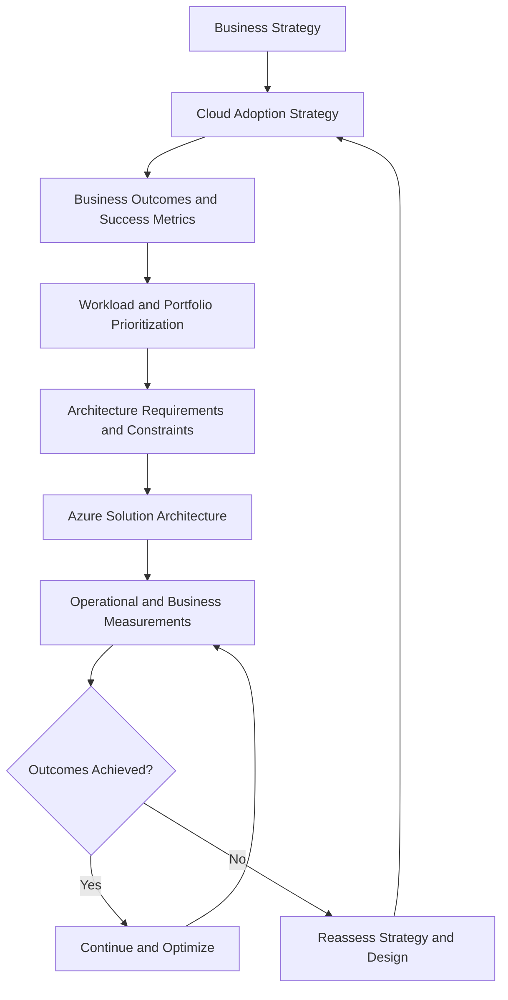

# CAF Strategy

## 1. Strategic Context

The **Strategy methodology** of the Microsoft Cloud Adoption Framework (CAF) establishes why an organization should adopt Azure, what business outcomes it expects, and how cloud investments should support its long-term objectives.

For a solution architect, cloud strategy is the starting point for architectural decision-making. It establishes the business context and constraints that influence workload placement, modernization, resilience, security, operating costs, and technology selection.

A cloud strategy should connect three levels of decision-making:

| Level | Primary concern | Expected outcome |
|---|---|---|
| Business strategy | Why must the organization change? | Business drivers and target outcomes |
| Cloud adoption strategy | How will cloud adoption support those outcomes? | Adoption priorities, investment direction, and measurable objectives |
| Solution architecture | Which technical design best supports the agreed strategy? | Architecture decisions justified by business and technical requirements |

Cloud strategy is iterative. Organizations revisit their priorities as business conditions, regulatory requirements, technology capabilities, and operational experience change.

## 2. Strategy-to-Architecture Alignment

A cloud strategy must translate business intent into architectural constraints and measurable outcomes.

The architecture must reflect the actual business objective rather than simply reproduce an existing environment in Azure.

For example, if the objective is to reduce the operational burden of a legacy application, migrating its virtual machines without changing the operating model may not achieve the intended outcome. A managed platform or application modernization approach may provide greater value, depending on compatibility, cost, and migration constraints.

## 3. Establish Business Motivations

Before selecting Azure services or defining a target architecture, identify the business reasons for adopting or expanding cloud usage.

Microsoft CAF groups common motivations into three broad categories.

| Motivation | Business drivers | Architectural implications |
|---|---|---|
| Reduce business risk | Security, compliance, business continuity, resiliency, datacenter modernization | Recovery architecture, security controls, data protection, regional design, and governance requirements |
| Accelerate innovation | AI adoption, cloud-native capabilities, digital products, data-driven decisions | Managed services, modern application platforms, data platforms, and faster delivery of new capabilities |
| Enhance agility and efficiency | Elastic capacity, simplified operations, cost flexibility, faster experimentation | Automation, scalable services, operational standardization, and workload-specific cost optimization |

These categories are not mutually exclusive. An enterprise may need to modernize its applications while also reducing infrastructure risk and improving cost transparency.

### 3.1 Prioritize motivations

Not every motivation deserves the same investment or implementation priority.

Evaluate each motivation against:

- **Business impact:** The effect on revenue, customer experience, operational efficiency, or risk exposure.
- **Urgency:** The deadline imposed by business conditions, contractual obligations, or regulatory changes.
- **Technical feasibility:** Whether the current application, data, dependencies, and skills support the proposed change.
- **Investment requirements:** Migration costs, modernization effort, licensing, ongoing consumption, and operational overhead.
- **Risk of inaction:** The business consequences of leaving the current environment unchanged.

An architecture decision should document which business driver it serves and which constraints take precedence when requirements conflict.

## 4. Define the Cloud Mission and Target Outcomes

The cloud mission expresses the role Azure is expected to play in the organization's business and technology strategy.

A useful mission statement identifies the intended business transformation rather than naming Azure products.

For example:

> Modernize the organization's digital services to improve customer experience, increase delivery agility, meet regulatory obligations, and maintain predictable operational costs.

Translate the mission into specific outcomes with measurable success criteria.

| Strategic objective | Example measurable outcome | Architectural consequence |
|---|---|---|
| Improve service continuity | Meet an agreed availability target and recovery objectives | Design appropriate redundancy, failover, backup, and recovery mechanisms |
| Accelerate product delivery | Reduce the time required to release application changes | Automate delivery workflows and reduce unnecessary infrastructure dependencies |
| Improve financial efficiency | Reduce cost per transaction while meeting performance targets | Evaluate managed services, scaling behavior, licensing, and unit economics |
| Strengthen compliance | Demonstrate compliance with applicable regulatory controls | Design access controls, auditability, data protection, and policy enforcement |
| Support business growth | Handle forecast demand without disproportionate infrastructure expansion | Select suitable scaling strategies and validate capacity limits |

These values must be established with business stakeholders. They are examples, not universal targets or guarantees provided by Azure.

### 4.1 Define measurable success criteria

For every strategic outcome, identify:

- Baseline performance before adoption.
- Target performance after adoption.
- Measurement method and data source.
- Accountable business or technical owner.
- Target date and review frequency.
- Acceptable cost, risk, and performance trade-offs.

A metric is useful only when the organization can measure it consistently and use it to make decisions.

For example, reducing infrastructure expenditure does not necessarily represent success if the resulting architecture increases downtime or degrades customer experience. Evaluate cost alongside the business outcome it supports.

## 5. Establish the Cloud Strategy Team

Cloud strategy requires cross-functional ownership because architecture choices influence business operations, finance, security, compliance, and application delivery.

The strategy team establishes priorities and validates alignment between business objectives and cloud adoption initiatives. It is not a replacement for the teams responsible for implementing and operating workloads.

| Function | Strategic responsibility |
|---|---|
| Executive leadership | Approve strategic direction, funding, and business priorities |
| Business owners | Define business outcomes, service expectations, and acceptable risk |
| Cloud and enterprise architects | Translate strategy into target architecture and evaluate technical alternatives |
| Application and platform teams | Assess workload constraints, implementation effort, and platform capabilities |
| Security and compliance teams | Define security objectives, regulatory constraints, and risk acceptance requirements |
| Finance and FinOps stakeholders | Evaluate investment assumptions, consumption costs, and financial accountability |
| Operations and reliability teams | Establish support requirements, operational capabilities, and service expectations |

For smaller organizations, individuals may cover several functions. For enterprise environments, decision authority and accountability should be explicitly defined.

Architecture decisions should have an identifiable owner, especially when the design requires exceptions to organizational standards or introduces material business risk.

## 6. Align Strategy With the Existing Technology Portfolio

An enterprise cloud strategy should consider the entire application and infrastructure portfolio rather than treat every workload as an independent migration project.

For each workload, establish its business value, technical condition, dependencies, regulatory requirements, and expected future role.

Typical portfolio decisions include:

| Decision | When it may be appropriate | Strategic consideration |
|---|---|---|
| Retain | The workload remains fit for purpose and there is no compelling reason to change | Avoid unnecessary migration risk and expenditure |
| Retire | The workload is redundant or no longer provides sufficient business value | Validate dependencies, data retention, and decommissioning obligations |
| Rehost | Speed and minimal application change are primary requirements | Recognize that legacy operational and architectural limitations may remain |
| Replatform | Managed services can reduce operational overhead without extensive application redesign | Validate compatibility, service limits, and migration effort |
| Refactor or rearchitect | Existing design prevents required scalability, agility, or maintainability | Compare modernization investment against expected business value |
| Rebuild or replace | The existing solution cannot reasonably meet future requirements, or an alternative product provides a better fit | Consider functional gaps, data migration, integration, and transition risk |

These are workload-level decisions, not a mandatory sequence. Different applications in the same portfolio may require different approaches.

Detailed migration execution and workload modernization belong in the relevant adoption and migration topics.

## 7. Strategic Constraints That Influence Architecture

The cloud strategy should establish the constraints that solution architects must respect when evaluating design alternatives.

### 7.1 Financial constraints

Determine whether the organization prioritizes short-term migration cost, long-term operating expenditure, predictable spending, or total cost over the workload's lifecycle.

Compare complete costs rather than compute prices alone. Include licensing, storage, networking, data transfer, support, observability, resilience, security, and operational effort where applicable.

### 7.2 Resilience requirements

Define the business impact of service interruption and data loss before selecting availability or disaster recovery designs.

Recovery Point Objective (RPO), Recovery Time Objective (RTO), availability expectations, and acceptable degraded operation should be business-approved requirements.

A multi-region architecture may be justified for some workloads but unnecessarily expensive for others. The strategic objective determines the required level of resilience.

### 7.3 Security and regulatory constraints

Identify data classification, applicable regulations, sovereignty requirements, identity boundaries, and risk acceptance criteria.

These constraints influence where workloads and data may reside, which services are suitable, and which controls must be applied. Security design and implementation details are addressed in their dedicated sections.

### 7.4 Existing technology and organizational constraints

Account for legacy application dependencies, licensing, network connectivity, technical skills, operational maturity, and third-party contracts.

A theoretically optimal architecture may be unsuitable if the organization cannot implement, secure, support, or operate it effectively.

## 8. Strategic Decision Record

A cloud strategy should produce a documented rationale that can be traced into subsequent architecture decisions.

For significant strategic choices, record:

| Field | Required information |
|---|---|
| Business driver | The reason the organization needs the change |
| Desired outcome | The expected business result |
| Baseline | Current state and measurable performance |
| Target state | Intended capability and measurable outcome |
| Constraints | Financial, regulatory, technical, operational, and timing restrictions |
| Alternatives | Plausible adoption or modernization approaches |
| Selected direction | The chosen approach and its rationale |
| Risks and assumptions | Dependencies, uncertainties, and accepted limitations |
| Success measures | Metrics, owners, and review intervals |

This record provides traceability from business strategy to architecture. Detailed technical decisions can then be maintained separately through Architecture Decision Records (ADRs).

## 9. Enterprise Scenario: Modernizing a Customer-Facing Platform

### Business context

A retail organization operates an online sales platform in its own datacenter. Traffic increases significantly during seasonal campaigns, releases are slow, and infrastructure capacity is difficult to forecast.

Leadership establishes three strategic priorities:

1. Improve customer-facing service continuity during peak demand.
2. Increase the speed of application delivery.
3. Control the cost of serving transactions as demand changes.

### Strategy assessment

| Consideration | Architectural question |
|---|---|
| Demand variability | Which components require independent scaling? |
| Application constraints | Can the application use managed services without extensive modification? |
| Continuity | Which components require redundancy, and what recovery objectives apply? |
| Delivery speed | Which deployment and testing activities can be automated? |
| Cost | How should the organization measure cost per transaction and peak-capacity expenditure? |
| Data dependencies | Which data stores, consistency requirements, and integration dependencies constrain modernization? |

### Architectural direction

The organization evaluates a phased transition rather than assuming that all components should be migrated or rebuilt simultaneously.

A potential target architecture could use Azure Front Door for global entry and routing where required, Azure App Service or Azure Container Apps for suitable application components, and an appropriate managed database service based on the workload's data and consistency requirements.

The final selection depends on application compatibility, traffic patterns, regional requirements, data characteristics, operational skills, and cost modeling.

The architecture is accepted only after its expected benefits, implementation risks, and ongoing operational responsibilities are evaluated against the agreed strategic outcomes.

### Decision boundary

The strategy establishes the business objectives and investment direction. It does not, by itself, determine the final database engine, network topology, landing zone structure, or disaster recovery configuration. Those decisions require workload-specific requirements and detailed architecture analysis.

## 10. Expected Strategy Deliverable

The output of this methodology is a cloud adoption strategy that can guide portfolio decisions and subsequent architecture work.

It should establish:

- Business motivations and prioritized outcomes.
- Cloud mission and measurable objectives.
- Executive sponsorship and decision accountability.
- Workload portfolio priorities and intended transformation direction.
- Financial, security, resilience, regulatory, and organizational constraints.
- Success metrics and the process for reviewing the strategy.

The strategy is a living decision framework. It should evolve when business objectives, workload requirements, or the evidence gathered during adoption materially changes.

## Microsoft References

- [Develop a cloud adoption strategy](https://learn.microsoft.com/en-us/azure/cloud-adoption-framework/strategy/partner-alignment)
- [Determine motivations, mission, and objectives](https://learn.microsoft.com/en-us/azure/cloud-adoption-framework/strategy/motivations)
- [Define your cloud strategy team](https://learn.microsoft.com/en-us/azure/cloud-adoption-framework/strategy/define-your-team)
- [Prepare for organizational alignment](https://learn.microsoft.com/en-us/azure/cloud-adoption-framework/strategy/prepare-organizational-alignment)
- [Select cloud migration strategies](https://learn.microsoft.com/en-us/azure/cloud-adoption-framework/plan/select-cloud-migration-strategy)
- [Microsoft Azure Well-Architected Framework](https://learn.microsoft.com/en-us/azure/well-architected/)
