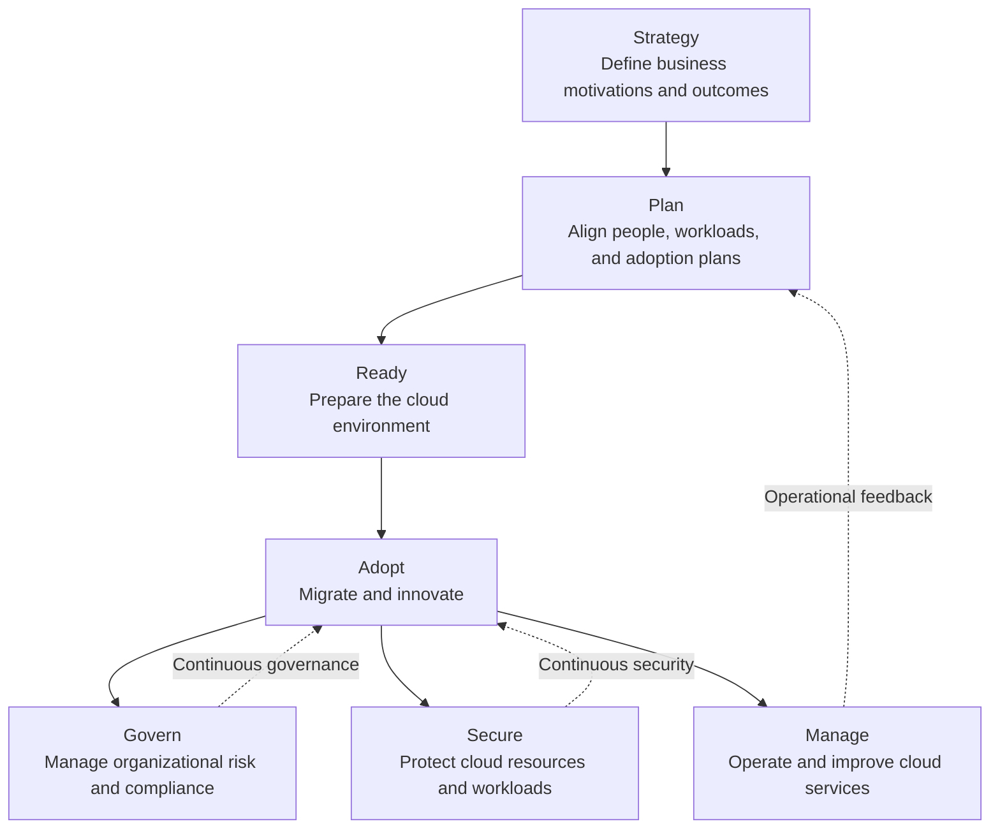

# Cloud Adoption Framework Overview

## 1. Architectural Context

The **Microsoft Cloud Adoption Framework (CAF)** is a collection of guidance, methodologies, and best practices that helps organizations adopt Azure in alignment with business objectives, organizational capabilities, and technical requirements.

For solution architects, CAF provides the strategic and operational context within which Azure architectures are designed, deployed, governed, and improved.

CAF is not an Azure service, a deployment template, or a mandatory sequence of implementation steps. It is a framework for making cloud adoption decisions consistently across workloads, teams, and organizational boundaries.

The framework helps organizations address questions such as:

- What business outcomes should cloud adoption deliver?
- Which workloads should be migrated, modernized, retained, or retired?
- What platform capabilities must exist before workloads are deployed?
- How should security, governance, and operational responsibilities be established?
- How should the organization measure and improve adoption outcomes?

## 2. CAF Methodologies

CAF organizes cloud adoption guidance into seven methodologies. Each addresses a different aspect of the adoption lifecycle.

The diagram represents the relationship between the methodologies, not a rigid sequence. Governance, security, and management must evolve throughout cloud adoption rather than being introduced only after migration.

| Methodology | Architectural purpose | Detailed coverage |
|---|---|---|
| Strategy | Establish business motivations, desired outcomes, and strategic direction | [3.2 CAF Strategy](../CAF%20Strategy/) |
| Plan | Align skills, workload priorities, organizational readiness, and adoption activities | [3.3 CAF Plan](../CAF%20Plan/) |
| Ready | Prepare the Azure environment and foundational platform capabilities | [3.4 CAF Ready](../CAF%20Ready/) |
| Adopt | Execute workload migration and cloud-native innovation | [3.5 CAF Adopt](../CAF%20Adopt/) |
| Govern | Establish controls for risk, compliance, cost, and organizational consistency | [3.6 CAF Govern](../CAF%20Govern/) |
| Secure | Integrate security capabilities and risk management across the cloud environment | [3.7 CAF Secure](../CAF%20Secure/) |
| Manage | Operate workloads, monitor service health, and improve operational outcomes | [3.8 CAF Manage](../CAF%20Manage/) |

## 3. CAF as an Architecture Decision Framework

CAF helps architects connect organizational objectives with the technical and operational decisions required to achieve them.

Consider an enterprise moving several business-critical applications to Azure. The architecture cannot be determined solely by selecting compute, networking, and database services.

The architect must also evaluate:

- Business priorities and acceptable transformation risk.
- Application dependencies and migration constraints.
- Organizational identity and access requirements.
- Platform readiness and subscription boundaries.
- Regulatory obligations and security controls.
- Operational ownership, monitoring, and recovery expectations.

CAF provides the adoption context for these decisions. Detailed technical architectures are then developed using workload requirements, Azure service capabilities, and relevant architectural guidance.

## 4. CAF and Azure Landing Zones

**Azure landing zones** provide the architectural foundation for deploying and operating workloads in Azure at scale.

CAF and Azure landing zones are related but serve different purposes:

| Dimension | Cloud Adoption Framework | Azure landing zones |
|---|---|---|
| Primary purpose | Guide cloud adoption and organizational transformation | Establish a scalable Azure environment for workloads |
| Scope | Strategy, planning, readiness, adoption, governance, security, and management | Identity, resource organization, networking, security, management, and platform capabilities |
| Main question | How should the organization adopt and operate cloud capabilities? | How should the Azure environment be structured and configured? |
| Architectural output | Adoption direction, priorities, operating practices, and governance approach | Platform architecture and workload hosting foundations |

CAF provides the broader adoption guidance. Landing zones translate relevant requirements into an Azure architecture that supports enterprise workloads.

Landing zones are covered in detail in [3.9 Azure Landing Zones](../Azure%20Landing%20Zones/).

## 5. CAF and the Well-Architected Framework

CAF and the Azure Well-Architected Framework (WAF) complement one another but should not be treated as interchangeable.

| Framework | Focus | Typical architectural question |
|---|---|---|
| Cloud Adoption Framework | Enterprise cloud adoption, organizational readiness, governance, and operations | How should the organization establish and evolve its cloud environment? |
| Well-Architected Framework | Workload-level architecture quality | How should this workload balance reliability, security, cost optimization, operational excellence, and performance efficiency? |

For example, CAF may guide an organization toward establishing a standardized Azure platform. WAF can then help evaluate whether an application deployed on that platform meets its reliability, security, cost, operational, and performance requirements.

Refer to [Section 2: Azure Well-Architected Framework](../Azure%20Well-Architected%20Framework/) for workload-level architecture quality.

## 6. Applying CAF in an Enterprise Environment

Consider an organization adopting Azure across development, testing, and production environments.

The organization needs to standardize how teams deploy workloads without preventing teams from meeting application-specific requirements.

CAF informs the broader adoption approach:

1. Establish business objectives and prioritize workloads.
2. Assess organizational readiness, skills, and dependencies.
3. Prepare the Azure platform and landing zone architecture.
4. Adopt workloads through appropriate migration or modernization approaches.
5. Apply governance and security controls across the environment.
6. Establish operational ownership and continuously evaluate outcomes.

These activities may overlap and repeat as new workloads, risks, and requirements emerge.

The resulting architecture should provide consistency where enterprise-wide standards are necessary while preserving flexibility where workload-specific requirements justify different designs.

## 7. Architectural Boundaries

CAF provides guidance for making adoption decisions, but it does not eliminate the need for detailed engineering.

| CAF helps establish | Requires further architecture design |
|---|---|
| Business outcomes and adoption priorities | Workload-specific service selection |
| Organizational governance requirements | Azure Policy definitions and assignment design |
| Cloud readiness objectives | Landing zone implementation and network topology |
| Security and risk management direction | Identity architecture, threat controls, and security configuration |
| Operational requirements | Monitoring architecture, alerting, recovery, and support procedures |
| Migration and modernization direction | Application refactoring, data migration, and deployment design |

Architects should use CAF to understand the context and constraints of a solution, then validate specific designs against Microsoft documentation, workload requirements, service limits, and operational realities.

## 8. Relevance to AZ-305 Solution Architecture

CAF is relevant to AZ-305 because Azure solutions must fit within the organization's broader cloud strategy, governance model, security posture, and operating capabilities.

When evaluating an architecture, consider:

- Whether the proposed solution supports the stated business outcomes.
- Whether the workload fits the organization's landing zone and governance model.
- Whether security and operational requirements are addressed from the beginning.
- Whether the architecture can evolve as adoption priorities change.
- Whether the design introduces unnecessary complexity or conflicts with established platform standards.

The objective is not to implement every CAF recommendation identically in every environment. It is to apply the relevant guidance proportionately to the organization's requirements, risk profile, and operating model.

## Microsoft References

- [Microsoft Cloud Adoption Framework Overview](https://learn.microsoft.com/en-us/azure/cloud-adoption-framework/overview)
- [Cloud Adoption Framework Methodologies](https://learn.microsoft.com/en-us/azure/cloud-adoption-framework/)
- [Azure Landing Zones](https://learn.microsoft.com/en-us/azure/cloud-adoption-framework/ready/landing-zone/)
- [Azure Well-Architected Framework](https://learn.microsoft.com/en-us/azure/well-architected/)
- [Azure Architecture Center](https://learn.microsoft.com/en-us/azure/architecture/)
