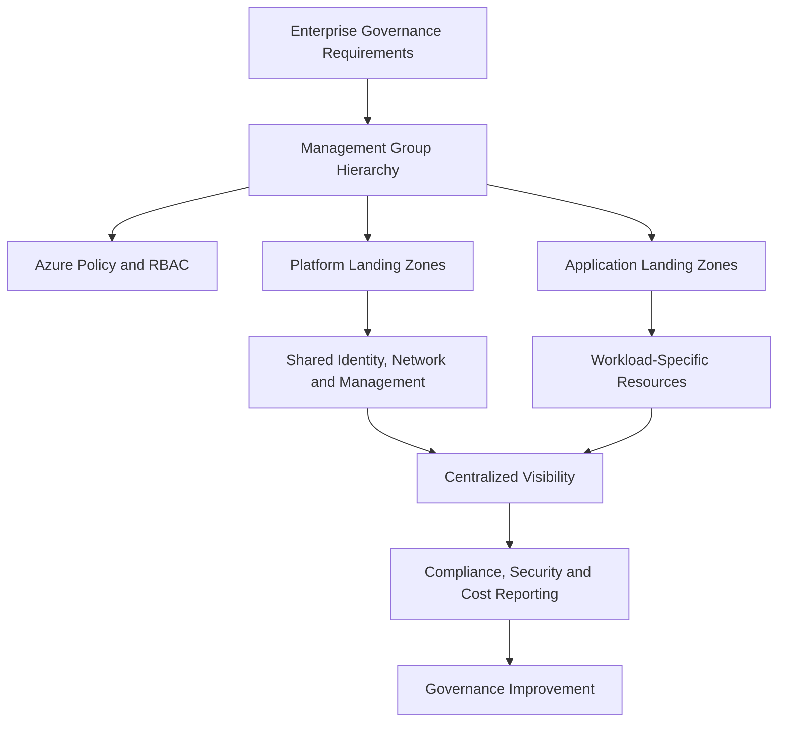
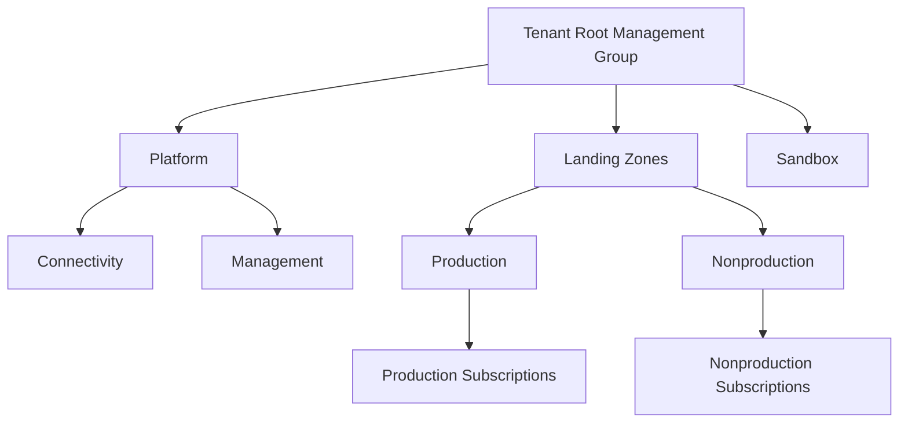
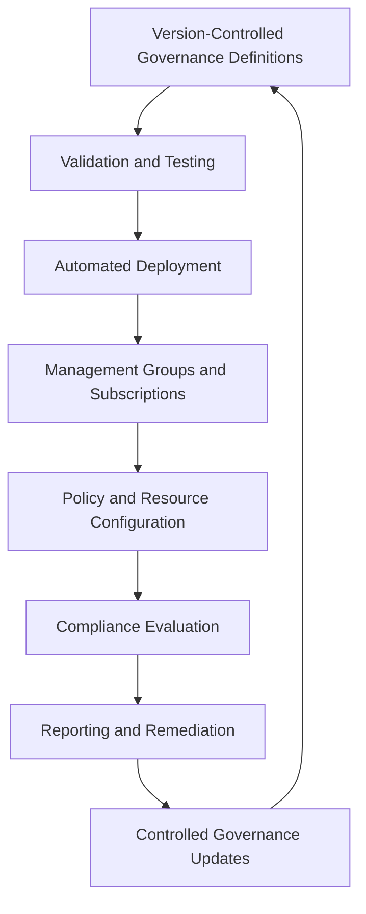
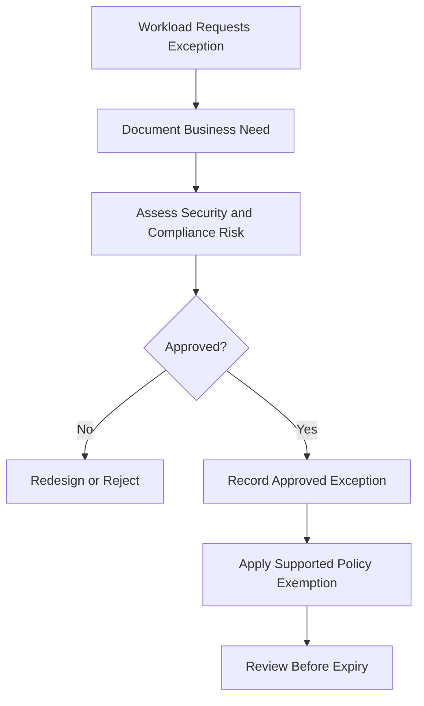

# Governance at Scale

## 1. Governance at Scale Architecture Context

Governance at scale is the ability to maintain consistent security, compliance, operational, and financial controls across a growing Azure environment without requiring every resource to be managed manually.

As an organization expands across subscriptions, business units, application teams, and Azure regions, governance must become repeatable, delegated, measurable, and adaptable.

For a solution architect, the objective is to establish a governance architecture that enables teams to deploy workloads independently while maintaining enterprise-wide standards.

A scalable governance model combines:

- Management groups and subscription hierarchy.
- Azure Policy and policy initiatives.
- Microsoft Entra ID and Azure role-based access control (RBAC).
- Standardized resource naming and tagging.
- Azure landing zones and reusable architecture patterns.
- Infrastructure as code and automated provisioning.
- Centralized monitoring, security visibility, and cost management.
- Controlled exceptions and continuous compliance assessment.

Governance at scale is not achieved by applying every control at the highest scope. It requires choosing the correct control scope, defining ownership, automating repeatable processes, and allowing justified workload-specific differences.

Official references:

- [Cloud Adoption Framework governance](https://learn.microsoft.com/en-us/azure/cloud-adoption-framework/govern/)
- [Azure landing zones](https://learn.microsoft.com/en-us/azure/cloud-adoption-framework/ready/landing-zone/)

## 2. Enterprise Governance Architecture

A scalable Azure governance model separates enterprise-wide controls from platform-level and workload-specific controls.

The diagram represents a conceptual architecture rather than a mandatory Azure hierarchy.

Enterprise controls establish the baseline. Platform teams provide shared services and governance capabilities. Application teams operate within approved boundaries and retain flexibility to meet workload-specific requirements.

The governance model should define which controls are mandatory, which are delegated, and which can be customized by workload owners.

## 3. Establish a Governance Operating Model

Technology alone cannot establish effective governance. A scalable model requires clearly defined responsibilities and decision-making authority.

### 3.1 Governance responsibilities

| Role | Primary responsibility |
|---|---|
| Cloud governance team | Defines enterprise standards, governance policies, and exception procedures |
| Cloud platform team | Operates shared platform services and landing zone capabilities |
| Security team | Defines security requirements, reviews risks, and monitors security posture |
| Application team | Designs, deploys, and operates workload resources within approved boundaries |
| FinOps team | Establishes cost accountability, analyzes spending, and coordinates optimization |
| Compliance team | Maps applicable obligations to controls and evidence requirements |
| Subscription owner | Manages subscription-level responsibilities within delegated authority |

These responsibilities can be combined or distributed differently depending on organizational size and operating model.

### 3.2 Centralized versus delegated governance

A centralized model offers strong consistency but can create bottlenecks when every decision requires approval from a single team.

A fully decentralized model can increase autonomy but may result in inconsistent controls, duplicated platform services, and fragmented cost visibility.

A common enterprise approach is **centralized guardrails with delegated execution**.

Under this model:

- Enterprise teams define mandatory controls.
- Platform teams implement shared capabilities.
- Application teams manage approved workload configurations.
- Automated policy enforcement reduces the need for manual reviews.
- Exceptions follow a documented risk-acceptance process.

The architect should delegate routine decisions while retaining central authority over requirements that affect enterprise security, compliance, or shared infrastructure.

## 4. Scale Governance Through Hierarchy and Inheritance

Management groups provide a way to organize subscriptions into a hierarchy and apply supported governance assignments across multiple subscriptions.

The hierarchy should reflect meaningful governance boundaries rather than mirror every department or application indiscriminately.

### 4.1 Example governance hierarchy

This is an illustrative hierarchy. Organizations may use different arrangements depending on regulatory boundaries, workload types, and delegated administration requirements.

### 4.2 Inheritance considerations

Azure Policy assignments and Azure RBAC role assignments can apply through supported scopes in the hierarchy.

This reduces the need to create identical assignments independently on every subscription.

However, inherited controls can affect a large number of workloads. The organization should test policy changes before applying them broadly, particularly when introducing deny effects or changing existing access assignments.

A scalable hierarchy should:

- Keep parent-level controls limited to genuinely shared requirements.
- Use lower-level scopes for specialized controls.
- Minimize unnecessary duplication.
- Document assignment ownership.
- Review inheritance effects before restructuring management groups.
- Use exemptions only through an approved governance process.

Official references:

- [Management groups](https://learn.microsoft.com/en-us/azure/governance/management-groups/overview)
- [Azure Policy scope](https://learn.microsoft.com/en-us/azure/governance/policy/concepts/scope)
- [Azure RBAC scope](https://learn.microsoft.com/en-us/azure/role-based-access-control/scope-overview)

## 5. Standardize Governance with Azure Policy

Azure Policy provides a mechanism to evaluate resource configurations and enforce supported organizational requirements.

At scale, policy definitions should be reusable, consistently maintained, and assigned at appropriate scopes.

### 5.1 Enterprise policy layers

| Policy layer | Example controls | Typical scope |
|---|---|---|
| Enterprise baseline | Approved regions, required tags, prohibited configurations | Appropriate enterprise or landing zone management groups |
| Platform baseline | Shared networking, monitoring, and platform configuration requirements | Platform management groups or subscriptions |
| Production baseline | Additional workload protection and configuration requirements | Production management groups or subscriptions |
| Workload-specific controls | Application-specific configuration requirements | Relevant subscription, resource group, or supported resource scope |

These layers are conceptual. They should be implemented through policy definitions, initiatives, and assignments appropriate to the actual requirements.

### 5.2 Policy lifecycle

A scalable policy lifecycle includes:

1. Define the business or technical requirement.
2. Select or create an appropriate policy definition.
3. Group related definitions into an initiative when useful.
4. Test the policy against representative resources.
5. Assign it at the appropriate scope.
6. Evaluate compliance and operational impact.
7. Remediate supported violations.
8. Introduce stronger enforcement when appropriate.
9. Review the policy as services and requirements evolve.

Policies should have named owners, documented intent, and a process for testing changes.

A large policy catalog without ownership or lifecycle management becomes difficult to maintain and can create conflicting requirements.

Official references:

- [Azure Policy overview](https://learn.microsoft.com/en-us/azure/governance/policy/overview)
- [Azure Policy initiatives](https://learn.microsoft.com/en-us/azure/governance/policy/concepts/initiative-definition-structure)
- [Azure Policy effects](https://learn.microsoft.com/en-us/azure/governance/policy/concepts/effect-basics)

## 6. Governance Automation and Infrastructure as Code

Manual governance processes become difficult to sustain as the number of subscriptions and workloads increases.

Automation makes governance repeatable and reduces the risk of configuration drift.

### 6.1 Automation opportunities

| Area | Automation approach |
|---|---|
| Subscription provisioning | Standardized subscription vending workflows |
| Resource deployment | Reusable Azure Resource Manager templates, Bicep, or Terraform modules |
| Policy assignments | Version-controlled governance definitions and deployment processes |
| Resource metadata | Automated naming and tagging conventions |
| Access management | Approved role assignments and identity lifecycle processes |
| Compliance validation | Policy compliance reporting and automated review workflows |
| Operational readiness | Deployment validation, monitoring configuration, and operational checks |
| Cost governance | Budgets, cost reports, allocation metadata, and alerting |

The tools selected depend on the enterprise platform and operating model. Azure-native deployment mechanisms and third-party infrastructure-as-code tools can both support scalable governance.

### 6.2 Governance automation architecture

Automation should be designed with appropriate permissions, deployment identities, approval requirements, and auditability.

For critical governance changes, validation should occur before deployment to broad management group scopes.

Infrastructure as code helps establish the desired configuration, while Azure Policy can independently evaluate supported resource requirements. These mechanisms complement each other but are not interchangeable.

## 7. Subscription Provisioning and Lifecycle Governance

As an organization grows, subscriptions must be provisioned and managed consistently.

A subscription provisioning process should establish the correct ownership, hierarchy placement, access model, policy assignments, and operational integration before workloads are deployed.

### 7.1 Subscription vending

A subscription vending process automates the creation and onboarding of subscriptions according to approved enterprise standards.

Depending on the organization, it may include:

- Selecting the appropriate management group.
- Defining subscription ownership and administrative responsibilities.
- Applying required policy and RBAC assignments.
- Configuring connectivity to shared network services.
- Integrating logging, monitoring, and security services.
- Establishing cost ownership and budget reporting.
- Recording subscription purpose, lifecycle, and support information.

The exact onboarding workflow depends on the organization's landing zone architecture and available automation.

### 7.2 Lifecycle controls

Governance must also cover subscription changes and retirement.

Before a subscription is decommissioned, the organization should identify resource dependencies, data retention obligations, backup requirements, access dependencies, and financial reporting needs.

Subscription deletion or cancellation should not be treated as a substitute for a controlled workload retirement process.

Official references:

- [Azure landing zone implementation options](https://learn.microsoft.com/en-us/azure/cloud-adoption-framework/ready/landing-zone/implementation-options)
- [Organize your Azure resources](https://learn.microsoft.com/en-us/azure/cloud-adoption-framework/ready/azure-best-practices/organize-resources)

## 8. Governance Exceptions and Risk Management

Enterprise-wide policies cannot always accommodate every legitimate workload requirement.

An exception process allows justified deviations without abandoning the governance model.

### 8.1 Exception management process

An Azure Policy exemption can document an approved exception to a policy assignment. The organization should also maintain the relevant business justification and approval evidence.

An exemption should identify the affected scope, the requirement being waived, the reason, the responsible owner, and the review or expiration conditions where appropriate.

### Exception governance considerations

- Require a documented business justification.
- Identify the risk owner and required approvals.
- Use the narrowest practical scope.
- Apply expiration or review conditions where appropriate.
- Monitor outstanding exceptions.
- Remove exemptions when the underlying requirement can be met.
- Ensure exceptions do not unintentionally weaken unrelated controls.

Not every exception needs to be handled identically. The approval process should reflect the sensitivity and business impact of the requirement.

Official reference: [Azure Policy exemptions](https://learn.microsoft.com/en-us/azure/governance/policy/concepts/exemption-structure)

## 9. Security Governance at Scale

Security governance must remain consistent as the number of subscriptions, identities, and applications grows.

Azure governance architecture should combine preventive controls, identity management, security monitoring, and operational response.

### Security governance capabilities

| Capability | Architectural role |
|---|---|
| Microsoft Entra ID | Identity, authentication, and identity governance capabilities |
| Azure RBAC | Authorization for Azure resource management |
| Azure Policy | Evaluation and enforcement of supported resource configuration requirements |
| Microsoft Defender for Cloud | Security posture management and supported workload protection capabilities |
| Azure Monitor | Monitoring, logging, and alerting for supported telemetry |
| Azure Key Vault | Managed storage and access control for supported secrets, keys, and certificates |
| Microsoft Sentinel | Security information and event management and security operations capabilities, where deployed |

The architect should not treat these services as substitutes for one another.

For example, Azure Policy can audit or restrict selected configurations, but it does not replace identity authorization or provide a complete security monitoring and incident response capability.

A scalable security architecture should define which responsibilities belong to the central security team and which are delegated to application teams.

Official references:

- [Azure security documentation](https://learn.microsoft.com/en-us/azure/security/)
- [Microsoft Defender for Cloud](https://learn.microsoft.com/en-us/azure/defender-for-cloud/defender-for-cloud-introduction)
- [Azure RBAC overview](https://learn.microsoft.com/en-us/azure/role-based-access-control/overview)

## 10. Cost Governance and Financial Accountability

Governance at scale must provide visibility into expenditure across subscriptions, applications, environments, and shared platform services.

Cost governance combines financial ownership, resource metadata, budgeting, reporting, and optimization practices.

### Design considerations

- Define accountable owners for subscriptions and workloads.
- Use tags and other supported cost-allocation mechanisms.
- Establish budgets and alerts for appropriate scopes.
- Review spending trends and investigate unexpected increases.
- Separate workload expenditure from shared platform expenditure where practical.
- Evaluate resource utilization and service-sizing decisions.
- Document the allocation method for shared services.

Budgets and alerts provide visibility but do not inherently guarantee a spending cap or automatically terminate resources.

Similarly, tags do not ensure complete cost allocation when costs are shared, untagged, or reported differently by individual services.

Official references:

- [Azure Cost Management](https://learn.microsoft.com/en-us/azure/cost-management-billing/costs/overview)
- [Azure Well-Architected Framework: Cost Optimization](https://learn.microsoft.com/en-us/azure/well-architected/cost-optimization/)

## 11. Governance Measurement and Continuous Improvement

A scalable governance program should measure whether its controls achieve their intended outcomes.

Counting policy assignments alone does not demonstrate effective governance. Measurements should show compliance, operational impact, exception levels, ownership, and the effectiveness of remediation.

### 11.1 Example governance metrics

| Metric | What it indicates |
|---|---|
| Policy compliance rate | The proportion of evaluated resources or applicable controls reported as compliant, according to the selected reporting method |
| Critical policy violations | Exposure to specific prohibited or high-risk configurations |
| Outstanding exemptions | The volume and age of approved deviations |
| Untagged resources | Gaps in resource metadata and cost attribution |
| Subscription onboarding time | Efficiency of the provisioning process |
| Remediation duration | Time taken to address selected governance violations |
| Unallocated expenditure | Cost that cannot be reliably attributed to an accountable owner |
| Governance deployment failures | Reliability of automated governance changes |

Metrics require clear definitions. For example, a compliance percentage can be misleading if policies are weighted equally despite having very different security or business importance.

A mature governance process uses these measurements to prioritize improvements, adjust policy design, and remove unnecessary friction from application delivery.

## 12. Enterprise Scenario: Governance Across Multiple Business Units

### Business requirement

A large organization operates multiple Azure subscriptions across finance, retail, and digital services.

Each business unit has its own application teams and release schedules, while the central platform team maintains shared networking, monitoring, and identity integration.

The organization needs consistent security controls and financial visibility without requiring centralized approval for every application deployment.

### Proposed architecture

The architect establishes:

1. A management group hierarchy that reflects meaningful governance boundaries.
2. Enterprise policy initiatives for shared requirements.
3. Additional policies for production and specialized workloads.
4. Delegated RBAC permissions for approved platform and application teams.
5. Standardized resource naming and tagging requirements.
6. Automated subscription provisioning and onboarding.
7. Shared platform capabilities for connectivity and operational visibility.
8. A documented exemption process for justified deviations.
9. Cost reporting aligned with business-unit and workload ownership.
10. Governance metrics and regular policy reviews.

### Architectural outcome

The organization retains centralized control over enterprise-wide requirements while allowing application teams to deploy resources within defined boundaries.

Governance becomes part of the provisioning and deployment process rather than a separate manual review for every resource.

The design remains adaptable because policy definitions, assignments, automation, and exceptions have clear ownership and can evolve as business requirements change.

## 13. Governance at Scale Validation

| Validation area | What to verify |
|---|---|
| Governance hierarchy | Management groups represent meaningful control boundaries |
| Policy architecture | Policies and initiatives have clear scope and ownership |
| Identity and access | Central and delegated permissions are appropriately separated |
| Subscription provisioning | New subscriptions receive the required baseline configuration |
| Automation | Governance deployments are repeatable, tested, and auditable |
| Security integration | Identity, policy, monitoring, and security services work together |
| Exceptions | Deviations are justified, scoped, tracked, and reviewed |
| Cost accountability | Spending can be investigated and attributed using the agreed model |
| Compliance reporting | Metrics reflect the intended scope and control requirements |
| Lifecycle management | Subscription and workload retirement processes account for dependencies |
| Continuous improvement | Governance changes are reviewed using operational evidence |

## Microsoft References

- [Cloud Adoption Framework governance](https://learn.microsoft.com/en-us/azure/cloud-adoption-framework/govern/)
- [Azure landing zones](https://learn.microsoft.com/en-us/azure/cloud-adoption-framework/ready/landing-zone/)
- [Management groups](https://learn.microsoft.com/en-us/azure/governance/management-groups/overview)
- [Azure Policy overview](https://learn.microsoft.com/en-us/azure/governance/policy/overview)
- [Azure Policy initiatives](https://learn.microsoft.com/en-us/azure/governance/policy/concepts/initiative-definition-structure)
- [Azure Policy exemptions](https://learn.microsoft.com/en-us/azure/governance/policy/concepts/exemption-structure)
- [Azure RBAC overview](https://learn.microsoft.com/en-us/azure/role-based-access-control/overview)
- [Azure security documentation](https://learn.microsoft.com/en-us/azure/security/)
- [Azure Cost Management](https://learn.microsoft.com/en-us/azure/cost-management-billing/costs/overview)
- [Azure Well-Architected Framework](https://learn.microsoft.com/en-us/azure/well-architected/)
- [Azure Architecture Center](https://learn.microsoft.com/en-us/azure/architecture/)
