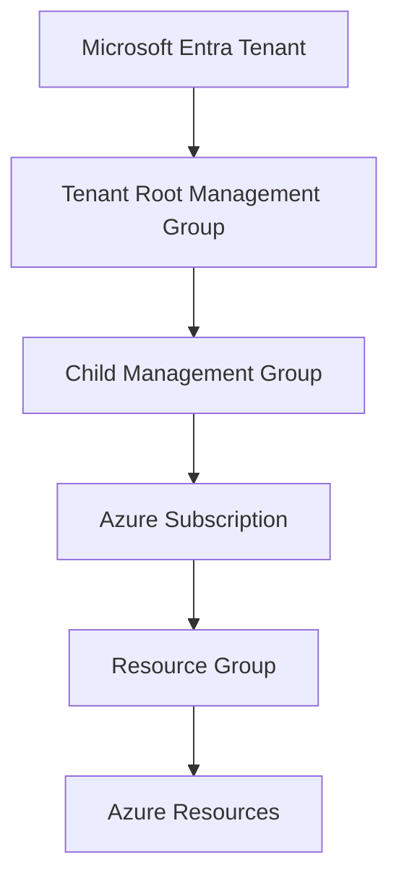
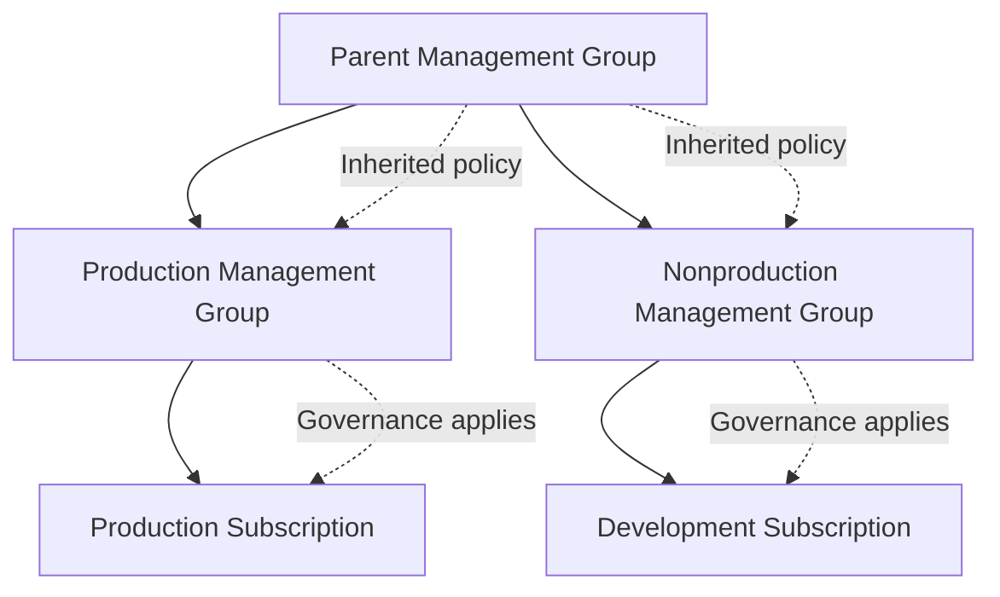
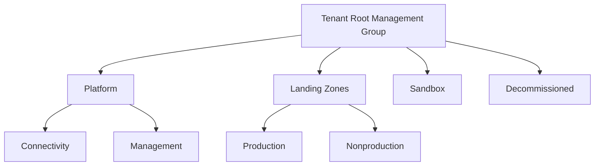

# Management Group Architecture

## 1. Management Group Architecture Context

Azure Management Groups provide a hierarchical governance structure for organizing Azure subscriptions and applying governance controls across an organization.

They allow architects to establish governance boundaries above individual subscriptions, making it possible to manage policy assignments, access permissions, and compliance requirements at an appropriate organizational scope.

In enterprise Azure environments, management groups help align the Azure resource hierarchy with business units, platform responsibilities, regulatory requirements, and workload environments.

A management group does not host application resources directly. Azure resources reside within resource groups in subscriptions, while management groups organize subscriptions and other management groups into a hierarchy.

The primary architectural objective is to establish a hierarchy that supports consistent governance without creating unnecessary administrative complexity.

Official reference: [Azure Management Groups](https://learn.microsoft.com/en-us/azure/governance/management-groups/overview)

## 2. Azure Resource Hierarchy

Azure governance follows a hierarchy that begins with the Microsoft Entra tenant and extends to individual resources.

Each level serves a different purpose:

| Hierarchy level | Architectural purpose |
|---|---|
| Microsoft Entra tenant | Establishes the identity directory and tenant boundary |
| Tenant root management group | Provides the top-level management group scope |
| Child management group | Organizes subscriptions according to governance requirements |
| Subscription | Provides a resource management, access, quota, and billing boundary |
| Resource group | Groups related resources for lifecycle and management purposes |
| Azure resource | Represents an individual service instance, such as a VM, storage account, or virtual network |

The tenant root management group is the top-level management group in the hierarchy. All management groups and subscriptions within that tenant's management group hierarchy ultimately descend from it.

Management group hierarchy is separate from the Microsoft Entra administrative-unit hierarchy. Administrative units delegate certain directory administration tasks; management groups organize Azure resource governance.

## 3. Management Group Inheritance

One of the most important architectural characteristics of management groups is **governance inheritance**.

Azure Policy assignments and Azure role assignments can be applied at supported scopes within the hierarchy. Applicable assignments at a parent management group can affect child management groups and subscriptions, subject to the relevant service's inheritance and scope rules.

For example, an organization can assign a policy at a parent management group to restrict deployments to approved Azure regions. Subscriptions below that management group can inherit the restriction without requiring an identical policy assignment on every subscription.

The diagram is conceptual. Effective policy behavior depends on the policy definition, assignment scope, parameters, exemptions, and applicable evaluation rules.

### 3.1 Inheritance considerations

- Child scopes inherit applicable parent policy assignments unless an applicable exemption or other supported policy behavior changes the outcome.
- Azure RBAC role assignments can grant permissions inherited by supported descendant scopes.
- Additional assignments at lower scopes can provide more specific governance or delegated access.
- A child scope does not automatically cancel a parent policy assignment simply because it has a different local assignment.
- Policy exemptions should be used only through an authorized, documented process.
- Broad permissions at parent scopes can grant extensive access across descendant subscriptions.

**Architecture implication:** Parent management group assignments should contain controls that genuinely apply to all intended descendants. Workload-specific requirements should be placed at more appropriate child scopes.

Official references:

- [Azure Policy scope and assignment](https://learn.microsoft.com/en-us/azure/governance/policy/overview)
- [Azure RBAC scope](https://learn.microsoft.com/en-us/azure/role-based-access-control/scope-overview)

## 4. Designing the Management Group Hierarchy

The hierarchy should reflect governance requirements rather than merely reproduce the organization's reporting structure.

A well-designed hierarchy separates scopes when different policies, permissions, compliance requirements, or operating responsibilities justify that separation.

### 4.1 Common architectural structure

This is an illustrative enterprise pattern, not a mandatory Microsoft hierarchy. Organizations may introduce additional management groups for identity-related platform services, regulated workloads, business units, or other requirements.

The names and depth of management groups should be driven by the policies and access boundaries that need to be applied.

### 4.2 Platform management groups

Platform management groups organize subscriptions that provide shared capabilities, such as network connectivity and management services.

These subscriptions may require specialized governance. For example, a connectivity subscription may have stricter restrictions on who can change network routing or firewall configuration than a general development subscription.

### 4.3 Landing zone management groups

Landing zone management groups organize application subscriptions.

Organizations commonly distinguish production from nonproduction when those environments require different access controls, policies, or operational processes.

Further separation may be justified for regulated workloads or workloads with specific governance requirements. However, every additional management group introduces more hierarchy to understand and maintain.

### 4.4 Sandbox management groups

A sandbox management group can support experimentation while applying appropriate cost, access, and security controls.

Sandbox subscriptions should not be treated as unrestricted environments. Organizations may restrict permitted regions, resource types, spending, public exposure, and access to production resources.

### 4.5 Decommissioned management groups

A decommissioned management group may be used to organize subscriptions undergoing retirement or awaiting final cleanup.

Moving a subscription into such a group does not itself delete resources, terminate every associated charge, remove all access, or guarantee that data has been securely erased.

Retirement requires a separate process covering resource deletion, data retention, dependency removal, identity cleanup, billing verification, and compliance obligations.

Official reference: [Azure landing zone design principles](https://learn.microsoft.com/en-us/azure/cloud-adoption-framework/ready/landing-zone/design-principles)

## 5. Management Groups and Azure Policy

Azure Policy is one of the primary mechanisms for enforcing organizational standards across management group hierarchies.

Policy assignments can be used to evaluate or control supported resource configurations. Depending on the policy definition and effect, this can include auditing resources, denying noncompliant deployments, modifying supported configurations, or deploying required related configurations.

Examples of management group governance include:

| Governance requirement | Example design |
|---|---|
| Region restrictions | Assign a policy that limits resources to approved regions |
| Resource type restrictions | Restrict deployment of unsupported or prohibited resource types |
| Security configuration | Audit or enforce selected security requirements |
| Tagging | Require or inherit selected organizational metadata where supported |
| Diagnostic configuration | Audit or deploy required diagnostic settings where supported |
| Platform protection | Apply platform-specific restrictions to shared-service subscriptions |

### 5.1 Policy inheritance design

A useful strategy is to divide governance into three layers:

1. **Enterprise baseline:** Requirements that apply broadly across the intended Azure estate.
2. **Environment or platform controls:** Additional requirements for production, nonproduction, sandbox, or platform subscriptions.
3. **Workload-specific controls:** Requirements for individual applications or specialized compliance boundaries.

The policy hierarchy should minimize unnecessary duplication while allowing justified differences between environments.

A policy assignment at a parent scope can affect child scopes. Therefore, policies must be tested before being applied broadly, particularly when they use deny effects or remediation tasks.

### 5.2 Policy exemptions

Some workloads may require an approved exception to a governance requirement.

Azure Policy exemptions support documented exceptions within supported scopes. The design should identify the reason for the exception, the approving authority, the applicable scope, and the period or conditions under which it remains valid.

An exemption should not become an informal substitute for correcting a noncompliant architecture.

Official references:

- [Azure Policy overview](https://learn.microsoft.com/en-us/azure/governance/policy/overview)
- [Azure Policy effects](https://learn.microsoft.com/en-us/azure/governance/policy/concepts/effect-basics)
- [Azure Policy exemption structure](https://learn.microsoft.com/en-us/azure/governance/policy/concepts/exemption-structure)

## 6. Management Groups and Azure RBAC

Azure RBAC can be used to delegate administrative responsibilities at suitable scopes.

For example, a platform team may receive permissions over platform subscriptions, while an application team receives permissions limited to its own workload subscription or resource groups.

Role assignments at a management group scope can extend to descendant subscriptions and resources within the supported scope. Such assignments should therefore be made carefully.

### 6.1 Delegated administration model

| Team | Example access boundary |
|---|---|
| Central governance team | Governance management at authorized management group scopes |
| Platform engineering team | Platform subscriptions and approved shared services |
| Network engineering team | Connectivity resources within its assigned scope |
| Application team | Workload resources within assigned subscriptions or resource groups |
| Security operations team | Required security visibility and response permissions |
| Audit team | Read-only access to appropriate governance and compliance information |

This is an example of responsibility separation, not a prescribed role assignment matrix. Actual permissions must match the team's tasks and the minimum required privileges.

### 6.2 Avoiding excessive privilege

Granting a broad administrative role at the tenant root management group can have a much larger impact than assigning a role to one workload subscription.

Before creating a role assignment, the architect should determine:

- Which resources the identity must manage.
- Whether the role is appropriate for those tasks.
- Whether a narrower scope is practical.
- Whether privileged access controls are required.
- How the assignment will be reviewed and removed.

Management groups are governance boundaries, not a reason to grant every administrator tenant-wide resource access.

Official references:

- [Azure RBAC overview](https://learn.microsoft.com/en-us/azure/role-based-access-control/overview)
- [Understand Azure role assignment scope](https://learn.microsoft.com/en-us/azure/role-based-access-control/scope-overview)

## 7. Management Group Design Trade-offs

The architecture must balance governance consistency with hierarchy complexity and operational autonomy.

| Design choice | Benefit | Trade-off |
|---|---|---|
| Shallow hierarchy | Easier to understand and maintain | May provide fewer natural governance boundaries |
| Deep hierarchy | Allows more specialized governance inheritance | Increases complexity and can make effective controls harder to reason about |
| Production/nonproduction separation | Supports different policies and access boundaries | Requires additional policy and subscription management |
| Business-unit separation | Supports organizational delegation | Can duplicate controls or create inconsistent governance if not centrally managed |
| Broad parent-level policies | Promotes consistent enforcement | Can unintentionally restrict workloads that require justified exceptions |
| Narrow child-level policies | Enables workload-specific controls | Can lead to duplication and governance gaps if baseline controls are not centralized |

The objective is not to create the maximum number of management groups. It is to create the smallest clear hierarchy that supports the organization's actual governance and delegation requirements.

## 8. Management Group Lifecycle and Change Control

Management group architecture evolves as organizations add subscriptions, reorganize teams, introduce regulations, or change their platform operating model.

Changes to the hierarchy can affect policy evaluation, inherited permissions, governance reporting, and operational responsibility.

The architecture should define how to:

- Create and retire management groups.
- Register and organize subscriptions.
- Review inherited policy and role assignments.
- Evaluate the impact of moving subscriptions between scopes.
- Validate policy behavior after structural changes.
- Document and approve governance exceptions.
- Audit changes to management group assignments and permissions.

Moving a subscription between management groups can change the effective policies and inherited access applicable to its resources. Such a move should be treated as a governance change, not merely an administrative reorganization.

The organization should validate the destination scope before moving production subscriptions, especially when policies can deny resource operations or change configuration.

## 9. Enterprise Scenario: Production and Nonproduction Governance

### Business requirement

An enterprise operates production applications, development environments, and shared platform services across multiple Azure subscriptions.

Production workloads require stronger change controls and more restrictive access. Development teams need flexibility to test approved Azure services, while central governance teams must enforce enterprise-wide requirements.

### Proposed architecture

The architect establishes:

1. A tenant root management group with controlled administration.
2. A platform management group for shared platform subscriptions.
3. A landing zones management group with production and nonproduction child groups.
4. Enterprise baseline policy assignments at an appropriate parent scope.
5. Additional production controls at the production management group.
6. More permissive but controlled policies for nonproduction.
7. Delegated Azure RBAC assignments aligned with platform and application responsibilities.
8. A documented process for policy exemptions and subscription movement.

### Architecture decisions

**Why separate production and nonproduction management groups?**

The separation is useful when the environments require materially different policy assignments, access controls, or governance processes. If no meaningful differences exist, an additional level may provide little benefit.

**Why not create a management group for every application?**

A dedicated management group is justified when it provides a distinct governance boundary. Applications that can use the same policies and delegation model may be organized through separate subscriptions without requiring separate management groups.

**What happens when a subscription moves to another management group?**

The applicable inherited policies and permissions can change. The architect should assess and test the resulting governance behavior before moving the subscription.

**How should policy exceptions be handled?**

Exceptions should be documented, approved by the appropriate authority, limited to the required scope, and reviewed according to the organization's risk and compliance requirements.

## 10. Management Group Architecture Validation

Before adopting or modifying a hierarchy, validate its governance behavior.

| Validation area | Evidence to evaluate |
|---|---|
| Hierarchy | Every management group and subscription is placed under the intended governance scope |
| Policy inheritance | Required policies apply to the intended descendant scopes |
| Policy enforcement | Deny and other required effects behave as expected |
| RBAC | Administrative permissions follow least-privilege principles |
| Environment separation | Production and nonproduction controls differ where justified |
| Exceptions | Exemptions have documented reasons, approval, and appropriate scope |
| Subscription movement | The impact on inherited controls is understood |
| Operations | Governance ownership and change approval responsibilities are defined |
| Auditability | Governance changes and role assignments can be reviewed through appropriate records |

Testing should include both compliant and noncompliant deployment scenarios. A policy that appears correctly assigned may still have an incorrect scope, parameter, or effect for the intended requirement.

## Microsoft References

- [Azure Management Groups overview](https://learn.microsoft.com/en-us/azure/governance/management-groups/overview)
- [Azure Management Groups documentation](https://learn.microsoft.com/en-us/azure/governance/management-groups/)
- [Azure landing zone design principles](https://learn.microsoft.com/en-us/azure/cloud-adoption-framework/ready/landing-zone/design-principles)
- [Azure Policy overview](https://learn.microsoft.com/en-us/azure/governance/policy/overview)
- [Azure Policy effects](https://learn.microsoft.com/en-us/azure/governance/policy/concepts/effect-basics)
- [Azure Policy exemption structure](https://learn.microsoft.com/en-us/azure/governance/policy/concepts/exemption-structure)
- [Azure RBAC overview](https://learn.microsoft.com/en-us/azure/role-based-access-control/overview)
- [Azure RBAC scope](https://learn.microsoft.com/en-us/azure/role-based-access-control/scope-overview)
- [Azure Architecture Center](https://learn.microsoft.com/en-us/azure/architecture/)
