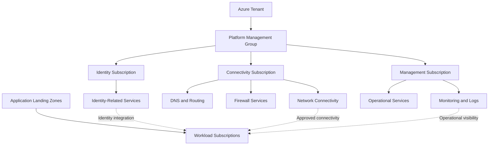
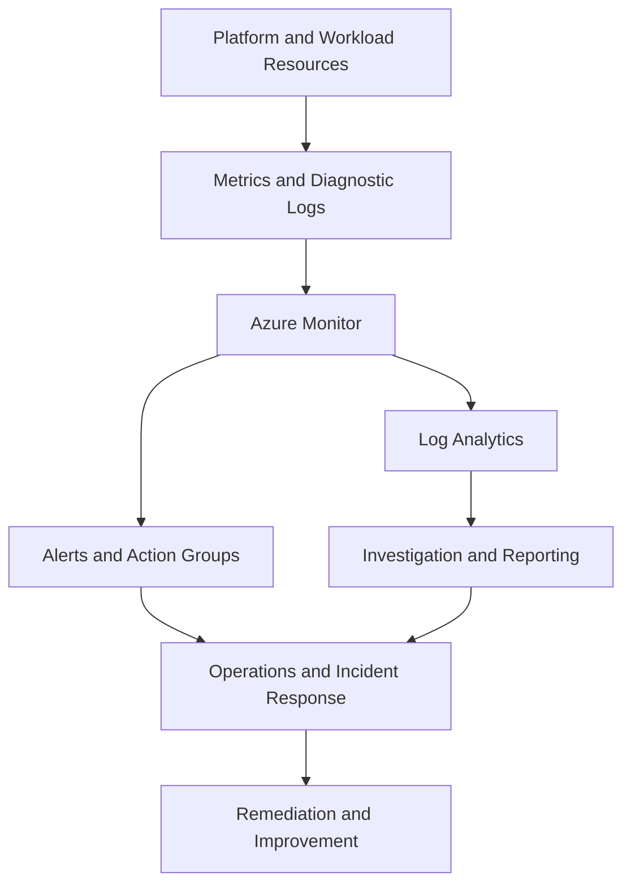

# Platform Landing Zone

## 1. Platform Landing Zone Architecture Context

A **Platform Landing Zone** is the part of an Azure Landing Zone architecture that provides shared services and foundational capabilities for multiple application landing zones.

Its purpose is to establish centrally managed capabilities for identity, connectivity, management, and other enterprise platform requirements. Application teams consume these capabilities instead of independently building every shared service.

The platform landing zone is typically implemented through dedicated Azure subscriptions organized under a platform management group. The exact subscription structure depends on the organization's scale, security requirements, operational ownership, and network architecture.

A platform landing zone should not be confused with an application landing zone:

- **Platform landing zone:** Hosts shared services that support multiple workloads.
- **Application landing zone:** Hosts the resources required by a particular application or workload.

The objective is not to centralize every Azure resource. It is to centralize capabilities when doing so improves governance, consistency, security, or operational efficiency, while preserving appropriate workload autonomy.

## 2. Platform Landing Zone Architecture

A common enterprise implementation separates shared identity, connectivity, and management responsibilities into dedicated subscriptions.



This is a logical reference architecture, not a mandatory deployment template. Not every organization requires a separate identity subscription, and not every identity-related service belongs there. Similarly, the management subscription may contain centralized monitoring capabilities, but workload-specific telemetry and operations can remain within application landing zones.

The design should reflect service ownership and dependency boundaries rather than blindly copying a reference hierarchy.

## 3. Core Platform Landing Zone Components

| Component | Primary responsibility | Architectural consideration |
|---|---|---|
| Identity | Support enterprise identity and access requirements | Separate platform administration from workload access |
| Connectivity | Provide shared network and hybrid connectivity capabilities | Evaluate routing, failure domains, traffic inspection, and regional resilience |
| Management | Support monitoring, inventory, and operational management | Define logging scope, access, retention, and cost ownership |
| Governance | Apply inherited policies and access controls | Align policy scope with organizational boundaries |
| Security integration | Support centralized security monitoring and controls | Define which controls are shared and which remain workload-specific |
| Automation | Provision and update platform resources consistently | Use controlled, versioned deployment processes |
| Cost management | Provide visibility into shared infrastructure expenditure | Establish allocation and chargeback or showback where needed |

These capabilities are interdependent. For example, a centralized firewall affects network routing, availability, operational responsibility, and cost. A centralized Log Analytics workspace affects data access, retention, ingestion cost, and compliance.

Platform architecture decisions should evaluate these interactions before implementation.

## 4. Identity Platform Design

The identity design establishes how administrators, platform engineers, application teams, and workloads authenticate and obtain access.

Microsoft Entra ID provides the tenant-level identity foundation. Azure RBAC controls access to Azure resources, while other identity and security capabilities can strengthen authentication and privileged access.

Important design considerations include:

- Separate platform administration from application administration.
- Assign Azure RBAC roles at the narrowest practical scope.
- Use managed identities for supported workload authentication scenarios.
- Apply multifactor authentication and Conditional Access according to organizational requirements.
- Protect privileged roles through appropriate privileged-access processes.
- Establish emergency access procedures and review administrative permissions.
- Define ownership and lifecycle processes for service principals and other application identities.

A platform landing zone does not require all identity resources to be hosted in an identity subscription. Microsoft Entra ID is a tenant-level service; the subscription structure is primarily an Azure resource and operational boundary.

**Architecture decision:** Centralized identity governance can improve consistency, but excessive privilege at broad scopes can increase the impact of compromised accounts. The architecture must balance central administration with least-privilege access.

Official reference: [Identity and access management design area](https://learn.microsoft.com/en-us/azure/cloud-adoption-framework/ready/landing-zone/design-area/identity-access)

## 5. Connectivity Platform Design

The connectivity platform provides shared network capabilities to application landing zones.

Depending on the organization's requirements, it may support:

- Connectivity between Azure virtual networks.
- Hybrid connectivity to on-premises environments.
- Centralized ingress and egress inspection.
- Shared DNS resolution.
- Routing and network segmentation.
- Connectivity to private Azure services.
- Regional network connectivity and disaster recovery requirements.

Two common architectural approaches are hub-and-spoke networking and Azure Virtual WAN.

### 5.1 Hub-and-spoke architecture

In a hub-and-spoke model, a hub virtual network provides shared connectivity services, while spoke virtual networks host workloads or workload-related services.

This model can be appropriate when the organization needs control over network topology, routing, and shared network appliances.

### 5.2 Azure Virtual WAN

Azure Virtual WAN provides a managed networking service for connecting branch locations, remote users, and Azure virtual networks through a hub-based architecture.

It can be appropriate for geographically distributed organizations with substantial connectivity requirements.

### 5.3 Selecting the topology

| Decision factor | Hub-and-spoke | Azure Virtual WAN |
|---|---|---|
| Network control | More direct control over hub resources and routing design | Uses a managed connectivity architecture |
| Operational model | Requires management of the chosen hub components | Reduces some connectivity-management responsibilities but still requires architecture and operations |
| Scale | Suitable for many enterprise designs when properly engineered | Designed to support large-scale distributed connectivity scenarios |
| Custom requirements | May suit specialized routing and network-appliance designs | Must be evaluated against Virtual WAN capabilities and supported configurations |
| Cost model | Depends on deployed network components and traffic | Depends on Virtual WAN resources, connectivity, and traffic |

Neither option is universally superior. The choice should account for traffic flows, network complexity, required features, operating skills, resilience, and total cost.

Official references:

- [Network topology and connectivity](https://learn.microsoft.com/en-us/azure/cloud-adoption-framework/ready/landing-zone/design-area/network-topology-and-connectivity)
- [Azure Virtual WAN](https://learn.microsoft.com/en-us/azure/virtual-wan/virtual-wan-about)

```markdown
## 6. Centralized DNS and Name Resolution

DNS is a critical shared dependency in enterprise landing zone architectures. Incorrect DNS configuration can disrupt application connectivity even when network routes and security rules are correct.

The platform architecture should define how name resolution works across:

- Azure virtual networks.
- On-premises DNS infrastructure.
- Private endpoints for Azure services.
- Hybrid applications.
- Multiple Azure regions.
- Shared platform and application services.

Azure DNS Private Resolver can support DNS resolution between Azure virtual networks and on-premises environments without requiring organizations to manage DNS forwarding infrastructure on virtual machines.

Azure Private DNS zones are commonly used to resolve private endpoint names and other private DNS records. Their virtual network links, resolution paths, and ownership must be designed carefully.

For private endpoints, creating the endpoint alone does not guarantee successful name resolution. The architecture must also ensure that clients resolve the service hostname to the intended private IP address.

### DNS design considerations

| Requirement | Design consideration |
|---|---|
| Hybrid DNS resolution | Define forwarding rules and resolution paths between Azure and on-premises DNS |
| Private endpoint resolution | Configure the appropriate private DNS zone and record integration |
| Shared DNS services | Determine whether DNS capabilities should be centralized or delegated |
| Regional availability | Evaluate dependencies on regional DNS forwarding and connectivity components |
| Troubleshooting | Establish monitoring and procedures for diagnosing resolution failures |

**Architecture decision:** Centralized DNS can simplify management, but it introduces shared dependencies. DNS forwarding, network connectivity, private zone ownership, and failure recovery must be considered together.

Official references:

- [Azure DNS Private Resolver](https://learn.microsoft.com/en-us/azure/dns/dns-private-resolver-overview)
- [Azure Private Endpoint DNS configuration](https://learn.microsoft.com/en-us/azure/private-link/private-endpoint-dns)

## 7. Management and Monitoring Platform

The management platform provides shared operational capabilities for monitoring, inventory, and maintaining Azure resources.

Depending on organizational requirements, this may include:

- Azure Monitor.
- Log Analytics workspaces.
- Azure Monitor Alerts and action groups.
- Azure Service Health.
- Azure Resource Health.
- Azure Resource Graph.
- Azure Update Manager.
- Operational dashboards and workbooks.

A centralized management subscription can host shared monitoring resources, but centralization should not be treated as an absolute requirement. Some workloads may need separate workspaces because of regulatory boundaries, data access restrictions, retention requirements, or operational ownership.

### 7.1 Monitoring architecture



The diagram represents a conceptual monitoring flow. Individual services have different telemetry capabilities, and diagnostic settings must be configured where supported and required.

### 7.2 Centralized versus distributed logging

| Design | Advantages | Trade-offs |
|---|---|---|
| Centralized workspace | Simplifies cross-resource queries and shared operational visibility | Requires careful access control, data separation, retention design, and ingestion-cost management |
| Separate workspaces | Supports workload isolation, distinct access boundaries, and different retention requirements | Can increase operational complexity and make cross-workload investigation more difficult |
| Hybrid approach | Combines shared operational monitoring with workload-specific boundaries | Requires clear standards for routing, access, and ownership |

The architect should determine which telemetry must be centrally accessible, which teams can query sensitive data, and how retention and ingestion costs will be controlled.

Official references:

- [Azure Monitor overview](https://learn.microsoft.com/en-us/azure/azure-monitor/overview)
- [Log Analytics workspace design](https://learn.microsoft.com/en-us/azure/azure-monitor/logs/workspace-design)

## 8. Security Integration in the Platform

The platform landing zone establishes shared security capabilities and integration points for application landing zones.

Potential capabilities include:

- Microsoft Defender for Cloud.
- Microsoft Sentinel.
- Azure Key Vault.
- Centralized security monitoring.
- Azure Policy security controls.
- Network traffic inspection.
- Security recommendations and compliance reporting.

The selection and deployment of these capabilities should follow the organization's security architecture, threat model, regulatory obligations, and existing security tooling.

### Shared responsibility model

| Responsibility | Platform team | Application team |
|---|---|---|
| Shared network controls | Designs and operates centrally managed controls | Configures workload connectivity according to platform standards |
| Identity governance | Establishes enterprise identity and access standards | Manages approved workload-specific access |
| Security monitoring | Provides shared security integrations where assigned | Enables and investigates workload-specific telemetry |
| Encryption and secrets | Defines platform standards and approved services | Implements application-specific encryption and secret-handling requirements |
| Vulnerability management | Establishes shared processes and visibility | Remediates findings affecting workload resources |
| Incident response | Coordinates platform-level response where applicable | Supports application investigation and remediation |

The exact division of responsibility must be documented. Centralized security tooling does not automatically make the platform team responsible for every workload's security configuration.

Official references:

- [Microsoft Defender for Cloud](https://learn.microsoft.com/en-us/azure/defender-for-cloud/defender-for-cloud-introduction)
- [Microsoft Sentinel](https://learn.microsoft.com/en-us/azure/sentinel/overview)

## 9. Platform Governance and Policy Inheritance

Platform subscriptions commonly inherit governance controls from their parent management groups. They may also receive additional policies tailored to their responsibilities.

For example, a connectivity subscription may require restrictions on which teams can modify routing, firewall configuration, and shared network resources. A management subscription may require additional controls for diagnostic data access and retention.

The governance design should distinguish between:

- Enterprise-wide baseline policies.
- Platform-specific requirements.
- Workload-specific requirements.
- Approved exceptions and exemptions.

Policy assignments should be scoped deliberately. A policy suitable for application workloads may be inappropriate for a shared platform resource, and a platform-specific requirement should not automatically be imposed on every workload unless the requirement justifies that scope.

The architect should also account for policy inheritance, conflicting requirements, remediation permissions, and the operational process for managing exceptions.

Detailed management group architecture and policy design are covered in Sections 3.11 and 3.13.

Official references:

- [Azure management groups](https://learn.microsoft.com/en-us/azure/governance/management-groups/overview)
- [Azure Policy overview](https://learn.microsoft.com/en-us/azure/governance/policy/overview)

## 10. Platform Resilience and Failure Domains

Shared platform services can support many workloads. Their failure may therefore affect multiple applications simultaneously.

A platform landing zone should identify critical shared dependencies and evaluate their availability requirements.

Examples include:

- Shared firewalls and routing components.
- Hybrid connectivity services.
- DNS forwarding infrastructure.
- Centralized monitoring and alerting.
- Shared identity-related dependencies.
- Platform automation and deployment pipelines.

### 10.1 Shared-service failure analysis

| Shared capability | Potential impact | Architectural consideration |
|---|---|---|
| Centralized network appliance | Connectivity disruption for dependent traffic flows | Evaluate supported redundancy, routing behavior, and failure recovery |
| Hybrid connectivity | Loss or degradation of on-premises communication | Assess connection redundancy, regional design, and recovery procedures |
| DNS forwarding | Applications may fail to resolve required names | Design resilient resolution paths and validate recovery behavior |
| Monitoring pipeline | Reduced visibility or delayed incident detection | Establish appropriate alerting, diagnostic retention, and recovery procedures |
| Deployment automation | Delayed platform or workload changes | Protect deployment access and define recovery and manual-contingency procedures |

Not every shared-service failure causes a complete application outage. The actual impact depends on traffic paths, cached information, regional architecture, application dependencies, and available fallback mechanisms.

### 10.2 Resilience design principles

- Identify which workloads depend on each shared service.
- Understand the service's supported availability and redundancy options.
- Avoid unnecessary single points of failure in critical connectivity paths.
- Test failover and recovery procedures rather than relying solely on configuration.
- Define operational ownership and escalation paths.
- Evaluate whether a shared dependency increases the blast radius of a failure.

Detailed disaster recovery and business continuity designs belong in the dedicated continuity section of the AZ-305 repository.

Official reference: [Azure Well-Architected Framework — Reliability](https://learn.microsoft.com/en-us/azure/well-architected/reliability/)

## 11. Platform Automation and Infrastructure as Code

Platform services should be deployed and maintained through controlled, repeatable processes wherever practical.

Infrastructure as Code can manage resources such as virtual networks, policy assignments, monitoring configurations, role assignments, and other supported Azure resources.

The implementation may use Azure-native deployment tools or other supported infrastructure automation platforms according to organizational standards.

The platform engineering process should establish:

1. Version-controlled definitions for platform resources.
2. Review and approval of infrastructure changes.
3. Validation before deployment.
4. Separation of development, testing, and production changes where appropriate.
5. Controlled access to deployment identities and credentials.
6. Monitoring and recovery procedures for failed deployments.
7. Drift detection and reconciliation processes.

A shared platform requires additional care because a change can affect multiple dependent workloads. Changes to routing, policy assignments, DNS, or shared monitoring should include impact analysis and appropriate testing.

This section addresses the architectural role of automation in the platform. Detailed DevOps tools, pipeline implementation, and CI/CD workflows belong in the separate DevOps repository.

Official references:

- [Azure landing zone implementation options](https://learn.microsoft.com/en-us/azure/cloud-adoption-framework/ready/landing-zone/implementation-options)
- [Azure Resource Manager templates](https://learn.microsoft.com/en-us/azure/azure-resource-manager/templates/overview)

## 12. Cost Management for Shared Platform Services

Platform costs may be distributed across many application teams. Without an allocation model, the organization may struggle to understand the cost of shared networking, security, monitoring, and operational services.

The architecture should establish how platform expenditure is measured and attributed.

Common approaches include:

| Approach | Description |
|---|---|
| Central funding | Platform costs are owned by a central infrastructure or cloud platform budget |
| Showback | Workload teams receive visibility into their share of platform costs without direct financial transfer |
| Chargeback | Costs are allocated to business units or application owners |
| Consumption-based allocation | Shared costs are apportioned using measurable consumption, where reliable data is available |

Cost allocation may use subscription ownership, resource tags, consumption metrics, or an agreed allocation model. Some shared costs cannot be attributed precisely to individual workloads, so allocation assumptions should be documented.

Architectural decisions should evaluate both direct resource costs and operational consequences. For example, a centralized network service may reduce duplicated infrastructure while increasing data-processing charges or cross-region traffic costs.

Official reference: [Azure Cost Management and Billing](https://learn.microsoft.com/en-us/azure/cost-management-billing/costs/overview)

## 13. Enterprise Scenario: Shared Platform for Multiple Workloads

### Business requirement

An organization operates production applications in multiple Azure regions. Several application teams need secure connectivity, centralized monitoring, consistent governance, and access to shared platform services.

The platform team is responsible for the shared environment, while application teams manage their own workloads.

### Proposed architecture

The architect establishes:

1. A platform management group with dedicated subscriptions for connectivity and management where justified.
2. Shared network capabilities based on the selected hub-and-spoke or Azure Virtual WAN architecture.
3. Central identity and access governance through Microsoft Entra ID and Azure RBAC.
4. Shared monitoring capabilities with workspace boundaries aligned to security and operational requirements.
5. Inherited Azure Policy assignments for enterprise baseline requirements.
6. Application landing zones with workload-specific resource boundaries.
7. Version-controlled platform configuration and controlled deployment processes.
8. Defined operational ownership for shared services and workload dependencies.

### Key architecture decisions

**Decision 1: Should every workload use the same network hub?**

Not necessarily. The architect must evaluate network isolation, traffic patterns, regional requirements, routing complexity, and failure impact before selecting a shared topology.

**Decision 2: Should every workload send logs to one workspace?**

Not necessarily. Centralized logging can simplify cross-workload investigation, but separate workspaces may be appropriate for distinct regulatory, access, or retention requirements.

**Decision 3: Should every platform resource be managed by one team?**

No. The organization may centralize ownership of shared services while delegating defined operational tasks. Delegation must be supported by appropriate permissions, documented responsibilities, and change controls.

**Decision 4: How should the platform scale?**

The architecture should expand based on new workload requirements, organizational boundaries, regional needs, and operational capacity. New subscriptions or platform components should be introduced when they provide a clear governance, isolation, lifecycle, or operational benefit.

## 14. Platform Landing Zone Validation

Before onboarding production workloads, validate that the platform provides the capabilities promised by its architecture.

| Validation area | Required evidence |
|---|---|
| Identity and access | Platform roles and delegated access are configured and tested |
| Network connectivity | Required traffic flows, DNS resolution, and segmentation work as designed |
| Governance | Inherited policies behave as expected and exceptions follow an approved process |
| Monitoring | Critical platform components have appropriate telemetry and actionable alerts |
| Security | Required security controls and monitoring integrations are verified |
| Resilience | Critical shared dependencies have documented and tested recovery procedures |
| Automation | Platform changes can be deployed through controlled, repeatable processes |
| Cost management | Shared costs have clear ownership and an appropriate allocation approach |
| Operations | Service ownership, incident escalation, and change responsibilities are documented |
| Workload onboarding | Application teams understand platform dependencies and inherited controls |

Validation should include negative tests and failure scenarios. For example, verify that unauthorized users cannot modify shared network resources and that DNS or connectivity recovery procedures work as intended.

The platform should be assessed continuously as new workloads, services, and dependencies are introduced.

## Microsoft References

- [Azure landing zones](https://learn.microsoft.com/en-us/azure/cloud-adoption-framework/ready/landing-zone/)
- [Azure landing zone architecture design areas](https://learn.microsoft.com/en-us/azure/cloud-adoption-framework/ready/landing-zone/architecture-design-areas)
- [Identity and access design area](https://learn.microsoft.com/en-us/azure/cloud-adoption-framework/ready/landing-zone/design-area/identity-access)
- [Network topology and connectivity design area](https://learn.microsoft.com/en-us/azure/cloud-adoption-framework/ready/landing-zone/design-area/network-topology-and-connectivity)
- [Azure management groups](https://learn.microsoft.com/en-us/azure/governance/management-groups/overview)
- [Azure Monitor overview](https://learn.microsoft.com/en-us/azure/azure-monitor/overview)
- [Azure DNS Private Resolver](https://learn.microsoft.com/en-us/azure/dns/dns-private-resolver-overview)
- [Azure Well-Architected Framework](https://learn.microsoft.com/en-us/azure/well-architected/)
- [Azure Architecture Center](https://learn.microsoft.com/en-us/azure/architecture/)
```
