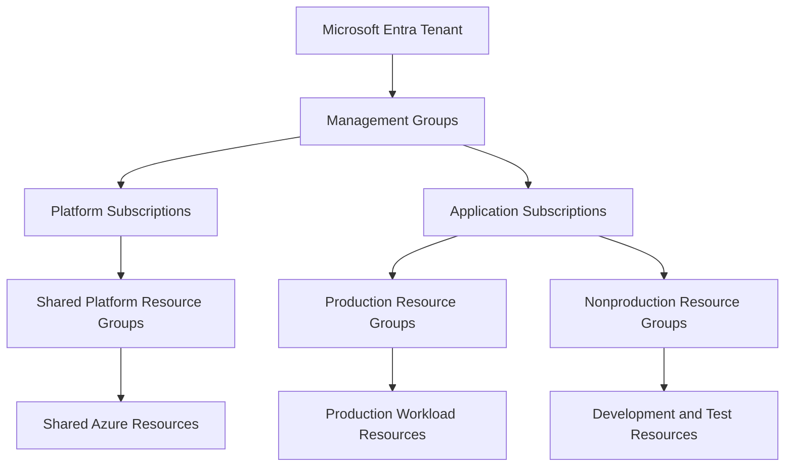
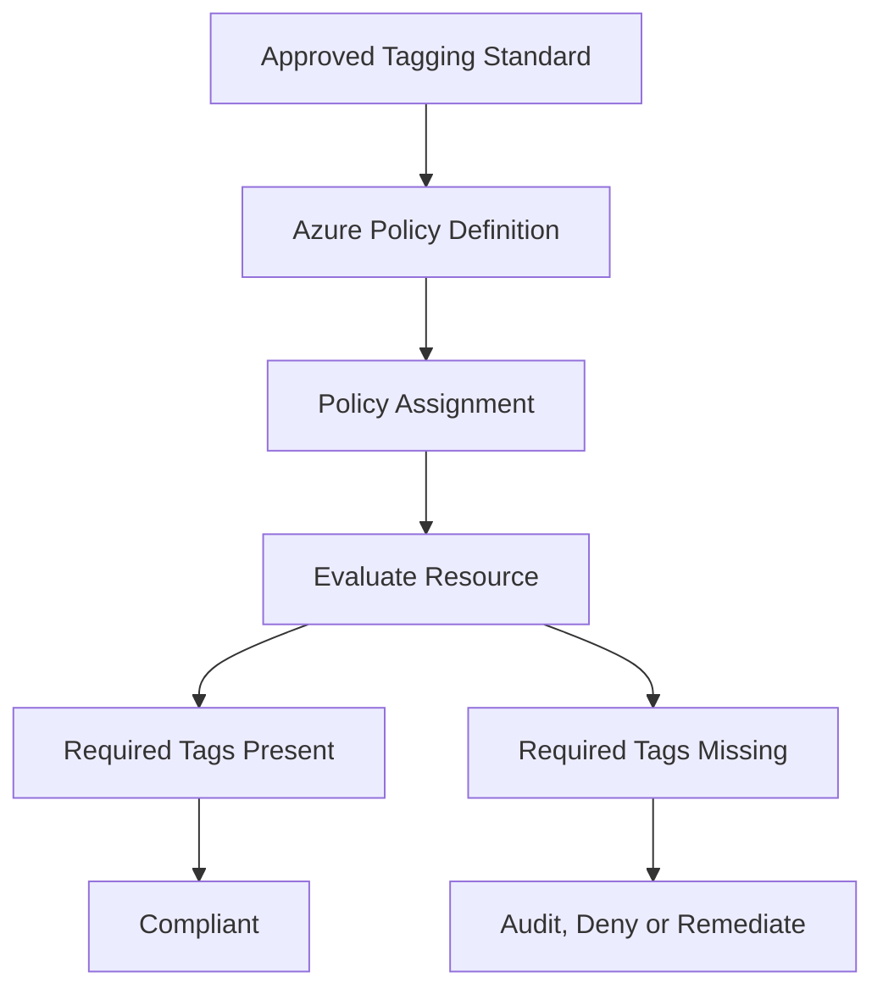
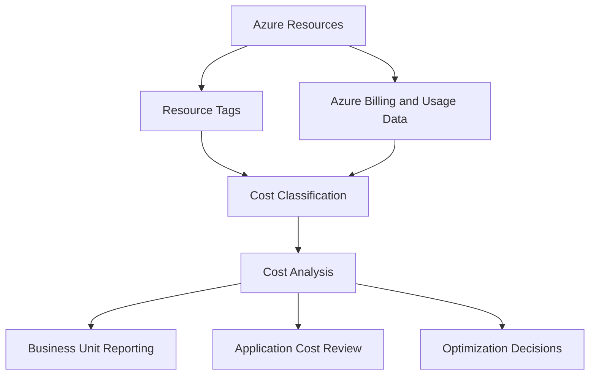

# Resource Organization and Tagging

## 1. Resource Organization Architecture

Azure resource organization defines how cloud resources are grouped, identified, governed, operated, and managed throughout their lifecycle.

For a solution architect, resource organization is not simply a naming exercise. It determines how teams locate resources, how governance controls are applied, how costs are attributed, and how operational responsibilities are assigned.

An effective resource organization strategy combines:

- Management groups for organizing subscriptions and applying governance at scale.
- Subscriptions for resource management, access boundaries, billing, and quota management.
- Resource groups for organizing resources with related lifecycle and management requirements.
- Resource naming conventions for identifying resources consistently.
- Resource tags for classification, ownership, cost allocation, and operational reporting.

These mechanisms serve different purposes. Tags provide metadata, but they do not replace management group hierarchy, Azure RBAC, Azure Policy, or network security controls.

Official reference: [Organize your Azure resources](https://learn.microsoft.com/en-us/azure/cloud-adoption-framework/ready/azure-best-practices/organize-resources)

## 2. Resource Organization Model

A typical enterprise resource organization model separates governance structure from workload resource organization.

This diagram is illustrative. The actual hierarchy should reflect the enterprise's governance requirements, ownership boundaries, and workload lifecycle.

Resource groups should generally contain resources that need to be managed together. Resources in different lifecycle or access boundaries may be better placed in separate resource groups, even when they support the same application.

## 3. Resource Naming Conventions

Azure resource names should be predictable, understandable, and compatible with the naming restrictions of each Azure service.

A consistent naming convention helps teams identify resource purpose, environment, ownership, and location without relying entirely on tags or external documentation.

### 3.1 Example naming structure

An organization might adopt the following logical pattern:

`<organization>-<workload>-<environment>-<region>-<instance>`

Example:

`contoso-payments-prod-eus-001`

This is an illustrative convention, not a universal Azure naming standard.

| Component | Example | Purpose |
|---|---|---|
| Organization | `contoso` | Identifies the organization or business context |
| Workload | `payments` | Identifies the application or workload |
| Environment | `prod` | Identifies the deployment environment |
| Region | `eus` | Represents an approved regional abbreviation |
| Instance | `001` | Distinguishes multiple resources of a similar type |

The organization may also include resource type identifiers where they improve readability, provided the complete name remains within the relevant service's naming restrictions.

### 3.2 Naming design considerations

- Check the naming rules for each resource type before finalizing the convention.
- Account for resource-specific length limits and allowed characters.
- Recognize that some resource names must be globally unique, while others are unique only within a particular scope.
- Avoid embedding sensitive information, personal data, or confidential business details in resource names.
- Avoid names that become misleading after application ownership or architecture changes.
- Keep naming rules simple enough for teams to apply consistently.
- Automate naming validation where appropriate.

Not every Azure resource supports the same naming format. Storage accounts, for example, have stricter naming requirements than many resource groups.

Official reference: [Define your naming convention](https://learn.microsoft.com/en-us/azure/cloud-adoption-framework/ready/azure-best-practices/resource-naming)

## 4. Azure Resource Tags

Azure resource tags are metadata represented as name-value pairs.

Tags can help classify resources and support reporting, cost allocation, operational ownership, and governance.

Example:

| Tag name | Example value | Purpose |
|---|---|---|
| `Environment` | `Production` | Identifies the deployment environment |
| `Application` | `Payments` | Identifies the application |
| `BusinessUnit` | `Finance` | Supports organizational reporting |
| `CostCenter` | `CC-1042` | Supports internal cost allocation |
| `Owner` | `platform-team` | Identifies the responsible team |
| `Criticality` | `High` | Communicates business importance |
| `DataClassification` | `Confidential` | Classifies the resource or workload |
| `ManagedBy` | `Terraform` | Records the intended management method |

These values are examples. Organizations should define their own approved tag vocabulary, ownership model, and data classification standards.

### Tagging considerations

- Use consistent tag names and value formats.
- Define which tags are mandatory for each resource category.
- Avoid placing secrets, credentials, or sensitive personal information in tags.
- Decide whether tag values should be standardized, such as using `Production` rather than mixing `prod`, `Prod`, and `production`.
- Establish an owner for the tagging standard.
- Avoid collecting tags that have no clear reporting, governance, or operational purpose.

Tags are not a security boundary. A tag such as `DataClassification=Confidential` does not automatically encrypt data, restrict access, or prevent public exposure.

Official reference: [Use tags to organize your Azure resources](https://learn.microsoft.com/en-us/azure/azure-resource-manager/management/tag-resources)

## 5. Designing an Enterprise Tagging Strategy

A tagging strategy should be designed around specific business and operational requirements rather than adding arbitrary metadata to every resource.

### 5.1 Define mandatory and optional tags

A practical strategy distinguishes between tags that are mandatory for organizational reporting and tags that are useful only for selected workloads.

| Tag category | Example | Intended outcome |
|---|---|---|
| Financial | `CostCenter` | Attribute expenditure to an accountable business unit |
| Ownership | `Owner` | Identify the team responsible for a resource |
| Application | `Application` | Group resources that support a workload |
| Environment | `Environment` | Distinguish production and nonproduction resources |
| Operations | `ManagedBy` | Identify the management or deployment approach |
| Classification | `DataClassification` | Record an approved classification label |
| Lifecycle | `Lifecycle` | Identify temporary, active, or decommissioning resources |

The organization should decide which tags are mandatory at the resource level and which are relevant only to particular resource types.

### 5.2 Define tag ownership

Tag governance should identify who creates, maintains, and validates each category of metadata.

For example:

- The finance team defines cost center identifiers.
- Application teams maintain workload ownership information.
- The cloud platform team defines naming and tagging standards.
- Governance administrators enforce mandatory tag requirements.
- FinOps teams use suitable billing and cost-management data to analyze expenditure.

Tag values should have a clear source of truth. Without ownership, tags become inconsistent and unreliable for reporting.

## 6. Enforcing Tagging Standards with Azure Policy

Azure Policy can evaluate resource tags and enforce supported tagging requirements.

Common patterns include:

- Auditing resources that are missing required tags.
- Denying applicable resource creation requests when mandatory tags are absent.
- Inheriting selected tag values from a resource group through supported policy effects.
- Applying or correcting supported tag configurations through `Modify` policies and remediation tasks.

The appropriate approach depends on the resource type, policy effect, deployment behavior, and whether existing resources need remediation.

### 6.1 Tag enforcement architecture

### 6.2 Audit versus deny

An audit policy identifies resources that do not satisfy the tagging requirement without blocking their creation.

A deny policy can prevent applicable requests from creating or updating resources that violate the requirement.

A common enterprise approach is to audit existing environments, correct missing metadata, and then introduce deny controls where mandatory tags can be reliably supplied by deployment workflows.

### 6.3 Inheriting tags

Azure Policy can be used to apply selected resource group tags to supported resources through appropriate policy definitions and effects.

However, tag inheritance should not be assumed to be automatic for every Azure resource.

The architect should verify:

- Whether the resource type supports the required tagging behavior.
- Whether the selected policy effect supports the operation.
- Whether existing resources require a remediation task.
- Whether resource-specific behavior could overwrite or conflict with inherited values.

For example, a resource group may contain `Environment=Production`, and a policy can be configured to propagate that tag to supported resources. If an individual resource needs a different environment classification, the policy design must account for that difference rather than blindly overwriting it.

Official references:

- [Azure Policy overview](https://learn.microsoft.com/en-us/azure/governance/policy/overview)
- [Apply tags through Azure Policy](https://learn.microsoft.com/en-us/azure/azure-resource-manager/management/tag-policies)

## 7. Resource Group Design and Lifecycle

Resource groups provide a logical container for Azure resources. Their design should reflect lifecycle, operational management, and access requirements.

A resource group is not merely a folder for resources with similar names.

### Resource group design principles

- Group resources that share a meaningful management or lifecycle boundary.
- Consider whether resources should be deployed, updated, or removed together.
- Separate components when their ownership, access requirements, or operational lifecycles differ.
- Avoid creating excessively large resource groups that make ownership and operational changes difficult.
- Avoid creating unnecessary resource groups that add management overhead without a clear benefit.
- Consider deployment dependencies before placing tightly coupled resources in separate lifecycle boundaries.

Deleting a resource group can delete the resources it contains. Resource group design must therefore account for resource dependencies, retention requirements, and deletion risk.

For example, an application may use an application service, monitoring resources, and supporting components. If a shared Log Analytics workspace serves many applications, placing that workspace in a workload resource group could create an unintended deletion or lifecycle dependency.

### Example resource group structure

| Resource group | Purpose |
|---|---|
| `rg-payments-prod-app` | Production application components |
| `rg-payments-prod-data` | Workload-specific data resources |
| `rg-payments-prod-monitoring` | Monitoring components dedicated to the workload |
| `rg-platform-monitoring` | Shared monitoring resources managed by the platform team |

The structure is illustrative. Separate resource groups should be introduced where lifecycle, ownership, or governance needs justify them.

## 8. Resource Tags and Cost Management

Tags can help organizations attribute Azure expenditure to applications, teams, business units, or cost centers.

However, tags alone do not guarantee complete or accurate cost allocation.

Some Azure costs are associated with shared services, and not every charge can be attributed directly to a single tagged resource. Cost-management reports can also have service-specific tagging and billing behaviors.

### 8.1 Cost allocation architecture

### 8.2 Cost allocation considerations

- Define approved cost center values with the finance team.
- Apply relevant tags consistently to supported resources.
- Use Azure Cost Management reports to review costs and investigate allocation gaps.
- Account for shared networking, monitoring, security, and platform services.
- Use appropriate allocation rules or documented allocation methods for shared costs.
- Review untagged expenditure and inconsistent tag values regularly.

A budget alert can notify stakeholders about spending thresholds, but a budget does not automatically stop resource consumption.

For governance and reporting, tagging should be integrated with billing analysis and financial ownership processes rather than treated as a complete cost-management solution.

Official reference: [Organize and allocate costs using tags](https://learn.microsoft.com/en-us/azure/cost-management-billing/costs/enable-tag-inheritance)

## 9. Tagging at Scale Across Subscriptions

In a large Azure environment, teams may create resources across multiple subscriptions and deployment pipelines.

The tagging architecture must support consistency without making every workload follow an unnecessarily rigid metadata model.

### Recommended architecture

1. Define enterprise-wide mandatory tags.
2. Define workload-specific tags where justified.
3. Establish approved names, values, and ownership.
4. Apply common requirements through Azure Policy at suitable scopes.
5. Use deployment templates or infrastructure-as-code modules to supply standard tags.
6. Audit existing resources and address missing or invalid values.
7. Review exceptions and update the standard as requirements change.

Management groups can provide suitable scopes for policy assignments, while subscriptions and resource groups can support more specific requirements.

The tagging strategy should also account for inheritance and policy interactions. A child-scope policy should not unintentionally conflict with a parent-scope requirement.

Official references:

- [Azure Policy scope](https://learn.microsoft.com/en-us/azure/governance/policy/concepts/scope)
- [Azure Policy effects](https://learn.microsoft.com/en-us/azure/governance/policy/concepts/effect-basics)

## 10. Resource Organization in Infrastructure as Code

Infrastructure as code can make resource naming, tagging, and resource organization more consistent across deployments.

Azure Resource Manager templates, Bicep, and Terraform can all support repeatable resource provisioning and the application of agreed naming and tagging conventions.

The exact implementation depends on the chosen tool and module structure.

### Architecture considerations

- Define naming and tagging requirements in reusable deployment modules.
- Supply environment and workload metadata through validated parameters.
- Avoid hardcoding values that should differ between environments.
- Keep sensitive values out of resource names, tags, and source-controlled configuration.
- Validate mandatory tags before deployment where practical.
- Use Azure Policy as an independent governance layer rather than relying exclusively on deployment templates.
- Plan how existing resources will be brought into compliance when standards change.

Infrastructure as code improves consistency, but it does not guarantee that every resource in the environment complies with the standard. Resources can be created through other deployment mechanisms, and policies may need to evaluate existing resources separately.

## 11. Enterprise Scenario: Organizing a Multi-Environment Application

### Business requirement

An enterprise runs a payments application in production and nonproduction environments. Several teams manage the application, database, networking, and monitoring components.

The organization needs consistent resource identification, clear operational ownership, and reliable cost allocation.

### Proposed design

The architect establishes:

- Separate production and nonproduction deployment boundaries where required by the application's governance and access model.
- Resource groups organized around workload components and lifecycle.
- Naming conventions that identify workload, environment, region, and instance.
- Mandatory tags for application, environment, owner, and cost center.
- Azure Policy assignments to audit and, where appropriate, enforce required tags.
- Reusable infrastructure-as-code modules to apply naming and metadata standards.
- Cost-management reporting to identify unallocated or incorrectly classified expenditure.
- An exception process for resources that cannot meet a standard immediately.

### Example resource metadata

| Resource | Environment | Application | Owner | Cost center |
|---|---|---|---|---|
| Application service | Production | Payments | Payments team | CC-1042 |
| Database | Production | Payments | Data platform team | CC-1042 |
| Application service | Nonproduction | Payments | Payments team | CC-1042 |
| Shared monitoring workspace | Shared | Platform monitoring | Cloud platform team | CC-1001 |

These values illustrate how resource metadata can support reporting. Shared resources should be allocated according to an agreed financial model rather than automatically charged to one application.

### Architecture decision

The architect should choose the resource organization model based on lifecycle, security, ownership, and reporting requirements—not simply to maximize the number of resource groups or tags.

A well-designed model provides enough structure for governance and operations while remaining practical for application teams and automated deployment workflows.

## 12. Resource Organization Validation

| Validation area | What to verify |
|---|---|
| Naming | Names comply with service-specific rules and the organizational convention |
| Resource groups | Resources are grouped according to lifecycle, ownership, and management requirements |
| Tag schema | Mandatory tags have defined names, values, and owners |
| Tag enforcement | Azure Policy evaluates the intended requirements at the correct scopes |
| Inheritance | Tag propagation works as expected for supported resources |
| Cost allocation | Billing reports reflect the intended allocation model and identify gaps |
| Infrastructure as code | Templates and modules apply consistent naming and metadata |
| Security | Names and tags do not expose secrets or sensitive information |
| Lifecycle | Resource group deletion and resource retirement processes account for dependencies |
| Exceptions | Deviations from the organizational standard are documented and reviewed |

## Microsoft References

- [Organize your Azure resources](https://learn.microsoft.com/en-us/azure/cloud-adoption-framework/ready/azure-best-practices/organize-resources)
- [Define your naming convention](https://learn.microsoft.com/en-us/azure/cloud-adoption-framework/ready/azure-best-practices/resource-naming)
- [Use tags to organize your Azure resources](https://learn.microsoft.com/en-us/azure/azure-resource-manager/management/tag-resources)
- [Apply tags through Azure Policy](https://learn.microsoft.com/en-us/azure/azure-resource-manager/management/tag-policies)
- [Azure Policy overview](https://learn.microsoft.com/en-us/azure/governance/policy/overview)
- [Azure Policy effects](https://learn.microsoft.com/en-us/azure/governance/policy/concepts/effect-basics)
- [Azure Cost Management and billing](https://learn.microsoft.com/en-us/azure/cost-management-billing/costs/overview)
- [Organize and allocate costs using tags](https://learn.microsoft.com/en-us/azure/cost-management-billing/costs/enable-tag-inheritance)
- [Azure Architecture Center](https://learn.microsoft.com/en-us/azure/architecture/)
