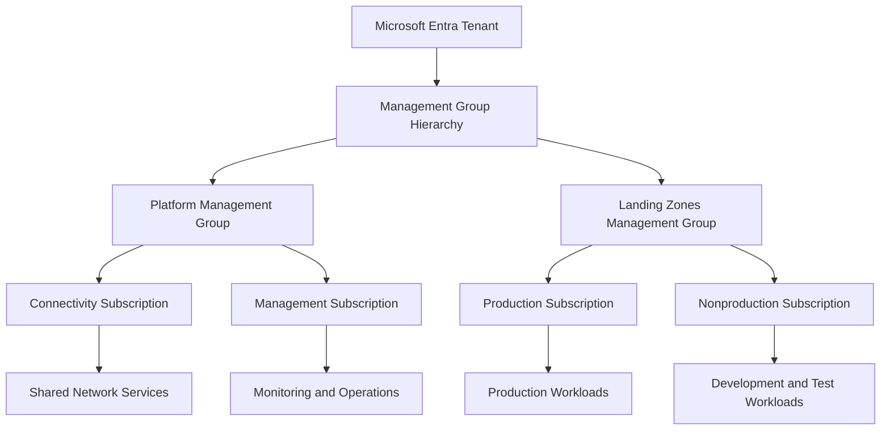
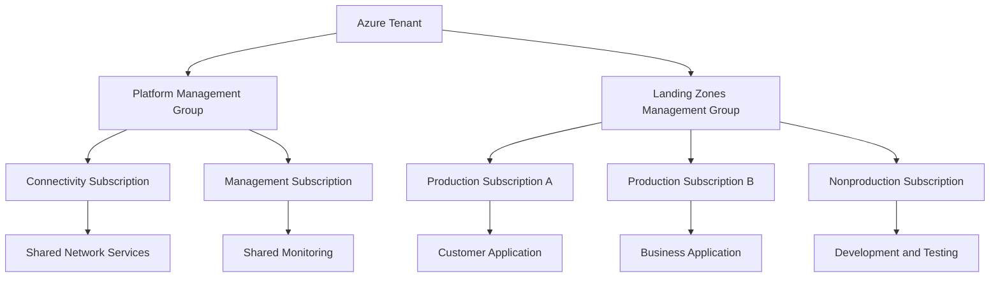
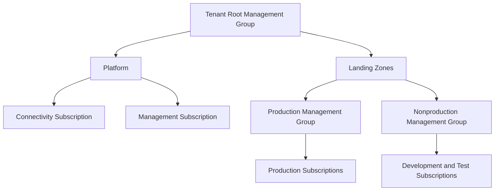

# Subscription Strategy

## 1. Azure Subscription Strategy Architecture Context

An **Azure Subscription Strategy** defines how an organization divides, organizes, governs, and manages its Azure resources across subscriptions.

An Azure subscription is a fundamental boundary for resource management, access control, quotas, billing, and governance. It provides a scope within which Azure resources are deployed and managed, while allowing organizations to separate workloads according to business, security, operational, and financial requirements.

For a solution architect, subscription design is not simply a decision about how many subscriptions to create. It determines how workloads are isolated, how teams receive permissions, how costs are attributed, how policies are applied, and how resource limits are managed.

A well-designed strategy balances isolation and governance with operational simplicity.

## 2. Azure Subscription Architecture

Subscriptions operate within a Microsoft Entra tenant and can be organized through management groups.

This is an illustrative enterprise structure rather than a mandatory subscription layout. An organization may require additional subscriptions for regulatory boundaries, business units, specialized workloads, or distinct operational responsibilities.

The management group hierarchy defines governance organization, while subscriptions provide resource management and other boundaries. These are complementary architectural mechanisms.

## 3. Understand the Azure Subscription Boundary

A subscription has several important characteristics.

| Boundary | Architectural significance |
|---|---|
| Resource management | Groups Azure resources under a subscription |
| Access control | Supports Azure RBAC assignments at subscription scope |
| Billing | Provides a scope for cost visibility and applicable billing arrangements |
| Quotas and limits | Applies subscription-level quotas and limits for relevant Azure services |
| Governance | Receives applicable management group and subscription-level policy assignments |
| Resource organization | Allows resources to be organized into resource groups |
| Operational ownership | Can align with a workload, platform capability, or organizational team |

A subscription is not a physical isolation boundary by itself. Workloads in separate subscriptions may still share network connectivity, identities, DNS, monitoring services, or other dependencies.

Likewise, placing multiple workloads in separate resource groups within the same subscription does not provide the same administrative boundary as using separate subscriptions.

The architect must identify which form of separation the requirements actually demand.

## 4. Factors That Drive Subscription Design

Subscription boundaries should be selected according to meaningful differences in workload requirements.

### 4.1 Environment separation

Production and nonproduction environments may require different access permissions, policies, change controls, and cost management processes.

Separate subscriptions can strengthen these boundaries, especially when the organization needs distinct administrative responsibilities or governance configurations.

However, separate subscriptions are not mandatory for every development, testing, and production environment. The design should be proportionate to the risk and operational requirements.

### 4.2 Business and application ownership

Different departments or application teams may need independent resource administration, cost visibility, or lifecycle management.

A subscription boundary can help separate responsibilities when the organizational model requires it.

### 4.3 Security and regulatory requirements

Sensitive workloads may require stricter administrative access, different policy assignments, specific deployment restrictions, or independent operational controls.

Subscription separation can support these requirements, but it does not automatically satisfy compliance obligations. Additional identity, network, data-protection, monitoring, and operational controls may be necessary.

### 4.4 Quotas and service limits

Azure services have different quotas and limits, some of which are scoped to a subscription, region, resource provider, or other boundary.

A subscription strategy should account for expected resource consumption and growth. Creating additional subscriptions can help when the relevant limit is subscription-scoped, but it does not resolve limits that apply at another scope.

### 4.5 Cost accountability

Separate subscriptions can simplify reporting for business units, applications, or environments.

However, subscription boundaries do not guarantee complete cost separation when workloads consume shared services such as centralized networking, security, or monitoring.

### 4.6 Lifecycle and operational responsibility

A subscription may be appropriate for a workload that has a distinct lifecycle, ownership model, or retirement process.

The design should avoid combining unrelated workloads when their operational responsibilities or risk profiles require independent control.

## 5. Common Subscription Strategies

| Strategy | Description | Suitable when |
|---|---|---|
| Environment-based | Separate production, development, and test environments | Environments have different access or governance requirements |
| Application-based | Allocate subscriptions to individual applications or workload groups | Applications require independent lifecycle, isolation, or ownership |
| Business-unit-based | Separate subscriptions by department or business function | Teams require delegated administration and cost accountability |
| Platform-based | Use dedicated subscriptions for shared platform capabilities | Shared infrastructure has distinct ownership and operational requirements |
| Compliance-based | Separate workloads according to regulatory or security boundaries | Requirements justify different controls and administration |
| Hybrid strategy | Combine multiple dimensions where necessary | Enterprise requirements cannot be met cleanly with one organizing principle |

These strategies are not mutually exclusive. A large organization may use platform-based subscriptions, separate production from nonproduction, and introduce additional boundaries for selected regulated workloads.

The hierarchy should remain understandable and should not introduce subscription boundaries without a clear reason.

## 6. Platform and Application Subscription Design

A common enterprise approach separates subscriptions that host shared platform services from those that host business workloads.

### 6.1 Platform subscriptions

Platform subscriptions can host shared services such as:

- Network connectivity and routing.
- Centralized monitoring and operational capabilities.
- Shared security services.
- Other centrally operated infrastructure.

Separate platform subscriptions should be created when the capabilities have distinct governance, ownership, security, or operational requirements.

### 6.2 Application subscriptions

Application subscriptions host workload-specific resources such as:

- Application compute and hosting services.
- Workload databases and storage.
- Application-specific networking components.
- Application monitoring and diagnostics.
- Supporting integration services.

The application team may receive delegated permissions within its subscription while enterprise controls are inherited from the relevant management groups.

### 6.3 Example architecture

This structure separates shared platform responsibilities from workload ownership. The number of subscriptions should reflect actual isolation, lifecycle, governance, and operational requirements rather than the size of the diagram.

## 7. Subscription Strategy and Management Groups

Management groups and subscriptions solve different architectural problems.

- **Management groups** organize subscriptions into a governance hierarchy.
- **Subscriptions** provide resource management, access, quota, and billing boundaries.

Management groups allow common policies and permissions to be assigned at appropriate parent scopes. Subscriptions beneath those scopes inherit applicable controls.

For example, a production management group can apply additional restrictions to production subscriptions while a broader parent management group enforces enterprise-wide requirements.

A management group should be introduced when it provides a useful governance or delegation boundary. Creating a management group for every subscription is not necessary.

Detailed management group architecture is covered in Section 3.11.

Official reference: [Azure management groups](https://learn.microsoft.com/en-us/azure/governance/management-groups/overview)

## 8. Subscription Access and Administrative Boundaries

Subscription strategy must define how access is delegated and how administrative privileges are controlled.

Azure RBAC supports role assignments at subscription scope and other supported resource hierarchy scopes.

A subscription can provide an appropriate boundary for delegating workload administration without granting the application team broad permissions over unrelated subscriptions.

### Design considerations

- Use least-privilege role assignments.
- Separate platform administration from application administration.
- Restrict privileged access to authorized identities.
- Define how workload identities authenticate and access resources.
- Review inherited role assignments from management group scopes.
- Establish processes for onboarding and offboarding teams.
- Document emergency access and operational responsibilities.

A subscription boundary does not automatically prevent communication with resources in another subscription. Network security, identity authorization, and service-specific access controls must enforce the required isolation.

Official references:

- [Azure RBAC overview](https://learn.microsoft.com/en-us/azure/role-based-access-control/overview)
- [Azure RBAC scope](https://learn.microsoft.com/en-us/azure/role-based-access-control/scope-overview)

## 9. Subscription Quotas, Limits, and Growth Planning

Azure services have quotas and limits that can affect architecture and deployment capacity.

Before selecting subscription boundaries, the architect should identify relevant limits for the planned services and estimate future resource consumption.

Examples include:

- Virtual machine vCPU quotas.
- Regional resource capacity constraints.
- Networking and public IP address limits.
- Service-specific deployment limits.
- Subscription-level restrictions applicable to particular resource types.

The precise quota scope varies by service and resource type. A limit may apply per subscription, per region, or at another scope, so the relevant service documentation must be consulted.

### Growth planning approach

1. Estimate current and projected workload demand.
2. Identify applicable service quotas and regional constraints.
3. Determine which limits can be increased through quota requests.
4. Evaluate whether subscription separation is justified by a genuine boundary or limit.
5. Establish a process to monitor utilization and request increases before capacity becomes critical.

Creating additional subscriptions should not be the default solution for every quota problem. The architect must first determine the scope and nature of the limiting factor.

Official reference: [Azure subscription and service limits](https://learn.microsoft.com/en-us/azure/azure-resource-manager/management/azure-subscription-service-limits)

## 10. Subscription Cost Management and Accountability

Subscription design influences cost visibility, but it does not eliminate the need for a cost allocation strategy.

Organizations may use subscriptions to separate spending by application, environment, department, or platform capability.

Shared services complicate cost attribution. For example, multiple workloads may consume centralized firewall services, shared monitoring workspaces, or network connectivity.

### Cost management considerations

| Requirement | Architectural approach |
|---|---|
| Application cost visibility | Organize subscriptions and resource ownership to support meaningful reporting |
| Environment cost comparison | Separate production and nonproduction costs where useful |
| Shared platform cost allocation | Establish a documented showback or chargeback model |
| Resource-level accountability | Use consistent resource tagging and ownership metadata |
| Spending controls | Configure appropriate budgets, alerts, and cost review processes |
| Cost optimization | Review usage, sizing, and unnecessary resources across subscriptions |

Budgets and alerts support financial awareness, but a budget should not be assumed to automatically stop resource consumption when a threshold is reached.

The architecture should also account for billing arrangements, discounts, shared service costs, and the limits of cost attribution.

Official reference: [Azure Cost Management and Billing](https://learn.microsoft.com/en-us/azure/cost-management-billing/costs/overview)

## 11. Subscription Provisioning and Lifecycle Management

An enterprise subscription strategy should define how subscriptions are requested, created, configured, transferred, and retired.

A controlled provisioning process may include:

1. Validate the business requirement and subscription owner.
2. Identify the workload, environment, and governance requirements.
3. Select the appropriate management group.
4. Establish authorized administrators and access boundaries.
5. Apply the required governance policies.
6. Configure approved connectivity and monitoring integration.
7. Establish cost ownership and resource metadata requirements.
8. Validate the subscription before production workloads are deployed.

Subscription creation and governance configuration can be automated using supported Azure platform capabilities and infrastructure automation processes.

The architecture should also address changes in ownership, organizational restructuring, and subscription retirement.

Retiring a subscription requires more than moving it to a different management group. Resources, data retention obligations, dependent services, access assignments, billing arrangements, and recovery requirements must all be evaluated.

## 12. Enterprise Scenario: Subscription Strategy for a Growing Organization

### Business requirement

An organization plans to deploy customer-facing applications, internal business systems, and development workloads to Azure.

The organization needs independent application administration, consistent enterprise governance, cost visibility, and enough capacity to accommodate future growth.

### Proposed architecture

The architect establishes:

- Platform subscriptions for shared connectivity and management capabilities.
- Production subscriptions aligned with workload ownership and isolation requirements.
- Nonproduction subscriptions for development and testing where separate boundaries are justified.
- Management groups that apply enterprise and environment-specific governance.
- Azure RBAC assignments that delegate administration without unnecessary cross-workload access.
- A common resource organization and tagging strategy.
- Cost reporting and budget alerts for appropriate ownership boundaries.
- A repeatable process for subscription provisioning and retirement.

### Architecture decisions

**Should every application have its own subscription?**

Only when the subscription provides meaningful benefits such as independent administration, lifecycle management, cost accountability, or isolation. Related workloads with the same ownership and control requirements may share a subscription.

**Should production and development share a subscription?**

They can in some designs, but separate subscriptions are often preferable when production requires stronger access, governance, compliance, or operational boundaries.

**Should every department have a separate management group?**

Not necessarily. Management groups should reflect governance differences, not merely organizational reporting lines.

**What if a subscription reaches a quota?**

Determine the exact quota scope, assess whether a quota increase is available, and evaluate architectural alternatives. Add another subscription only when it is appropriate for the broader requirements.

## 13. Subscription Strategy Validation

| Validation area | Evidence to evaluate |
|---|---|
| Workload boundaries | Subscription separation aligns with ownership, lifecycle, and isolation requirements |
| Governance | Subscriptions are placed under the correct management groups |
| Access control | Administrative permissions follow least-privilege principles |
| Policy inheritance | Applicable policies are assigned and evaluated as intended |
| Quotas and capacity | Relevant service limits and growth requirements are understood |
| Cost accountability | Costs can be reported and allocated according to the operating model |
| Networking | Cross-subscription connectivity follows approved network and security controls |
| Operations | Subscription owners and support responsibilities are documented |
| Provisioning | New subscriptions can be created consistently |
| Retirement | Data, dependencies, resources, access, and billing are addressed before decommissioning |

The subscription strategy should be reviewed as the organization grows. New subscriptions should be introduced when they solve a real governance, isolation, ownership, capacity, or lifecycle problem.

## Microsoft References

- [Azure subscription governance](https://learn.microsoft.com/en-us/azure/cloud-adoption-framework/ready/azure-best-practices/organize-resources)
- [Azure management groups](https://learn.microsoft.com/en-us/azure/governance/management-groups/overview)
- [Azure landing zones](https://learn.microsoft.com/en-us/azure/cloud-adoption-framework/ready/landing-zone/)
- [Azure RBAC overview](https://learn.microsoft.com/en-us/azure/role-based-access-control/overview)
- [Azure subscription and service limits](https://learn.microsoft.com/en-us/azure/azure-resource-manager/management/azure-subscription-service-limits)
- [Azure Cost Management and Billing](https://learn.microsoft.com/en-us/azure/cost-management-billing/costs/overview)
- [Organize Azure resources](https://learn.microsoft.com/en-us/azure/cloud-adoption-framework/ready/azure-best-practices/organize-resources)
- [Azure Architecture Center](https://learn.microsoft.com/en-us/azure/architecture/)
